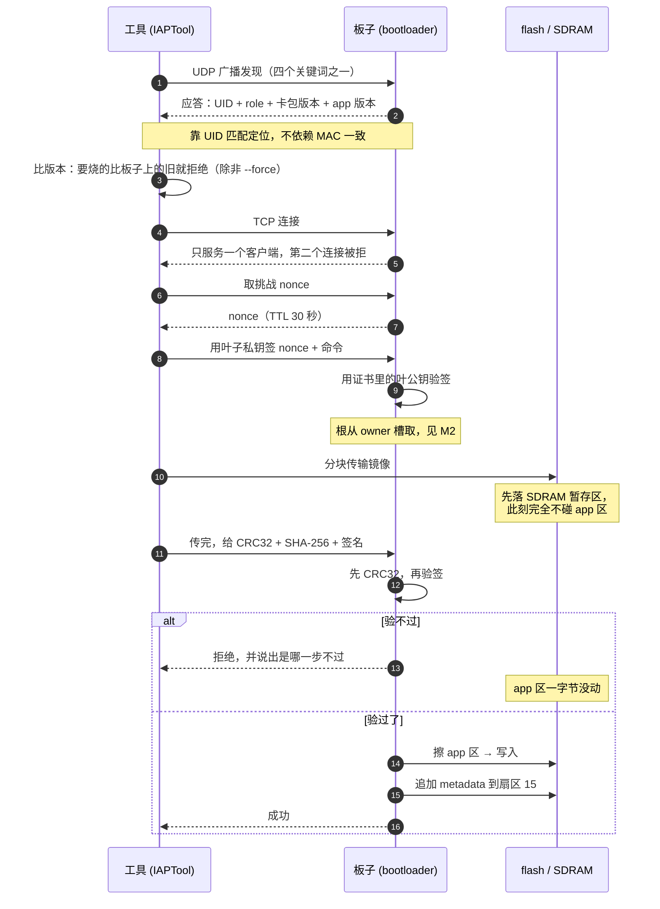
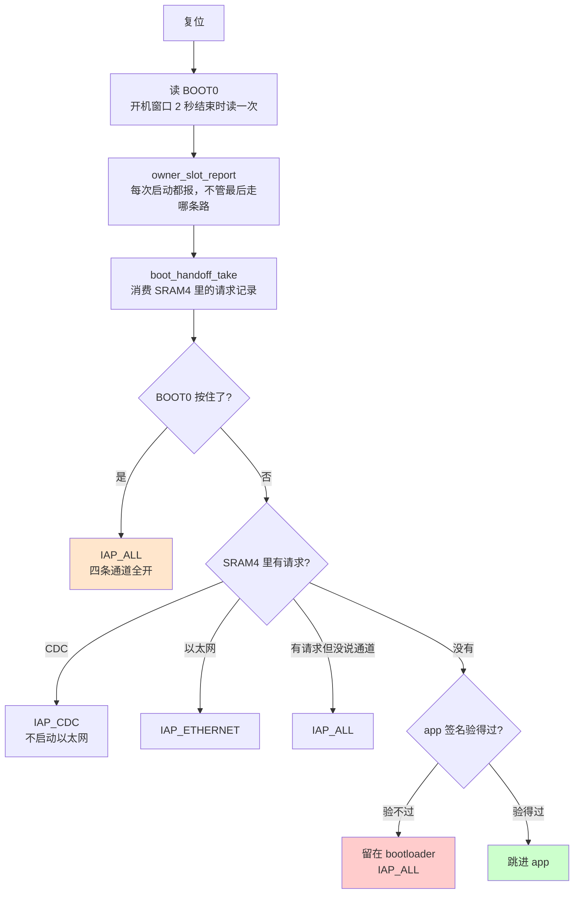

# M1 · 固件升级

**外面的人能让这块板做什么**：把一份新固件装进去，装不坏 —— 找得到板子、只让有授权的人装、
装到一半断电也不变砖、装完能自己判断装进去的东西能不能跑。

**这个模块管到哪为止**：从工具在网上找到板子，到板子决定「这次复位跑 app 还是留在 bootloader」。
**谁有资格装**不在这里，在 [M2 归属与信任](M2-ownership.md)。

---

## 1 · 一次上传是怎么走完的



> ⚠️ **「先落 SDRAM 再擦 app」是这张图里最要紧的一件事。** 它是 `R1-25`（校验失败的上传不破坏已装好的 app）
> 存在的全部理由，也是为什么掉电测试要拆成两条：传输期间断电（`T1-21`）和擦写窗口断电（`T1-22`）。

### 版本闸门：烧录前比一次版本

✅ **core / bootloader / IAPTool 三侧已实现，2026-09-21 上板验收**（真实的 Arduino 上传路径）。定稿见[烧录前比版本 + 校准值住进扇区 15](../../maps/version-gate-and-calibration/map.md) 和 `DECISIONS.md` 第 62 条。

**这是一道防呆闸，不是安全机制** —— 它挡的是「自己人误推旧版本」。
对有物理接触的人、对拿到叶私钥还能自己造固件的人都无效，那两类由证书链和撤销机制管。

| | |
|---|---|
| **谁比** | 上位机（IAPTool）。板子不参与，也不记录 |
| **比什么** | sketch 里 `OPENPLC_APP_VERSION(maj, min, pat)` 声明的版本，对 identity 第 5 段 |
| **什么时候比** | **请板子进 bootloader 之前**那一次 UDP 发现。⚠️ 这是约束不是选择 —— 板子进了 bootloader，第 5 段就是 `-`，取不到 app 版本了 |
| **怎么比** | 逐段数值比较，三段各 0–255。**严格小于才算更旧**，相等放行（重烧同一版是日常操作） |
| **拿不到版本怎么办** | `CUSAPP` 才比；`BOOTLD` / `BOOTLD-INVALID` **放行**（没有「当前版本」可言）；**发现超时则拒绝** —— 未知不等于没有 |
| **怎么强制** | IDE 菜单 `低版本强制烧录`（默认「否」）⇒ IAPTool 收到 `--force`。**一次性**：标记只在烧成功后写，再烧一次会被拒，把菜单拨回「否」即重置 |
| **挡不住哪条路** | ⚠️ **只有 ETH Transfer 挡得住**。**CDC Transfer 挡不住，是缺陷、要改（决策 132）** —— app 在跑时 `cdcIdentify` 拿不到任何应答（sketch 占着 CDC 数据管道），等它进了 bootloader，第 5 段已经是 `-`，**CDC 路径上不存在能读到已装版本的时刻**。**SWD / Serial 直连**同样挡不住，唯一手段 RDP Level 2 不可逆且会废掉 BOOT0 恢复出厂和 ST-Link 救砖 ⇒ 不做，留给客户 |

⚠️ **sketch 不声明版本号就编译不过** —— core 只声明 `extern const char openplc_app_version[]` 不定义，
`prebuild.sh` 先粗查给出可读报错，链接器兜底。**这会让所有现存 sketch 在换上新板卡包后第一次编译失败**，是故意的。

### IAPTool 怎么判上传结论、打什么日志

决策 124 定。板子那一侧回什么见 [IAP-PROTOCOL.md](M1/IAP-PROTOCOL.md)「一次 `flash` 的往返」。

| | |
|---|---|
| **结论从哪来** | 最后一块之后板子的回答，USB 和网口一样：拒收文本 ⇒ 报 `the board refused the image: <文本>`、退出码 1；确认接受才退出码 0 |
| **`flash` 命令被拒**（如证书的叶已撤销） | 板子在传数据之前就回 `ERR`：报 `the board refused the flash command: <回答>`、退出码 1。2026-10-14 真板上 USB 这一支曾静默退出 0，已修 |
| **网口怎么确认接受** | 板子复位后重新答话（`$TOOL` `IAP_Ether.go` 的 `readFinalVerdict`），怎么找见下一行 |
| **等板子回来**（请 app 进 bootloader 后、镜像写完后） | 每秒单播问一次原 IP，目标 UID 答了就停，另一块板答了就报换了板子；原 IP 连续 30 s 不答才加发广播，找被 DHCP 换了地址的板子。正常上传不发广播（决策 124；[IDE-16](../../maps/arduino-examples-and-ide-flow/issues/IDE-16-board-cannot-answer-until-the-pc-arps-it.md) 的「IAPTool 密集发现」） |
| **USB 怎么确认接受** | COM 口随复位消失：读口报错，或系统串口列表里没了这个口（`$TOOL` `common.go` 的 `readCDCVerdict`）。bootloader 只在接受时复位，所以口消失就是接受 |
| **等多久** | 两条通道都 90 秒：`Flash Failed` 要等擦写完才来。到时既没回答也没复位 ⇒ 报「未确认」、退出码 1 |
| **默认打什么** | 目标、目标 UID、请 app 进 bootloader、一行进度条、结论或错误；第一次认领另有认领那几行 |
| **`-v`** | 全部过程日志：每一块、每条命令（含签名 hex）、等待期每次问询。IDE 勾「上传时显示详细输出」时由板卡包 `platform.txt` 的 `{upload.verbose}` 传入 |

### 八步，每步认证到什么程度

**这张表回答的是「哪一步挡住了什么」。** 三种程度写在第二列，不要混：

| 步 | 做什么 | 程度 |
|---|---|---|
| **0** | `sha256_selftest()` 拿 FIPS 180-4 已知向量跑一遍，**每次上电一次** | 自检。⚠️ **它不检查 bootloader 或 app 的完整性**。不过 ⇒ **此后一切验签结论一律当作失败** —— 验证器自己都不可信，它的结论没有意义 |
| **1** | `server_decide()` 现算 app 区的 SHA-256，拿它核对最后一条被接受的 metadata | **认证**。每次启动都重问两件事：① 这张证书是板子当前信任的根签的吗 ② 证书里的叶公钥签过这个镜像吗 |
| **2** | UDP 发现回一个「设备名_UID_角色_版本」 | **刻意不认证**。要密钥才能发现设备是循环论证，而且这一步不改变任何设备状态 |
| **3** | 进入上传模式 | **两个触发器两套标准**，见下一节 |
| **4** | `flash「size · crc32 · 镜像签名 · 证书 · nonce 签名」` | **认证**。失败**在擦 flash 之前**就被拒 ⇒ 一个坏请求不会白白毁掉一个能用的 app |
| **5** | 收全之后对整个镜像算一遍 CRC32 | **只有完整性**。⚠️ 它对「谁发的」「有没有被故意改过」**什么都不证明** —— 改完重算一个 CRC 是白送的 |
| **6** | 和第 1 步**同一个** `iap_cert_verify_image()` 调用，但对象是**暂存在 SDRAM 里**那份 | **认证**。它问的和第 4 步**不是同一个问题**：不是「这个会话有没有被授权」，而是「**这个确切的二进制**是不是被证书指名的那把钥匙签的」⇒ 一个**已授权**的会话上传一个被篡改的镜像，照样在这里被拒 |
| **7** | 追加 metadata，然后**重启回第 0/1 步从零重验** | 不相信这次会话自己的成功报告 |

**第 1 步和第 6 步是同一个调用、不同对象** —— 这是刻意的：同一份验证代码只有一处，不可能出现「启动时严、上传时松」。

### 会话认证：签名到底盖在什么上面

```
sha256( nonce ‖ "flash <size> <crc32hex> <signature_hex>" )
```

**命令文本被逐字节重建后参与签名**，所以改动其中任何一个参数都会让签名失效。

**证书刻意不折进签名消息** —— 它不是秘密、不是会话相关，自身的有效性由 `root_sig` 锚定。塞进去只会让消息更长，不增加任何保证。

⚠️ **两步都必须做**：一张有效证书不说明谁签了这个 nonce；某个叶子的有效签名不说明那个叶子被认证过。

**nonce 是 RNG 外设出的 16 字节真随机数**（决策 66），怎么造、取不到时怎么办见 [CHALLENGE-AUTH.md](M1/CHALLENGE-AUTH.md)。

**挑战的四条性质**：

| | |
|---|---|
| **一次性** | **无论验成功还是失败**，这个 nonce 都被消费掉。失败也消费，是为了不给攻击者拿同一个 nonce 反复试的机会 |
| **TTL 30 秒** | 发出超过 30 秒的挑战一律不再接受。把「截获一个签名后慢慢用」的窗口压到半分钟 |
| **自检没过就一律拒** | SHA-256 自检失败时不拿一个已知坏的原语算摘要。宁可拒绝一切，也不给出一个不知道对不对的「通过」 |
| ⚠️ **全局单 nonce** | 同时只能有一个挑战在飞，CDC 和以太网并发会互相冲掉。**这是可用性怪癖，不是安全洞** —— nonce 不可能被双重消费，也不可能在被覆盖后仍被接受 |

## 2 · 每次复位，板子怎么决定跑哪个

照 `$BOOT/IAPServer/IAP_server.c` 的 `server_decide()` 画。



**三条在代码里写死、改动前必须知道的顺序**：

| 顺序 | 为什么不能换 |
|---|---|
| `boot_handoff_take()` 要在读复位原因**之前** | 它同时负责读并清 `RCC->RSR`，换了顺序复位原因就读不到了 |
| BOOT0 由调用方（`main.c` 的 `boot_window()`）在开机窗口结束时读，不在这里采样 | 在这里读引脚，等于要求操作员在复位后几毫秒就已经按住 —— 那不是人的反应时间 |
| `owner_slot_report()` 在分支**之前** | 「这块板信哪把根」不能只在有人正好在看的时候才可见 |

> ⚠️ **BOOT0 按住压倒一切** —— 不看请求记录，也不看签名。那是物理逃生口，
> 谁在开机窗口里按住了按钮，谁就说了算。

### 四条进入上传模式的路，各自的门槛

**门槛高低不一样，这是刻意的** —— 物理接触本身就是一个更高的信任层级，不必再叠一层密码学。

| 路 | 怎么触发 | 门槛 | 结果 |
|---|---|---|---|
| ① **BOOT0 按住** | 复位后按住 PG9 穿过开机窗口（系统指示灯快闪那 2 秒） | ✋ 物理 | `IAP_ALL`（不知道操作者会用哪条通道，全开） |
| ② **USB CDC 1200 bps** | 打开串口设 1200 波特再关掉 | ⚠️ **无认证可能** | `IAP_CDC` |
| ③ **网络请求重启** | `openplc_server_reboot_challenge` → `openplc_server_reboot` | 要签名 | 回答这条的是**正在跑的 app**，不是 bootloader |
| ④ **没有可跑的 app** | 第 1 步验签没过，或压根没有 metadata | 派生结果 | `IAP_ALL`，停在 bootloader 等人来重传 |

⚠️ **② 为什么不能加认证**：1200 bps 的 magic touch 是**单向的波特率信号，没有回程通道**，做不了挑战应答。接受它是因为摸到这条路已经需要**物理 USB 访问**，比把一个 UDP 包路由到某个 IP 高一个信任层级 —— 而且它只武装「等上传」状态，**真正的授权仍在第 4 步**。

⚠️ **这条不对称是刻意接受的，不是缺口** —— 写出来就是为了**不被后来的人当成 bug 去「修」**。

### 交接记录为什么住在 SRAM4 而不是 RTC 备份寄存器

② 和 ③ 都写同一条交接记录然后复位。记录在 **SRAM4 起始 32 字节（`0x38000000`），魔数 `"PLC!"`** —— `boot_handoff_request()` 是唯一写入口，`boot_handoff_take()` 是唯一读出口，**读即消费**。

⚠️ **为什么不用 RTC 备份寄存器**：写它在 `PWR_CR1.DBP` 没置位时会**静默什么都不做**，编译器和 HAL 返回值都不会告诉你（以太网上传路径曾因此静默失败，见 [BOOT-SEQUENCE.md](M1/BOOT-SEQUENCE.md)）。**普通内存没有这种隐藏门。**

另外三个理由：不需要初始化（USB / 以太网 / FMC 都还没起来就能读）；**生命周期正好** —— RAM 扛热复位但不扛掉电，而「进一次上传模式」正是热复位范围的请求；不依赖 VBAT。

**两个链接脚本的 `RAM_D3` 都从 `0x38000020` 开始** ⇒ 链接器**不可能**把东西放进那 32 字节。这是保证，不是约定。

## 3 · 板上的东西住在哪、格式是什么

### 地址布局

| 起始 | 大小 | 内容 | 谁写 | 能不能擦 |
|---|---|---|---|---|
| `0x08000000` | 128 KiB | **bootloader 代码**，只放代码（决策 72） | ST-Link / `flashboot` | 整扇区 |
| `0x08020000` | 1792 KiB | **app 区**，第 1 步每次启动现算这块的 SHA-256 | bootloader | 提交时 |
| `0x081E0000` | 128 KiB | **扇区 15** —— 校准值 8 KiB + **根区** 8 KiB（owner 链和撤销）+ metadata 约 112 KiB（511 条）+ 完整标记，见 [SECTOR-15.md](M1/SECTOR-15.md) | bootloader / 工装 | 只在回收时，先暂存进备份 SRAM |
| `0xC0000000` | 2 MiB | **SDRAM 暂存区** | bootloader | — |
| `0x38000000` | 32 B | 交接记录（SRAM4） | bootloader / app | 读即消费 |

⚠️ **SDRAM 暂存区刻意不在任何链接脚本的 MEMORY 块里** ⇒ 工具链不可能把东西放到这。

链接了 `OpenPLC_KNX` 的程序让出 app 区最后一个扇区（`0x081C0000`）给 KNX 数据，见 [BOOTLOADER-PROJECT-LAYOUT.md](../build/BOOTLOADER-PROJECT-LAYOUT.md)「Flash 分区」。

### 三个 on-flash 格式

**都是固定偏移，没有 parser。**

`iap_cert_t` · **128 字节**：

| 偏移 | 长度 | 字段 |
|---|---|---|
| 0 | 64 B | `leaf_pubkey` |
| 64 | 64 B | `root_sig` —— 根对 `sha256(前 64 字节)` 的签名 |

`IAP_CERT_SIGNED_LEN = 64`。**撤销按叶公钥点名，不按流水号** —— 见 [撤销记录点名的是序号还是公钥](../../maps/owner-revoke-and-boot-upgrade/issues/OWN-01-revoke-by-serial-or-by-pubkey.md)。

`iap_fw_metadata_t` · **216 字节，占 7 格**（`IAP_METADATA_SLOTS = 7`；一格 = 一个 32 字节 flash word）：

| 偏移 | 长度 | 字段 |
|---|---|---|
| 0 | 4 B | `app_size` |
| 4 | 64 B | `signature` |
| 68 | 128 B | `cert` —— **整张存进来** |
| 196 | 20 B | 保留 |

**为什么存整张证书而不是缓存叶公钥**：每次启动要**重验 `root_sig`**。缓存叶公钥会让「换 owner 追溯作废固件」这条性质**静默失效**。M 记录从 4 格涨到 7 格就是为了这个。一次更新只占 7 格，metadata 区 3583 格（`$BOOT/IAPServer/bootloader_state.c` 的 `IAP_META_SLOT_COUNT`）⇒ **511 次更新触发一次回收**。

### 扇区 15 的三条规则

布局、写入路径、过渡期差异全在 [扇区 15 设计说明](M1/SECTOR-15.md)，这里只留支撑需求的那三条。

| 规则 | 为什么 |
|---|---|
| **校准值和 metadata 诉求相反，所以分区** | 校准值**必须能覆盖**（重新标定要改得掉），metadata **只追加**。在 NOR flash 上「能覆盖」最终要擦整扇区 ⇒ 把校准值钉在最前 8 KiB 固定地址，让 510/511 次升级完全不碰它 |
| **写 metadata 时才可能擦，而且要先搬校准值** | 这一刻新镜像**已经写进 app 区了**，旧证明描述的东西已经不存在 ⇒ 擦掉不损失有效信息；在这里掉电最坏是「需要重刷」，**那个结论从擦 app 区的那一刻起就已经成立**。⚠️ 但**校准值不一样，重刷固件救不回来** ⇒ 擦之前先读出那 8 KiB，且**工装要按板子 UID 留副本** |
| **认证失败不落 flash** | 只计数并打一行 `Auth rejected (attempt N this boot, peer …)`。未认证的调用者**必须完全碰不到 flash**，否则一串被拒的命令就能磨损这个扇区、逼出一次擦除 |

⚠️ **没有事件日志**（决策 61）。代价：「换了新 bootloader 读到旧布局」这种情况
**没有独立的痕迹可查**，它会表现成「出厂空板」。

## 4 · 功能表

**一行一条需求，紧挨着写明谁证明它。** 判据和跑法不挤进这张表，在下一节。

| # | 阶段 | 要做到什么 | 谁证明 | 状态 |
|---|---|---|---|---|
| **R1-01** | 入口通道 | 通过 USB CDC 能把 app 烧进板子并正常启动 | `T1-23` | ✅ |
| **R1-02** | 入口通道 | 通过以太网能烧写**停在 bootloader** 的板子 | 手工 + `T1-09` | ✅ |
| **R1-03** | 入口通道 | 通过以太网能烧写**正在跑 app** 的板子。**不论 app 编译时菜单选的是 `cdcMethod` 还是 `ethMethod`，运行中的 app 都在 UDP 56865 上接收网口重启请求**；菜单只决定 IDE 这次上传走哪条通道（用户 2026-10-12 定）。app 不答 TCP，`getowner` 只有 bootloader 答（见 [IAP-PROTOCOL.md](M1/IAP-PROTOCOL.md#udp)） | `T1-23` | ✅ |
| **R1-04** | 入口通道 | 按住 BOOT0 复位能强制进入上传模式 | `T1-27` | ✅ |
| **R1-05** | 入口通道 | 从 CDC 请求进上传模式时**不启动**以太网 | `T1-25` | ✅ |
| **R1-06** | 入口通道 | app 请求进上传模式的通道只有一条（SRAM4 `boot_handoff_t`） | P2（查不分叉，非本功能） | 🟡 |
| **R1-07** | 入口通道 | 同一台主机上的多个工具不会互相打断上传 | 手工 + `T1-09`/`T1-18a`–`T1-18g`（间接，见下） | 🟡 |
| **R1-08** | 发现 | 四个发现关键词都应答 | `T1-01` | ✅ |
| **R1-09** | 发现 | 连续多轮发现都应答 | `T1-02` | ✅ |
| **R1-10** | 发现 | 发现回复落在工具的 2s 超时之内 | `T1-03` | ✅ |
| **R1-11** | 发现 | 长时间浸泡下发现不丢 | `T1-04` | ✅ |
| **R1-12** | 发现 | 发现被泛洪时限流，**且限流不打死正常发现** | `T1-05` | ✅ |
| **R1-13** | 发现 | 设备定位靠 UDP 广播 + UID 匹配，不依赖 MAC 一致 | 手工 | ✅ |
| **R1-14** | 发现 | 每块板的 MAC 互不相同（从 UID 派生） | P2（查算法一致，非本功能）+ 2026-09-28 两块板实测不同，见 [ACCEPTANCE-CHECKLIST.md](../tables/ACCEPTANCE-CHECKLIST.md#chk-c--单板出厂) | ✅ |
| **R1-15** | 会话 | 设备一次只服务一个 TCP 客户端 | `T1-06` | ✅ |
| **R1-16** | 会话 | 空闲客户端约 60s 后被踢 | `T1-07` | ✅ |
| **R1-17** | 会话 | 50s 内的空闲客户端**不**被踢 | `T1-08` | ✅ |
| **R1-18** | 会话 | 传输进行中闯入的第二个连接不打断传输 | `T1-09` | ✅ |
| **R1-19** | 会话 | 第一个连接正常关闭后能再连 | `T1-10` | ✅ |
| **R1-20** | 认证 | 会话认证：签名挑战应答，nonce 跨掉电不重复 | `T1-15` `T1-16` `T1-17` `P20` | ✅ |
| **R1-21** | 认证 | 工具在传输前就能判断「这块板收不收我的签名」 | `T1-18a`–`T1-18g` | ✅ |
| **R1-22** | 传输与校验 | 镜像先过 CRC32 | `T1-24` | ✅ |
| **R1-23** | 传输与校验 | 镜像的 SHA-256 + ECDSA 签名在**上传时**被校验 | `T1-11` `T1-12` | ✅ |
| **R1-24** | 传输与校验 | 签名的编码在签方和验方之间一致 | `T1-19` `T1-20` | ✅ |
| **R1-25** | 传输与校验 | **校验失败的上传不破坏已装好的 app** | `T1-14` `P16` ⁶ | ✅ |
| **R1-26** | 启动切换 | app 的签名在**每次启动时**被重新校验 | `T1-13` | ✅ |
| **R1-27** | 启动切换 | 掉电中断升级后板子仍可恢复 | `T1-21` `T1-22` | ✅ |
| **R1-28** | 记录与诊断 | metadata 记在扇区 15 的 metadata 区，**一次成功升级 = 7 槽** ⁵ | `T1-26` | ✅ |
| **R1-29** | 记录与诊断 | 扇区满了能 reclaim 并恢复：metadata 区 511 条满时擦整扇区，擦之前把校准值那 8 KiB 读出来再写回 ⁵ | `T1-28` | ✅ |
| **R1-30** | 记录与诊断 | 复位原因能正确报出（PIN / SOFT / POR） | 手工 | ✅ |
| **R1-31** | 记录与诊断 | RTC 备份域失效（VBAT 没电）时能被发现 | 手工 | ✅ |
| **R1-32** | 记录与诊断 | 任何丢包 / 拒绝路径都能说出自己为什么 | 代码审查 | ✅ |
| **R1-33** | 启动切换 | app 的起始地址满足向量表的对齐要求 | `P15` ⁷ | ✅ |
| **R1-34** | bootloader 自升级 | `flashboot` 能把新 bootloader 写进扇区 0，板子重启后跑新的 | `T1-29` | ✅ |
| **R1-35** | bootloader 自升级 | `flashboot` 的镜像签名**只接受 owner 根**，叶证书签的被拒 | `T1-30` | ✅ |
| **R1-36** | bootloader 自升级 | 换完 bootloader 后**所有权还在**（根区在扇区 15，`flashboot` 不碰它）；根区在扇区 15 回收时**压缩** | `T1-31` `T1-33` | ✅ |
| **R1-37** | bootloader 自升级 | **没有根**的板子拒绝 `flashboot`，按不按 BOOT0 都一样（决策 72：没有根就没有人能签这个镜像，`IAP_server.c:465-468`） | `T1-32` | ✅ |
| **R1-38** | 入口通道 | 从 Arduino IDE 的 Upload（`upload_method=ethMethod`，不传任何参数）烧**正在跑 app** 的板子：用用户配置目录里的密钥（没有根的出厂板在 bootloader 里，第一次上传自动认领，见 [M2 归属与信任](M2-ownership.md)）；重启请求发出后 IAPTool 按「等板子回来」找它：答 `BOOTLD` 就传；三次请求后还答 `CUSAPP` 就报「板子没接受重启请求」——密钥不对**或**请求丢了，提示进 bootloader 后用 `getowner` 确认；没人答就只报「板子没回来」，不提密钥（找密钥的顺序见 [IDE-13](../../maps/arduino-examples-and-ide-flow/issues/IDE-13-where-does-the-ide-upload-key-live.md)） | `T1-34` `T1-35` | ✅ |
| **R1-39** | 启动切换 | 从 bootloader 第一批语句到 sketch 第一次写之前，DO 全断开、AO 0 mA、继电器断开（决策 81），KNX 发送脚 PB14 为低、不占总线 | `T1-36` `T1-37` | ✅ 2026-10-08 上板：AO 经 470 Ω 约 5.6 mV、DO 约 0.3 mV、继电器不响、PB14 低；毫秒级瞬态待示波器 |
| **R1-40** | 入口通道 | 烧录前比版本：要烧的 sketch 比板上正在跑的旧就拒绝；`--force` 只放行一次，烧成功后再用被拒（见「版本闸门」） | `T1-38` | ✅ |
| **R1-41** | 传输与校验 | IAPTool 经 USB 和网口上传都读板子的最终结论：被拒报错、退出码非 0（决策 124，见「IAPTool 怎么判上传结论」） | `T1-35` | ✅ 2026-10-14 真板：已撤销的叶经 USB 上传报错、退出码 1，板上原 app 不动；最后一块之后的拒收只有 `T1-35` 单元测试 |
| **R1-42** | 入口通道 | IDE 不勾「上传时显示详细输出」时 IAPTool 只打关键行和进度条（十行以内），勾了打全（决策 124） | `T1-34` `T1-35` | ✅ |
| **R1-43** | 日志与诊断 | bootloader 不往 RS232 端子写任何东西（死机时也不写）；日志走 USB 口 1（口 2 跑 IAP 协议），电脑打开口 1 之前的输出存在 SRAM4 的开机缓存里；故障信息存进复位后不丢的内存（格式见 [BOOT-LOG.md](M1/BOOT-LOG.md)），SWO 保留给开发；**USB 初始化失败、不枚举或没人读时，开机、跳进 app、经网口上传都不受影响**（用户 2026-10-17）（决策 147，[USB-01](../../maps/usb-for-debug-rs232-for-devices/issues/USB-01-who-reads-boot-and-crash-info.md)） | 待定（[测试靠什么看板子内部](../../maps/usb-for-debug-rs232-for-devices/issues/USB-04-how-tests-see-inside-the-board.md)） | ⬜ |

**共 43 条。其中 34 条有测试用例直接测它，9 条没有。**

| 「谁证明」是什么 | 条数 | 哪些 |
|---|---|---|
| 有 `T1-xx` 用例直接测 | **34** | `R1-01`–`R1-05` `R1-08`–`R1-12` `R1-15`–`R1-29` `R1-34`–`R1-42`（`R1-40` 在 bootloader 替身上跑；`R1-38` 的 IDE 上传在替身上跑，真板子未认领那一次见 `work/TODO.md` #18，见 ¹⁰） |
| 纯手工 | **3** | `R1-13` `R1-30` `R1-31` |
| 只有静态检查 P2 | **1** | `R1-06` |
| 静态检查 P2 + 两块板实测 | **1** | `R1-14` |
| 只有静态检查 `P15` | **1** | `R1-33` |
| 手工 + 间接（`T1-09`/`T1-18` 测的是别的需求） | **1** | `R1-07` |
| 代码审查 | **1** | `R1-32` |
| 还没定（地图「USB 管调试和升级，RS232 留给设备」） | **1** | `R1-43` |

**这 8 条写出来，因为不写就会被当成有测试覆盖。**

> ✅ **一个检查能不能当某条需求的证据，看它测的是不是这条需求本身**，不看它是静态还是动态（2026-09-17 定）。
> `P2` 测的是「跨仓镜像没分叉」，证明不了「通道只有一条」，所以 `R1-06` 是 🟡；`ENG-02` 那类「镜像不分叉」的需求，`P2` 测的就是它本身，是 ✅。

**`R1-07` 仍是 🟡**：IAPTool 一次上传只开一条 TCP 连接（`$TOOL` `IAP_Ether.go`，决策 54），
但 `T1-09`/`T1-18` 用的是合成的第二条连接，没有脚本直接让两个真实 `IAPTool` 进程互相抢。

### 「手工」的意思是没有脚本把判定接到退出码上

| 需求 | 留下了什么 |
|---|---|
| `R1-13`（定位靠 UID 不依赖 MAC） | 复现配方在 `$TEST/onboard/iap_probe/iap_probe.ino` 的文件头；两块板同时在台上那次在 `work/TODO.md` #21 |
| `R1-30`（复位原因） | 2026-10-08 上板：按复位键报 `PIN`、断 24 V 报 `POR`、上传后重启报 `SOFT` |
| `R1-31`（备份域失效能被发现） | 实地证据在 `docs/engineering/HOW-TO-RUN-TESTS.md`，不写脚本的理由也在那 |

## 5 · 测试怎么跑

M1 的上板用例和契约用例在 `$TEST` 跑；部件测试的命令前写了仓名（决策 78）。

| # | 对应需求 | 测什么 | 判据 | 跑法 | 条件 | 状态 |
|---|---|---|---|---|---|---|
| `T1-01` | `R1-08` | 四个发现关键词都应答 | 四个关键词逐个发，都要有应答 | `$TEST/udp_discovery.go` | 真板子；替身（`python host/fakeboard/run_protocol.py --only T1-01`）证明发现应答的代码，真 lwIP / PHY 仍要真板子 | ✅ |
| `T1-02` | `R1-09` | 连续多轮发现 | 连发多轮不丢 | 同上 | 真板子；替身（`python host/fakeboard/run_protocol.py --only T1-01`）证明多轮发现，真 lwIP / PHY 仍要真板子 | ✅ |
| `T1-03` | `R1-10` | 发现回复够快 | 回复落在工具的 2s 超时之内 | 同上 | 真板子；替身测不了：判的是发现应答的时延，替身的 PC socket 转接本身就有秒级抖动 | ✅ |
| `T1-04` | `R1-11` | 发现长时间浸泡 | 10 分钟连续发现，0 失败 | 同上 | 真板子；替身测不了：浸泡要抓 lwIP / PHY 长跑问题，替身把这一层换掉了 | ✅ |
| `T1-05` | `R1-12` | 发现泛洪限流 | 限流生效，**且正常发现仍然答得出** | 同上 | 真板子；替身（`python host/fakeboard/run_protocol.py --only T1-01`）证明限流的代码，真 lwIP / PHY 仍要真板子 | ✅ |
| `T1-06` | `R1-15` | 一次只服务一个客户端 | 第二条连接被拒 | `$TEST/tcp_session.go` | 真板子；替身（`python host/fakeboard/run_protocol.py --only T1-01`）证明一次只服务一个，真 lwIP / PHY 仍要真板子 | ✅ |
| `T1-07` | `R1-16` | 空闲连接被踢 | 约 60s 后断开 ¹ | 同上 | 真板子；替身（`python host/fakeboard/run_protocol.py --only T1-01`）证明空闲踢人的计时，真 lwIP / PHY 仍要真板子 | ✅ |
| `T1-08` | `R1-17` | 空闲连接不被误踢 | 50s 时仍然连着（反向用例） | 同上 | 真板子；替身（`python host/fakeboard/run_protocol.py --only T1-01`）证明不误踢，真 lwIP / PHY 仍要真板子 | ✅ |
| `T1-09` | `R1-02` `R1-18` | 传输中闯入不打断 | 第二条连接被 RST 拒，传输照走完 | 同上 | 真板子；替身（`python host/fakeboard/run_protocol.py --only T1-01`）证明传输中闯入不打断，真 lwIP / PHY 仍要真板子 | ✅ |
| `T1-10` | `R1-19` | 拒绝状态不卡死 | 第一条正常关闭后能再连（反向用例） | 同上 | 真板子；替身（`python host/fakeboard/run_protocol.py --only T1-01`）证明关闭后能再连，真 lwIP / PHY 仍要真板子 | ✅ |
| `T1-11` | `R1-23` | 无效签名被拒 | 「没有任何密钥能产生的签名」上传被拒 | `$TEST/signature.go` | 真板子；替身（`python host/fakeboard/run_protocol.py --only T1-01`）证明验签拒绝，真 lwIP / PHY 仍要真板子 | ✅ |
| `T1-12` | `R1-23` | 签方不对被拒 | 「格式完全正确但签方不对」被拒 ² | `$TEST/signature_wrongkey.go` | 真板子；替身（`python host/fakeboard/run_protocol.py --only T1-01`）证明签方不对被拒，真 lwIP / PHY 仍要真板子 | ✅ |
| `T1-13` | `R1-26` | 启动时重新验签 | 直接改坏已装好的 app，下次启动必须拒绝启动它 ² | `python tools/run_s3.py` | 真板子；替身（`python host/fakeboard/run_protocol.py --only T1-13`）证明启动时重新验签（改坏 app 区一个字节），真 flash 擦写仍要真板子 | ✅ |
| `T1-14` | `R1-25` | 失败上传不伤 app | 上传失败后 app 区**一字节没动** | `python tools/run_case.py --case T1-11 --then-reset` | 真板子；替身（`python host/fakeboard/run_protocol.py --only T1-14`）证明失败上传前后 app 区逐字节不变，真 flash 擦写仍要真板子 | ✅ |
| `T1-15` | `R1-20` | 主机侧密码学 | 证书签发、序列号计数、挑战签名三组断言 | `$TOOL`：`go test ./tests/...` | 主机侧 | ✅ |
| `T1-16` | `R1-20` | bootloader 单元测试 | 拿真实 bootloader 源码跑板子侧的判断逻辑 | `$BOOT/tests`：`ctest --preset local -R T1-16` | 主机侧 | ✅ |
| `T1-17` | `R1-20` | nonce 跨掉电不重复 | 真断电前后各取一批 nonce，全部互不相同（nonce 来自 TRNG，决策 66） | `python tools/run_au1.py` | **真板子 + 人工断电**；替身测不了：替身的随机数来自 PC，不是 TRNG | ✅ |
| `T1-18a` | `R1-21` | 签名密钥就是这块板收的那把 | 板子答的公钥 = 工具签名用的，工具报 `Signing key matches this board` | `host/fakeboard/run_cases.py` | bootloader 替身（主机） | ✅ |
| `T1-18b` | `R1-21` | 签名密钥不对，工具自己拦 | 板子答另一把公钥，工具拒并说 `verifies against a different signing key` | 同上 | bootloader 替身（主机） | ✅ |
| `T1-18c` | `R1-21` | ~~老 bootloader 不认这条命令时不卡住~~ | 决策 79（测试阶段不做向后兼容）取消：IAPTool 遇到不认识 `getpubkey` 的 bootloader 改为报错，替身里假扮老 bootloader 的开关已删 | — | — | ⛔ 已作废 |
| `T1-18d` | `R1-21` ³ | 委托证书由这块板的根签发 | 板子答签发根，工具报 `Certificate was issued by this board's root` | 同上 | bootloader 替身（主机） | ✅ |
| `T1-18e` | `R1-21` ³ | 证书的签发根不是这块板的根 | 工具拒并说 `was not issued by this board's root` | 同上 | bootloader 替身（主机） | ✅ |
| `T1-18f` | `R1-21` ³ | 证书覆盖的是别人的密钥 | 工具拒并说 `was issued for a different key` | 同上 | bootloader 替身（主机） | ✅ |
| `T1-18g` | `R1-21` | 一把密钥都没有 | 工具拒并说 `no signing key found` | 同上 | bootloader 替身（主机） | ✅ |
| `T1-19` | `R1-24` | SHA-256 编码交叉验证 | 独立第三实现逐向量比对 | `$TOOL`：`python tests/crypto_ref/run_checks.py` | 主机侧 | ✅ |
| `T1-20` | `R1-24` | ECDSA 编码交叉验证 | 同上 | 同上 | 主机侧 | ✅ |
| `T1-21` | `R1-27` | 掉电落在传输期 | 断电后重新上电，**旧 app 照常启动** | `python tools/run_s4.py` ⁴ | **真板子 + 人工断电** | ✅ |
| `T1-22` | `R1-27` | 掉电落在擦写窗口 | 报 `App signature invalid or absent`，重传能救回 | 同上 ⁴ | **真板子 + 人工断电**；替身（`python host/fakeboard/run_lifecycle.py --only T1-22`，第 1 次擦除后掐断）证明判定和重传，真 flash 的擦写窗口仍要真板子 | ✅ |
| `T1-23` | `R1-01` `R1-03` | 一次真实上传走完，且擦除在验证之后 | 日志出现 `Staging in SDRAM`，且 `Erasing application region` 在 `Transfer complete, verifying` **之后** | `python tools/upload_and_watch.py --bin <app.bin> --ip <IP>`（或 `--cdc <COM>`） | 真板子；替身（`python host/fakeboard/run_protocol.py --only T1-23`）证明先校验后擦除（网口那支），CDC 那支和真 flash 仍要真板子 | ✅ |
| `T1-24` | `R1-22` | 坏 CRC 必须在验签之前被拒 | 板子回 `Checksum Failed` 而**不是** `Signature Failed` —— 「先」过 CRC32 这半句正是它证明的 | `python tools/run_case.py --case T1-24 --bin <app.bin>` | 真板子；替身（`python host/fakeboard/run_protocol.py --only T1-01`）证明坏 CRC 先于验签被拒，真 lwIP / PHY 仍要真板子 | ✅ |
| `T1-25` | `R1-05` | CDC 上传模式下以太网栈不起来 | 板子进 CDC 模式后不应答 UDP 发现，**且同一轮的正向对照答得出** ¹³ | `python tools/run_cdc_does_not_start_ethernet.py --cdc <COM> --ip <IP>`（接 ST-Link：进没进 CDC 模式从 SRAM4 开机日志读） | 真板子；Renode（`python host/renode/boot_entry.py`）用真 bootloader 证明：SRAM4 里放 CDC 请求、软复位后进 `UPLOAD Mod ... (CDC upload requested)`，`MX_USB_DEVICE_Init` 跑了、`MX_LWIP_Init` 一次没跑；同一轮放以太网请求的对照里 `MX_LWIP_Init` 跑了。USB 枚举和真网口仍要真板子 | ✅ |
| `T1-26` | `R1-28` | 一次成功升级消耗 7 个 metadata 槽 | 上传前后各复位一次读 `Bootloader state: N/M metadata slots used`，差值 **= 7** ¹⁴ | `python tools/run_journal_slot_accounting.py --bin <app.bin>` | 真板子 + ST-Link；替身（`python host/fakeboard/run_protocol.py --only T1-26`）证明一次成功上传占 7 格，真 flash 擦写仍要真板子 | ✅ |
| `T1-27` | `R1-04` | 按住 BOOT0 复位强制进上传模式 | 日志同时出现 `** UPLOAD Mod ... (BOOT0 held)` 和 `** Reset cause: PIN` ¹⁵ | `python tools/run_boot0_upload_mode.py` | **真板子 + 人按住 BOOT0**；Renode（`python host/renode/boot_entry.py`）用真 bootloader 证明手势判定：PG9 从上电拉高、7 s 时松开 → `** BOOT0 held` 和 `** UPLOAD Mod ... (BOOT0 held)`，不跳 app、不进恢复出厂；不按的对照跳进 app。真按键、复位键（`Reset cause: PIN`）和 BOOT0 对芯片启动地址的作用仍要真板子 | ✅ 2026-10-08 上板 |
| `T1-28` | `R1-29` | metadata 区满了能 reclaim 并恢复，**且校准值那 8 KiB 原样搬过去** ⁹ | 灌满后板子报 `** Metadata area full - the next successful update reclaims sector 15. **`，一次上传后日志出现 `Reclaiming sector 15 (<n> metadata slots, root area compacted)`，且板子照常启动 app | `python tools/run_journal_reclaim.py --bin <app.bin>` | 真板子 + ST-Link；替身（`python host/fakeboard/run_protocol.py --only T1-28`）证明灌满后下一次上传回收扇区 15、校准值逐字节保留，真 flash 擦写仍要真板子 | ✅ |
| `T1-29` | `R1-34` | `flashboot` 换掉 bootloader | 升级后板子报新的 `Boot Loader <版本>`，且照常启动已装的 app | `python tools/run_flashboot.py --bin <boot.bin> --key <owner.pem>` | 真板子；替身测不了：替身不落盘扇区 0，换 bootloader 只能真板子 | ✅ |
| `T1-30` | `R1-35` | 叶证书签的 bootloader 镜像被拒 | 用叶密钥签同一个镜像，板子回 `Signature Failed`，**扇区 0 一个字节没动** | `python tools/run_flashboot.py --bin <boot.bin> --key <leaf.pem> --sign-with-leaf` | 真板子；替身（`python host/fakeboard/run_protocol.py --only T1-30`）证明叶钥签的 bootloader 镜像被拒、扇区 0 没写，真扇区 0 仍要真板子 | ✅ |
| `T1-31` | `R1-36` | 换完 bootloader 所有权还在 | 升级前后各跑一次 `IAPTool getowner`，generation 和根公钥完全一致 | 同 `T1-29`，脚本自带前后对比 | 真板子；替身测不了：依赖 `T1-29` 真写进扇区 0 | ✅ |
| `T1-32` | `R1-37` | 没有根的板子拒绝 `flashboot` | 恢复出厂后发 `flashboot` → `Refused`，扇区 0 不变，板子照旧启动原 bootloader | `python tools/run_flashboot.py --bin <boot.bin> --key <owner.pem> --unclaimed`（先恢复出厂）| 真板子；替身（`python host/fakeboard/run_protocol.py --only T1-32`，裸命令，IAPTool 发命令前就会拦）证明无根板对 `flashboot` 回 `Refused`；认领后真写扇区 0 仍要真板子 | ✅ 2026-10-08 上板 ¹¹ |
| `T1-33` | `R1-36` | **压缩留对了东西**：只留当前生效那条和还生效的作废 | 喂一块故意乱掉的根区（合法首条 + 一条坏格式 + 一条签名换主 + 一条**无签名**的高 generation），跑**真实**的 `owner_slot_build_carry()`：留下的只有签名换主那条（**签名被剥掉**），**无签名那条没有被压缩扶正**；点名当任根的 `'R'`（R4 忽略的那种）被丢掉，另两条保留。**再把结果写进擦过的区重扫一遍**，根、generation、作废名单全部不变 ⁸ | `$BOOT/tests`：`ctest --preset local -R T1-33` | 主机侧（要 gcc/clang） | ✅ |
| `T1-34` | `R1-38` `R1-42` | IDE 那条上传命令在 bootloader 替身上走通：板子在跑 app，未认领 / 已认领 / 密钥不对各一次 | `arduino-cli upload -l network -p <本机网卡 IP> --discovery-timeout 10s`（`upload_method=ethMethod`）上传编好的 `OpenPLC_Ports/DO_Outputs`：①未认领（出厂板，在 bootloader 里）、用户目录里没有密钥 → 在用户目录生成密钥并认领，退出码 0，输出有 `Claimed.`（决策 72）；②已认领、owner 密钥放在用户目录 → 退出码 0，IAPTool 打的行（`[INFO]` 加进度条）不超过 10 行（决策 124）；③用户目录里是另一把密钥 → 替身里 app 一侧拒绝重启请求，退出码非 0，输出有 `did not accept the reboot request`。①②还要**替身那边验过整个镜像**（`Checksum and signature OK`），且收完镜像后真的复位、回到 app ¹⁰ | `python host/fakeboard/run_ide_upload.py` | bootloader 替身（本机），**手工跑，不进 selfcheck** ¹⁰ | ✅ |
| `T1-35` | `R1-38` `R1-41` `R1-42` | IAPTool 自己的主机侧单元测试：密钥查找顺序、串口层、协议常量与绑物理网卡拨号、USB 上传结论判读、`-v` 开关 | 全部 `go test` 通过；密钥按「`--key` → `local_config.json` → 用户配置目录 → exe 旁边」的顺序找到；USB 结论判读对假串口：拒收文本（含和最后一块的 `OK` 粘在一起）报错，读口报错或口从列表消失算接受，既无回答又没复位算未确认 | `$TOOL`：`go test . ./internal/... ./iapproto/... ./netiface/...` | 主机侧，进 selfcheck | ✅ |
| `T1-36` | `R1-39` | 开机输出置 0 | `safe_outputs_init()` 之后 11 个脚（DO1–DO8、PA4、PA5、PB14）都是推挽输出、电平为低，同端口其他脚不变，对应 GPIO 时钟已开 | `$BOOT/tests`：`ctest --preset local -R T1-36` | 主机侧（假 GPIO 寄存器），测不到真引脚电平和时序 | ✅ |
| `T1-37` | `R1-39` | 开机输出置 0，经真 bootloader 跳进 app 之后仍是 0；BOR 检查 | 当前 `$BOOT` 工作区编出的 bootloader + 不碰这些脚的 `SystemLED`：`HAL_Init()` 入口（`safe_outputs_init()` 刚做完）、`server_jump_to_app()` 入口、app 的 `Reset_Handler` 入口（`HAL_DeInit()` 后又置了一次）、`setup()` 入口、app 跑满 20 s 时各读一次 GPIO，11 个脚（DO1–DO8、PA4、PA5、PB14）都是推挽输出、`ODR` 为 0。BOR：选项字节 `BOR_LEV` 为 0 时串口有那行警告，用选项字节编程序列改成 3 后没有 ¹² | `python host/renode/boot_outputs.py` | Renode，进 selfcheck（`--quick` 跳过） | ✅ |
| `T1-38` | `R1-40` | 烧录前比版本 | 板上 app 报 `9.9.9` 时传 `1.0.0`：IAPTool 拒绝，板子一个字节没收；加 `--force` 放行并烧成；紧接着再 `--force` 被拒（`force flash has already been used once`） | `python host/fakeboard/run_lifecycle.py --only T1-38` | 替身（真 bootloader 代码 + 真 IAPTool，经网口）；CDC 那支本来挡不住（见「版本闸门」），IDE 菜单那条走真板子 | ✅ |

**共 44 条**（`T1-18a`–`T1-18g` 是一族七种情况，原先压成一个 `T1-18`；`T1-18c` 2026-10-03 作废）。

¹¹ **`T1-32` 按决策 72 后的判据（没有根一律拒绝，`$BOOT/IAPServer/IAP_server.c:465-468`）2026-10-08 在真板子上通过**；2026-09-22 那次测的是之前「按住 BOOT0 放行」的行为，不算数。

¹² **`T1-37` 只在几个时刻采样，不连续监视。** 测不到：复位到 `main()` 第一行之前那几毫秒、`HAL_DeInit()` 到再次置 0 之间的空档、真引脚电平和 AO 电流、掉电和真欠压复位、GPIO 时钟是否已开（归 `T1-36`）、继电器。BOR 能判，是因为 Renode 1.17 的 `STM32H7_FlashController` 建了 `OPTSR_CUR` 和选项字节编程（解锁 `OPTKEYR` → 写 `OPTSR_PRG` → 置 `OPTCR.OPTSTART`），复位值 `0x0406AAF0`（`BOR_LEV` = 0）。bootloader 编进临时目录（`tools/build_image.py` 的 `build_copy()`），不碰 `$BOOT/Debug/`。

¹³ **正向对照不是可选的。** 反向用例（「板子应该沉默」）没有对照就分不清「以太网栈没起」和「板子死了」；对照组失败时脚本报「这一轮什么都没证明」而不是通过。

¹⁴ **两头必须用 ST-Link 复位，不能走 IAP。** 走 IAP 复位会多绕一遍上传路径，差值里会混进测量本身的开销。

✅ **`T1-29`–`T1-31` 2026-09-22 在真板子上通过**：`flashboot` 换掉 bootloader 后板子起来，所有权和已装的 app 都在，升级前后 `getowner` 同为 generation 1 同一把根。

¹⁵ **复位必须由人按，不能由 ST-Link 驱动。** BOOT0 是启动模式引脚：按住它的时候复位，芯片去启动 ST 自带的 DFU，我们的 bootloader 根本不执行，串口全程静默。正确顺序是**先复位、再按住**，系统指示灯快闪的那 2 秒就是窗口。⚠️ **长按超过 10 秒会武装恢复出厂**，在已认领的板子上会抹掉 owner 密钥。

¹ **「约 60s」本身就是判据的一部分**，不是判据写得含糊。实测过 1m01s 和 1m02s，两次都算过 —— 把它收紧成一个确定值会让一次正常的抖动变成假失败。

² `T1-11`（无效签名被拒）**证明不了** `T1-13`（启动时重新验签）。SDRAM 暂存做完之后，失败的上传根本不碰 app 区，所以它碰不到「启动时验签」这条路径。`T1-13` 是直接改坏已装好的 app 来测的。

³ **这一族七种情况（`T1-18a`–`T1-18g`）全部服务 `R1-21`**，判据出处是
`$TEST/host/fakeboard/KEY-MATCH.md`（贴着代码放的那份）。
标 ³ 的三条（`T1-18d` `T1-18e` `T1-18f`）**同时**是 [M2 归属与信任](M2-ownership.md) 证书链需求的证据 ——
它们验的是「这块板信的根有没有为这张证书背书」。**一族测试同时服务两个模块怎么归，还没定** ——
已记进地图的迷雾。

⁴ 要**人工断电**，脚本靠板子停止应答来判断电真的断了，不用人回来按回车。`T1-17` 也要人工断电。

⁹ **校准值搬运 2026-09-22 上板验过**：校准值区写一段可辨认的字节，灌满 metadata 触发 reclaim，擦完后逐字节还在。填充步骤必须整扇区读写 —— `STM32_Programmer_CLI -w` 写扇区任一部分都会先擦整扇区。

⁸ **`T1-33` 在主机上跑，不上板** —— 压缩只在扇区 15 回收时执行，一旦留错东西，板子就此不认主人。
主机侧跑的是**真实的 `owner_slot.c`**，喂一块 RAM 假 flash。**回收本身和中途掉电**由 `T2-34`（M2）盖。

⁵ **metadata 留在扇区 15、没有事件日志、最前 8 KiB 给校准值**（决策 61，[烧录前比版本 + 校准值住进扇区 15](../../maps/version-gate-and-calibration/map.md)）。一次升级 7 槽，metadata 区 3583 格（`$BOOT/IAPServer/bootloader_state.c`）。

⁶ **`P16` 证的是结构，不是某一次运行。** flash 写入中途失败时，若从循环里直接 return，
`HAL_FLASH_Lock()` 和 `SCB_EnableICache()` 都会被跳过 —— **flash 就一直开着锁**，
此后任何走飞的写入都能改掉已装好的 app。制造一次失败写入只走通其中一条出口，
证不了另外几条；静态检查覆盖全部出口。⚠️ **它证不到的**：运行时 I-cache 真的是开的，
以及这次改动有没有把烧写本身弄坏 —— 那两条归 `T1-23` / `T1-24` 的上板回归。

¹⁰ **`T1-34` 测的是 PC 这一侧**：arduino-cli → discovery → 板卡包里那份 IAPTool → 找密钥 → 重启握手 → 传输 → 判决。脚本把 IAPTool 拷到临时目录再用（`--upload-property path=`），因为包里 `keys\` 可能已有 `fw_signing_key.pem`，会挡住要测的那条查找路径；`APPDATA` / `TEMP` 也指到临时目录，真实的用户密钥和上传锁都不碰。**不进 selfcheck**：一遍要几分钟（密钥不对那种要等 IAPTool 问满三次重启），超出 selfcheck 一分钟的预算。
**测不到**：真 lwIP / MAC / PHY 和时序、复位时 MAC 一起被拉掉（真板子烧写成功收不到 `OK`）、板子在另一台机器上的真实局域网、IDE 图形界面（只走 arduino-cli）、勾了详细输出（`-v`）那一支（只跑不勾的）、USB 通道。板子侧的校验（镜像签名、证书链、nonce、CRC）在替身里是真代码跑的，但跑在 PC 上；同一段在真板子上仍归 `T1-23`、`T1-11`。替身见 [BOOTLOADER-STAND-IN.md](../engineering/BOOTLOADER-STAND-IN.md)。详见 [IDE-04-findings.md](../../maps/arduino-examples-and-ide-flow/IDE-04-findings.md)「这条模拟测不到什么」。

⁷ **`P15` 守的是一个链接期不变式，不是一次运行。** app 的向量表就在 FLASH 起点，
所以 VTOR 的对齐要求落在 `LD_FLASH_OFFSET` 上；而 `ldscript.ld` 对 `.isr_vector`
只有 `ALIGN(4)`，**偏移写错了会链接成功、烧得进、校验也过，然后跳转时跑飞**，
只能按 BOOT0 救。1024 = 向量表 664 字节向上取整到 2 的幂（架构要求）；
**硬件本身只强制 128**，2026-09-21 在真板子上量过。

## 6 · 为什么这里没有「证据日期」和「最近结果」

**这份文档只写 ✅ / 🟡 / ⬜ 一个状态，不写日期、不写「最近一次跑出来多少」。**

理由：那些数字每跑一次就变，**用文档去维护会漂，而漂的时候没有任何东西会报警**。
它们该跟着测试脚本的输出走 —— 要数字就跑一次上面那一列命令。
判据和跑法是稳定的，所以它们留在文档里。

⚠️ 上面脚注里确实出现了几个实测数字（1m01s / 1m02s、10 分钟），
**那些是一次性的观察，用来说明判据为什么这么定**，不是要维护的当前值。
区别在于：**判据变了要改这份文档，测试结果变了不用。**

## 7 · 板子起不来怎么查

**串口打出来的那行就是索引。**

| 串口打的是 | 说明什么 | 怎么确认 | 怎么恢复 |
|---|---|---|---|
| `Owner slot: empty - no root, the next upload claims this board`，接着 `App signature invalid or absent` | **出厂空板 / 刚被擦过** | UDP 发现回的角色是 `BOOTLD-INVALID` | 第一次上传就正常了，并自动认领 |
| `State sector holds an unrecognised record at slot N - the next reclaim clears it` | **换过 bootloader**，metadata 区里有这一版不认的记录 | 该区转为只读 | 重传一次 app → reclaim 整扇区 |
| `Sector 15 is not in this layout, or a reclaim was cut short with no backup copy - rebuilt with calibration only` | 扇区 15 是旧布局，或回收时断电且备份 SRAM 没有副本 | 之后 `getpubkey` 回 `none` | 再上传一次即自动认领，见 [M2 归属与信任](M2-ownership.md) |
| `App signature invalid or absent - staying in bootloader` | 上传中断，或验签不过 | app 区内容和 metadata 对不上 | 重传 |
| 同上，**而且你刚做过 `setowner`** | **换根把现有 app 追溯作废了。这是设计行为，不是故障** | metadata 里那张 cert 是旧根签的，`root_sig` 在新根下验不过 | 用新根（或新根签的证书）重传 |
| `BOOT0 held` | **不是故障**。有人按住了 BOOT0，物理逃生口赢过一切 | 模式是 `IAP_ALL`，reason 打的是 `BOOT0 held` | 松开 BOOT0 再复位 |
| `flash command failed authentication - refusing` | 证书不是这块板信的根签的，或工具和 bootloader 版本不配 | `getpubkey` 查板子信哪把根 | 换对的密钥 / 新版 IAPTool |
| `Backup domain was lost - VBAT supply or RTC clock source changed.` | **RTC 备份域丢过**，RTC 从固定时间重新起。⚠️ **不一定是电池** —— 两边 RTC 时钟源不一致也会清空它，见 [DECISIONS.md 第 57 条](../tables/DECISIONS.md) | DR3 里的见证值不见了 | 不影响上传和认证（nonce 由 TRNG 出，决策 66）。影响的是走时 |

## 8 · 这个模块的边界

**挡得住什么**：没有有效签名的镜像装不进去；装一半断电不变砖；没授权的人连不上。

**挡不住什么**（写出来，因为不写就会有人以为挡得住）：

- 能物理接触板子的人按住 BOOT0 十秒就能恢复出厂 —— **那是设计，不是漏洞**（丢了私钥的板子否则会变砖）
- 没上 flash 写保护（WRP），所以跑起来的 app 理论上能写 bootloader 区 —— 见 [M2](M2-ownership.md) 的边界一节

**这套设计抄了谁、避开了谁**（和 UEFI Secure Boot 同构、避开 ESP32 的 aggressive revoke）——
见 [M2 归属与信任](M2-ownership.md)，那些选择都是信任模型层面的，住在那一份里。

**和其他模块的关系**：

| 关系 | 去哪看 |
|---|---|
| 「谁有资格装固件」—— 信任根、证书链、owner 槽 | [M2 归属与信任](M2-ownership.md) |
| 装完之后 app 拿到的是一块什么状态的板子 | [M3 应用运行环境](M3-app-runtime.md) |

> **引用别的模块一律只写指针，不抄内容。** 这是「一个事实只有一个家」的落地方式，
> `check_doc_dupes.py`（P8，一个说法不许写进两份文档）会抓抄过来的段落，**指针不算**。

## 9 · 这个模块的细节文档

主文档是骨架，下面这些是深度。**它们在 `M1/` 子目录里，一个事实只有一个家 —— 这里是指针，不是摘要。**

| 文档 | 讲什么 |
|---|---|
| [BOOT-SEQUENCE.md](M1/BOOT-SEQUENCE.md) | 每次复位走完的完整流程：谁被读、谁被初始化、外设以什么状态交给 app |
| [BOOT-LOG.md](M1/BOOT-LOG.md) | SRAM4 开机日志缓存：位置、头和记录格式、前缀、坏了怎么办、谁读 |
| [SECTOR-15.md](M1/SECTOR-15.md) | 扇区 15 的切法、metadata 记录格式、回收机制、三种「读不到 metadata」的情况 |
| [FLASHBOOT.md](M1/FLASHBOOT.md) | `flashboot` 原地升级：命令形状、谁能授权、为什么擦写必须在 RAM 里跑、断在哪会怎样 |
| [CHALLENGE-AUTH.md](M1/CHALLENGE-AUTH.md) | 挑战应答的全部细节：nonce 怎么造、一次性消费、证书是独立一步 |
| [IAP-PROTOCOL.md](M1/IAP-PROTOCOL.md) | 线上命令一览：bootloader 和 app 各认哪些命令、要什么认证、回什么 |
