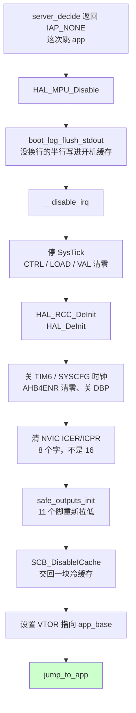

# M3 · 应用运行环境

**外面的人能让这块板做什么**：自己写的 sketch 跑起来之后，能用板子的资源 ——
64 MB 外部内存、完全归自己的 RS232 端子、USB 口上的打印和系统日志、看得见的引脚 —— 而且**不会被 bootloader 留下的状态坑到**。

**这个模块管到哪为止**：从 bootloader 决定「这次跳进 app」的那一刻，
到 app 拿到一块什么状态的板子，以及它能用到哪些封装好的东西。
**怎么把 app 装进去**不在这里，在 [M1 固件升级](M1-firmware-upgrade.md)。

---

## 1 · 交权那一刻，app 拿到的是什么

照 `$BOOT/IAPServer/IAP_server.c` 的 `server_jump_to_app()` 画，不是照文档画。

**写死在代码里、改动前必须知道的事**：

| 这一步 | 为什么是这样 |
|---|---|
| **没有 RS232 / UART4 要交还** | bootloader 从不打开收发器、不初始化 UART4（`R1-43`），PB10 一直是 `MX_GPIO_Init()` 写的低，`HAL_DeInit()` 之后由 R68 继续拉低；app 拿到的是关断的收发器 |
| **跳之前刷一次日志** | `printf` 按行进 SRAM4 开机缓存（[BOOT-LOG.md](M1/BOOT-LOG.md)），最后没换行的半行不刷就丢了 |
| **`HAL_MPU_Disable()`** | bootloader 的 MPU 区描述的是它自己的 lwIP 缓冲区，对 app 毫无意义；而那层 4 GB 无访问覆盖会**直接挡掉外部 SDRAM**。一条寄存器写，不像外设 de-init 那样有东西会忘 |
| **NVIC 清 8 个字不是 16，且放在两个 DeInit 之后** | 256 个 IRQ 是 ARMv7-M 架构上限，循环超过 8 就写进了寄存器组之间的保留填充区；`HAL_RCC_DeInit()` 会重开 TIM6 时基和它的中断，所以时钟和 NVIC 都在 DeInit 之后再清 |
| **`safe_outputs_init()` 在最后再做一次** | `HAL_DeInit()` 把所有 GPIO 复位成浮空，输出要重新拉低留给 sketch 的第一次写（决策 81） |
| **`SCB_DisableICache()`** | app 不能继承装着 bootloader 指令的缓存行。I-cache 关着时它是空操作，`.ioc` 里一旦打开就立刻正确 |

> ⚠️ **这里没有 `MX_USB_DEVICE_DeInit()`，是因为这条路上 USB 从来没被初始化过。**
> `server_decide()` 刻意把全部判断做在「一个外设都还没初始化」之前，
> 让 USB、以太网、FMC 在跳 app 这条路上**原封不动** ——
> **「从来没初始化」不会出错，而一份 de-init 清单要靠人手维护，会悄悄烂掉。**

## 2 · 功能表

**一行一条需求，紧挨着写明谁证明它。** 判据和跑法不挤进这张表，在下一节。

| # | 阶段 | 要做到什么 | 谁证明 | 状态 |
|---|---|---|---|---|
| **R3-01** | 交权前 | 启动时自检 SDRAM，失败时把根因直接打出来 | `T3-01` | ✅ |
| **R3-02** | 交权那一刻 | 交权给 app 时把外设留在冷板子状态 | 手工 | ✅ |
| **R3-03** | app 拿到的资源 | app 能用板载 64MB SDRAM，**且通过封装好的 API**，用户不碰链接脚本、不用自己清零 | `T3-02` `T3-11`（`T3-11` 在 Renode 里经封装 API 跑两个 SDRAM 例程） | ✅ |
| **R3-04** | 引脚可见性 | FMC 占用的 39 个脚在变体头里**有名字、看得见**，用户不会误碰 | P4 + P2（查表自洽与不分叉，非「不会误碰」） | 🟡 |
| **R3-05** | 串口不被抢 | 用户的 `RS232` 不会被别的 UART（如 `Serial4`）抢走 | `T3-03` | ✅ |
| **R3-06** | 串口对外 | RS232 端子 C05/C06 收发正常 | `T3-04` | ✅ |
| **R3-07** | 网络不被 sketch 卡住 | sketch 在 `delay()` 里等待时，板子照样应答网络、能经网口上传 | 手工 | ✅ |
| **R3-08** | 例程起得来 | `OpenPLC_Ports` 的每个例程经 bootloader 启动后，`setup()` 走完、`loop()` 一直在转、不进 fault | `T3-05` | ✅ |
| **R3-09** | 例程在真板上 | 自有库每个例程（`OpenPLC_Ports` `OpenPLC_KNX` `OpenPLC_SDRAM`）在真板上的输出和端子行为与它文件头写的一致 | `T3-06` `T3-11`（`T3-11` 只在 Renode 里，见 ⁶） | 🟡 `OpenPLC_Ports` `OpenPLC_SDRAM` 上板已过；`OpenPLC_KNX` 等 `T3-13`–`T3-20` |
| **R3-10** | 模拟量带单位 | `OpenPLC_Ports` 给 mV / mA 的 AI、AO 读写，并套用这块板的校准值；校准值无效时退回标称换算并打一行日志（[CALIBRATED-ANALOG.md](M3/CALIBRATED-ANALOG.md)） | `T3-07` `T3-21` | ✅ |
| **R3-11** | 复位原因 | sketch 能知道上次复位的原因（看门狗、上电、复位键、软件复位），用来自己决定看门狗复位之后怎么办（决策 80） | `T3-08`（真板子 2026-10-09 `$TEST` `run_t3_08.py` 过） | ✅ |
| **R3-12** | KNX TP 收发 | `OpenPLC_KNX` 在 TP 总线上按 STKNX 的位时序收发帧、应答、重发，空闲时不占总线（[KNX-TP-DATA-LINK.md](M3/KNX-TP-DATA-LINK.md)） | `T3-09` | 🟡 主机侧已过；上板 2026-10-12 `KNX_BusMonitor` 手动收发都通（[KEX-08](../../maps/knx-examples/issues/KEX-08-board-sees-no-bus-pulses.md)） |
| **R3-13** | 文件经串口进 SD 卡 | `OpenPLC_Ports` 能按 YMODEM 从串口收一个文件（名字、精确长度、丢包重传），例程 `SD_FileReceive` 经 USB（`Serial`）收，把它写进 SD 卡并读回校验（[EXB-03](../../maps/core-examples-on-board/issues/EXB-03-how-does-a-file-get-from-rs232-onto-the-sd-card.md)） | `T3-10`（上板走 `T3-06`） | ✅ |
| **R3-14** | SD 卡和文件系统 | 板卡包自带 SD 卡读写和 FAT32 / exFAT 文件系统（`OpenPLC_SD` + FatFs），MBR 和 GPT 分区的卡都认（`FF_LBA64 1`：电脑格出来的卡常是 GPT），接口照 Arduino 的 `SD` / `File`，不含 GPL 代码（决策 84） | `T3-12`（上板走 `T3-06`、Renode 走 `T3-11`） | 🟡 |
| **R3-15** | KNX 总线监视 | `KNX_BusMonitor` 不经 ETS 打印 TP 总线上每一帧，并把 `Serial`（USB 口 1，`R3-23`）输入的组写发到总线上（[KNX-TP-DATA-LINK.md](M3/KNX-TP-DATA-LINK.md)） | `T3-13` | ✅ 2026-10-15，人工走：ETS 写 1/0/1、板子 RS232 发，`knx_monitor.py` 只收作旁证，执行器 1/0/1 那一路亮灭人看 |
| **R3-16** | KNX 联动 | 板子作为 KNX TP 设备（0x07B0）由 ETS 设地址、下载后，和总线上别的 KNX 设备互相控制：别人控制板子的继电器和 AO，板子的 DI、温度阈值和 AI 测量值发给别人，温度过阈值时本板 DO2 也出 24 V（阈值从 `Serial` 设）（[用例怎么判](../../maps/knx-examples/issues/KEX-06-how-does-each-test-case-judge.md)） | `T3-14`–`T3-18` `T3-20` | ⬜ |
| **R3-17** | KNX IP 路由器 | `KNX_IPRouter`（0x091A）在网口（KNXnet/IP）和 TP 总线之间转发报文 | `T3-19`（ETS 给路由器本身编程不在这一轮：没有路由器的产品文件） | ⬜ |
| **R3-18** | DO 的 PWM 分辨率 | sketch 用 `analogWriteResolution(bits)` 设 `analogWrite()` 的分辨率（1–16 位，默认 8），DO 的 PWM 按它换算占空比；用的是 core 自带的 STM32duino 接口，没另加 | `T3-11`（上板走 `T3-06`） | ✅ 2026-10-13 上板 `T3-06` 过 |
| **R3-19** | KNX 重启留痕 | ETS 让板子重启时，`OpenPLC_KNX` 在重启**之前**往系统日志（`R3-22`）打一行：普通重启 `[sys][KNX] restart requested by ETS (basic)`，主复位 `[sys][KNX] restart requested by ETS (master reset, erase code N)`，好分清每次重启是谁让的（用户 2026-10-13 定） | 手工：上板时 ETS「全部下载」，每次重启前日志里有这一行 | ✅ 2026-10-13 上板：全部下载两次重启前各打一行 `(basic)` |
| **R3-20** | KNX 换角色不死机 | `OpenPLC_KNX` 开机时 KNX 数据区头部的角色和本程序的不同（换了 TP 设备 0x07B0 / IP 路由器 0x091A，或 2026-10-16 之前写的、不带角色的头部），或上次写数据区时中途断电，都不恢复数据、按未编程运行，用 ETS 重新下载一次即恢复（[KEX-14](../../maps/knx-examples/issues/KEX-14-router-crashes-on-tp-data-and-drops-tunnel-frames.md) 方案 A，用户 2026-10-16 定） | `T3-22`（上板见 [TODO](../../work/TODO.md) #82） | 🟡 主机侧 `T3-22` 已过；上板等 TODO #82 |
| **R3-21** | KNX 对象映射只写一处 | 板上端口和 ETS 组对象的对应关系只写在 `$ETSPROD` `knx_objects.json`；`$ETSPROD` `tools/gen_product.py` 由它生成产品文件 `OpenPLC_TP.xml` / `.knxprod` 和板卡包的 `libraries/OpenPLC_KNX/src/openplc_knx_objects.h`，例程从头文件取对象编号和订货号（[KEX-15](../../maps/knx-examples/issues/KEX-15-port-to-object-map-in-one-config.md)） | `T3-23`、P2（镜像 17） | ✅ 2026-10-17：`T3-23`、P2、P5 已过，签出的 `.knxprod` ETS 5.7 导入成功（用户） |
| **R3-22** | 日志与诊断 | core 不往 RS232 端子写任何东西；系统日志带前缀走 USB 口 1（就是用户的 `Serial`），电脑打开口 1 时先吐 SRAM4 开机缓存再接实时输出，sketch 里可关；IAPTool 有命令随时读缓存（`IAPTool log <ip>`，[IAP-PROTOCOL.md](M1/IAP-PROTOCOL.md)「`openplc_log`」）；故障信息复位后经口 1 吐出（决策 147，[USB-01](../../maps/usb-for-debug-rs232-for-devices/issues/USB-01-who-reads-boot-and-crash-info.md)） | `T3-24`（缓存本身）；口 1 吐出和故障记录待定，和 `R1-43` 一起定 | ⬜ |
| **R3-23** | 端子归用户 | `RS232` 端子只在用户程序调 `RS232.begin()` 时才打开（先配串口引脚、再拉高 `RS232_EN`），`RS232.end()` 关；用户打印用 `Serial`（即 `SerialUSB`，USB 口 1）；系统日志带 `[sys]` 前缀，sketch 里写 `OPENPLC_SYSTEM_LOG(OFF);` 可让它不往口 1 吐；口 1 没打开时系统日志只进缓存、不拖慢程序；例程不等电脑，只打一次的输出（开头的说明、一次性的结果、初始化失败的原因）在 `Serial` 从没连变成连上时补打（复位后 USB 必然断开重连，串口工具要重开；等 3 秒不够，实测过）（[USB-03](../../maps/usb-for-debug-rs232-for-devices/issues/USB-03-where-serial-and-core-log-go.md)） | 待定，和 `R1-43` 一起定 | ⬜ |
| **R3-24** | KNX 角色写在 sketch 里 | 用 `OpenPLC_KNX` 的 sketch 在 `.ino` 里写一行 `OPENPLC_KNX_ROLE(TP_DEVICE);`（TP 设备，0x07B0）或 `OPENPLC_KNX_ROLE(IP_ROUTER);`（IP 路由器，0x091A），同 `OPENPLC_APP_VERSION` 的写法；IDE 菜单里没有 KNX 角色。没写角色又用了这个库，编译报错并给出要加的那一行；不用 KNX 的 sketch 照常编（[KEX-14](../../maps/knx-examples/issues/KEX-14-router-crashes-on-tp-data-and-drops-tunnel-frames.md)「角色在哪定」，用户 2026-10-15 定） | P5（6 个 KNX 例程按各自写的角色编过）；没写角色报错 手工 | 🟡 2026-10-17 已实现，未编译验证 |
| **R3-25** | 认出板子的 USB 口 | Arduino IDE 端口列表里板子的 COM 口旁标出板子名（`boards.txt` 声明 `upload_port.0.vid=0x0483`、`upload_port.0.pid=0x5740`）；电脑打开这个 COM 口（DTR 从无到有）时，板上心跳灯（LED3，PE2，[HARDWARE-FACTS.md](../hardware/HARDWARE-FACTS.md)）快闪约 2 s 后恢复原状态，几块板同时插着时打开哪个口哪块闪（[IDE-19](../../maps/arduino-examples-and-ide-flow/issues/IDE-19-tell-serial-ports-apart.md)，用户 2026-10-17 定） | 手工：上板时 IDE 2 看端口列表、两块板各开一次串口监视器 | 🟡 2026-10-17 已实现，未编译验证 |

**共 25 条。其中 18 条有测试用例直接测它，7 条没有。**

| 「谁证明」是什么 | 条数 | 哪些 |
|---|---|---|
| 有 `T3-xx` 用例直接测 | **18** | `R3-01` `R3-03` `R3-05` `R3-06` `R3-08` `R3-09` `R3-10` `R3-11` `R3-12` `R3-13` `R3-14` `R3-15` `R3-16` `R3-17` `R3-18` `R3-20` `R3-21` `R3-22` |
| 纯手工 | **4** | `R3-02` `R3-07` `R3-19` `R3-25` |
| 静态检查 P5 + 手工 | **1** | `R3-24` |
| 只有静态检查 | **1** | `R3-04` |
| 还没定（地图「USB 管调试和升级，RS232 留给设备」） | **1** | `R3-23` |

> 静态检查算不算证据，判据见 [M1](M1-firmware-upgrade.md)。
> `P4` 测的是变体头自洽、`P2` 测的是它和 `fmc.c` 不分叉 —— 都不是「用户不会误碰」，
> 所以 `R3-04` 是 🟡。⚠️ **运行时拦截被否决过**，`digitalWrite(PE7,…)` 仍然编得过，这是刻意的。

**`R3-02` 上板核对**：`$TEST` 的 `python tools/run_r3_02.py` 用 GDB 在 bootloader 的 `Reset_Handler`（冷板子参照）和 app 的 `Reset_Handler`（交权时刻）各取一次快照，比 RCC 时钟使能、GPIOA–K、NVIC、SysTick、VTOR、MPU、缓存、UART4、ETH、FMC、USB、PWR、FLASH_ACR；除下表两行外有任何不同即失败。2026-10-09 真板子过。设计理由见 `docs/tables/DECISIONS.md` 第 4 条。

| 交权时与冷板子不同 | 来自 | 现在的影响 |
|---|---|---|
| 11 个脚推挽输出低、GPIOA/B/E/H/I 时钟开 | `safe_outputs_init()`，决策 81 | 刻意的 |
| VTOR = `0x08020000`、复位标志已清 | 跳转本身；复位原因经 SRAM4 交给 app | 刻意的 |

其余外设时钟、`PWR_CR1.DBP`、NVIC 使能一律回到冷板子的值（2026-10-09 用户定：app 怎么用外设无法预测）。

**`R3-07`**：core 的 `yield()`（`delay()` 等待时反复调用）也处理网络，否则网络只在两次 `loop()` 之间才被处理。2026-09-28 真板子 `DO_Outputs`（一圈 8 s）跑着时：25 s 内 ping 752 次应答 746 次，`IAPTool ether` 一次成功。

**`R3-18`**：分辨率是全局一个值，DAC 也用它 —— `openplcWriteAO_mA()` 每次把它设成 12，和 DO 的 PWM 混用时在 `analogWrite()` 前重设。实际级数不超过定时器一个周期的计数数，频率越高越少；传 0 或大于 32 进 `Error_Handler()` 停机（`$CORE_REPO` `cores/arduino/wiring_analog.c`）。

**`R3-19`**：协议栈的重启入口（`$CORE_REPO` `libraries/OpenPLC_KNX/src/knx/bau_systemB.cpp` `restartRequestIndication()`）复位前调平台钩子 `restartRequested()`（`knx/platform.h` 里加的，默认空），本板平台打这一行并 `flush()`；钩子加在协议栈里，因为主复位的擦除码只有那里拿得到。这是协议栈调 `NVIC_SystemReset()` 的唯一入口。

**`R3-21`**：配置字段和生成规则写在 `$ETSPROD` 的 README「Object map」；头文件是生成的副本，由 P2 用同一个生成函数重算比对（[ARCHITECTURE.md](../repo/ARCHITECTURE.md) 镜像 17）。只做 Windows（决策 143），签名只认 ETS 5.7；签名工具随 `$ETSPROD` 一起提交，ETS 的位置是唯一的绝对路径，单独放在 `tools/ets_paths.json`（决策 145）。

**`R3-20`**：角色写在头部的 hardwareType（6 字节）前两字节，即编译进程序的掩码版本 `MASK_VERSION`（`$CORE_REPO` `libraries/OpenPLC_KNX/src/OpenPLC_KNX.cpp` 在 `readMemory()` 之前设）；对不上走协议栈现成的「数据无效」分支（`knx/memory.cpp` `readMemory()`），旧数据留在 flash 里，直到 ETS 下次下载整块重写。写数据区时先擦扇区、写头部以外的数据，**最后写含头部的那个 32 字节 flash word**（`knx_nvm.cpp` `knx_nvm_sector_write()`），中途断电时头部仍是 `0xFF`、按无效处理（KEX-14 方案 D）。

**`R3-24`**：编译前 `$CORE_REPO` `system/extras/prebuild.sh` 从 `.ino` 里读出角色，生成 `{build.path}/sketch/openplc_knx_role.h`（定义 `MASK_VERSION`、`KNX_FLASH_SIZE=16384` 和 `OPENPLC_KNX_ROLE()` 宏），经 `build.opt` 用 `-include` 交给每个编译单元，所以协议栈自己的 `.cpp` 也看到同一个掩码；头文件内容不变就不改写，不换角色不重编。没写角色时头文件只有宏、不定义 `MASK_VERSION`，`OpenPLC_KNX` 的头文件据此 `#error`。角色只认单独成行、没被 `//` 注释掉的那一行；写了两个不同的角色或拼错，`prebuild.sh` 直接报错。

## 3 · 测试怎么跑

**编号按需求顺序排** —— `T3-01` 证明 `R3-01`，往下顺推，跳过没有用例的那几条。

下表的 `tools/`、`host/` 都是 `$TEST` 里的路径。

| # | 对应需求 | 测什么 | 判据 | 跑法 | 条件 | 状态 |
|---|---|---|---|---|---|---|
| `T3-01` | `R3-01` | 启动时 SDRAM 自检 | 日志出现 `SDRAM staging buffer OK (2 MiB at C0000000)`；坏了则出 `** SDRAM SELF-TEST FAILED at offset ... **` 并点名偏移 ¹ | `python tools/flash_bootloader.py` 自动判 | 真板子 | ✅ |
| `T3-02` | `R3-03` | `OpenPLC_SDRAM` 封装 | 19 条断言全过，并测出清零速率 ² | `python tools/run_sdram.py` | 真板子 | ✅ |
| `T3-03` | `R3-05` | 用户的 `RS232` 不被别的 UART 抢 | `Serial4.begin()` 之后 `RS232` 仍然收得到，5/5 回显 ³ | `python tools/run_m5.py`（自己编译、烧写、发字节、验回显） | 真板子；Renode 测不了：原故障是引脚复用冲突，Renode 不建模复用 | ✅ |
| `T3-04` | `R3-06` | RS232 端子收发 | 往端子 C05/C06 发字符，每个字节原样回显 | `$TEST/onboard/rs232/SerialPort` | 真板子；Renode 测不了：判的是端子电平；回显逻辑由 `T3-11` 在 Renode 里判 | ✅ |
| `T3-05` | `R3-08` | `OpenPLC_Ports` 的每个例程（2026-10-10 是 15 个）经 bootloader 启动 | 每个例程：bootloader 跳进 app、`setup()` 进一次、`loop()` 开头和结尾都还在进、没进 `Default_Handler`、PC 不停在 `b .`；`USB_Serial` 在 `setup()` 里等 PC 打开串口（决策 124），Renode 没有 USB 主机，`loop()` 两项不判 ⁴ | `python host/renode/run.py [--only NAME]` | Renode | ✅ |
| `T3-06` | `R3-09` | 自有库例程在真板上逐个测通 | 每个例程：上传后（`--upload cdc|ether`，默认 `cdc`；`ether` 跑 `IAPTool ether <bin> <IP>`，IP 取 `--ip`，否则按 `BOARD_UID` 广播发现，由运行中的 app 经 UDP 重启进 bootloader，不用 CDC 口；只有 `cdc` 上传或例程用到 USB 口时才要 `--cdc`），脚本按表里那一行发输入、等输出，用正则认例程自己的人读输出；要人配合的步骤由脚本提示 ⁵ | `python tools/run_examples.py [--only NAME] [--upload ether]` | 真板子 | ✅ 2026-10-10 表里 15 个全过，2026-10-13 `Relays`（轮数、时长可设）和 `DO_PWM`（含 `r` 设分辨率）上板过（`AI_Inputs` 2026-10-15 上板：AI1 加 10 V 读 9979–10014 mV（未校准），AI2 没接电流源；AO 量的是 470 Ω 两端电压，未校准板偏差 ±1.1%） |
| `T3-07` | `R3-10` | 带单位 AI / AO 套用校准值 | 写入已知系数后换算结果按系数变；魔数错、CRC 错、UID 不符三种都退回标称，日志只打一次 | `$CORE_REPO` 里 `python tests/selfcheck.py`（CTest 的 `T3-07`） | 主机侧，测不到真板子上的读数精度 | ✅ |
| `T3-08` | `R3-11` | 复位原因交给 app | bootloader 一侧发布的原值，app 一侧读回并译对：看门狗（带复位键标志也算看门狗）、上电、软件复位；校验不对或没写过时返回「未知」 | `$CORE_REPO/tests`：`python tests/selfcheck.py` | 主机侧（core 那份交接代码 + 假 SRAM4），测不到真芯片的 `RCC->RSR` | ✅ |
| `T3-09` | `R3-12` | KNX TP 数据链路层 | 字节编解码和偶校验、校验字节、帧长；地址是自己的才在帧尾后 15 位回 ACK，校验错回 NAK；首发前空闲 50 位、普通和低优先级 53 位；没等到 ACK 重发 3 次且清重复位；自己不发脉冲的位上出现脉冲即停发；开监视时不是发给自己的帧也交上来但不应答 | `$CORE_REPO/tests`：`python tests/selfcheck.py` | 主机侧（真 `stknx_tp1.c` + 假时钟、假脉冲），测不到真定时器、光耦延迟和总线电平 | ✅ |
| `T3-10` | `R3-13` | YMODEM 接收 | 首包取名字和长度；1 KB 和 128 字节两种包；末包按长度截断；CRC 错回 NAK、重复包回 ACK 不重写；EOT 两次收尾，空首包结束整批；连续两个 CAN 中止 | `$CORE_REPO/tests`：`python tests/selfcheck.py` | 主机侧（真 `openplc_ymodem.c` + 写好的字节流），测不到真串口的时序和 Tera Term / `sb` 的实际行为 | ✅ |
| `T3-11` | `R3-09` | 例程在 Renode 里的行为 | 每个例程按文件头给输入、看输出：DI 逐路拉高只亮那一位；DO、继电器、系统灯按顺序和时长翻转，继电器走完一轮停下、`r` / `i` 越线打提醒、走的时候发字符就停；`DO_PWM` 按串口命令把占空比、频率和分辨率写进那一路的定时器；AO 写进 DAC 的码按 0 / 5 / 10 / 15 / 20 mA；温度按给的电压换算；`AI_Inputs` 按给 AI1 / AI2 引脚的电压换算成 mV、mA（2026-10-15 新增；Renode 不模拟 ADC 时钟和采样时长）；RS232、RS485、`Serial` 回显；CAN 计数在涨、注入的帧打出来；网口 link、DHCP 地址、发现有应答；SD 读写回读一致、YMODEM 收的文件 CRC-32 对、插拔两行；SDRAM 写入校验 0 错、能 dump ⁶ | `python host/renode/behaviour.py [--only NAME]` | Renode | ✅ |
| `T3-12` | `R3-14` | `OpenPLC_SD` 的文件操作 | 在内存盘上格式化后：写、追加、读回、`seek` / `size`、删、`exists`、建目录、列目录，结果和写进去的一致；`FILE_WRITE` 打开已有文件时接在末尾 | `$CORE_REPO/tests`：`python tests/selfcheck.py` | 主机侧（真 FatFs + 真 `OpenPLC_SD.cpp`，磁盘是内存），测不到 SDMMC 驱动和真卡 | ✅ |
| `T3-13` | `R3-15` | 总线监视收发（`KNX_BusMonitor`） | 脚本经隧道写执行器开关 = 1：板子打印 `KNX RX <源> -> 1/0/1 Write 1`，人看 执行器 1/0/1 那一路的灯亮（y/n）；往板子的 `Serial` 输入 `w 1/0/1 0`：隧道上收到板子发的这一帧，板子打印 `KNX TX acknowledged`，人看 执行器 1/0/1 那一路的灯灭（y/n）。执行器被总线写时不回报状态，不判 7/3/1（[执行器被总线写时不回报状态](../../maps/knx-examples/issues/KEX-11-actuator-does-not-report-status-on-bus-write.md)） | `python tools/run_knx_box.py --only T3-13` | 真板子 + 测试盒（经它的 IP 接口开隧道），不用 ETS | ⬜ |
| `T3-14` | `R3-16` | ETS 给板子编程（`KNX_Switch`） | 人在 ETS 里给板子设地址、按 [KEX-06](../../maps/knx-examples/issues/KEX-06-how-does-each-test-case-judge.md) 的表关联组地址、下载（按一下 BOOT0 进编程模式）；测试盒三台设备保留已有配置、不重新编程（[KEX-04-findings.md](../../maps/knx-examples/KEX-04-findings.md)「2026-10-12」）：板子打印 `KNX: address x.y.z, configured`（自动） | `python tools/run_knx_box.py --only T3-14` | 真板子 + 测试盒（经它的 IP 接口开隧道） + ETS | ✅ 2026-10-15，ETS 下载成功，复位后板子打印 `KNX: address 1.1.20, configured` |
| `T3-15` | `R3-16` | ETS 控制板子（`KNX_Switch`） | 脚本写板子继电器 1 开关 1 / 0：板子打印 `KNX RX relay 1 switch = 1` / `0`，隧道上收到板子回的状态 1 / 0；人听到 RY1 吸合 | `python tools/run_knx_box.py --only T3-15` | 真板子 + 测试盒（经它的 IP 接口开隧道） | ✅ 2026-10-15，人工走：ETS 写 3/0/1，板子打印并回 3/0/2，`knx_monitor.py` 旁证 |
| `T3-16` | `R3-16` | 板子控制执行器（`KNX_Inputs`） | 人给 DI1 加 / 撤 24 V：板子打印 `KNX TX DI 1 = 1` / `0`，隧道上收到板子发往 1/0/1 的 1 / 0，人看 执行器 1/0/1 那一路的灯亮 / 灭（y/n） | `python tools/run_knx_box.py --only T3-16` | 真板子 + 测试盒（经它的 IP 接口开隧道） + 24 V | ✅ 2026-10-15，DI1 加 16 V（手头电源最高 16 V，已在 IEC 61131-2 必读 1 的 15 V 以上）保持 5 s / 24 s：板子发 1/0/1 的 1、0（隧道旁证），执行器灯亮、灭 |
| `T3-17` | `R3-16` | 温度传到板子（`KNX_Temperature`） | 板子开机读温度并打印 `KNX RX temperature = x`；脚本不发报文，在隧道上等真传感器 9.0.12 自己往 7/5/4 写的那一帧（每 5 秒一次，最多等 12 s），两者相差不超过 0.5 °C | `python tools/run_knx_box.py --only T3-17` | 真板子 + 测试盒（经它的 IP 接口开隧道） | ✅ 2026-10-15，板子打印的温度和传感器 9.0.12 每 5 秒写的 7/5/4 一致（29.4 °C 两边相同） |
| `T3-18` | `R3-16` | 按温度联动（`KNX_Temperature`） | 脚本不往总线写温度，用真传感器 9.0.12 写到 7/5/4 的室温：等板子打印 `KNX RX temperature = x`，`Serial` 先输入 `t <x+1.0>`（从关开始，这一步不判）；再输入 `t <x-1.0>`：板子打印 `threshold = <x-1.0>`、`KNX TX switch = 1` 和 `DO2 = 1`，隧道上收到板子发往 1/0/1 的 1，人看 执行器 1/0/1 那一路的灯亮（y/n）、万用表看 DO2 约 24 V；再输入 `t <x+1.0>`：都回到 0，灯灭，DO2 约 0 V（高于阈值开，低于阈值减回差 0.5 °C 关）；最后输入 `t 27` 回到默认阈值 | `python tools/run_knx_box.py --only T3-18` | 真板子 + 测试盒（经它的 IP 接口开隧道） | ✅ 2026-10-15，阈值室温 ±1 °C 各保持 20 s：板子发 1/0/1 的 0 / 1（隧道旁证），执行器灯和 DO2（示波器）跟着变 |
| `T3-19` | `R3-17` | IP 路由器转发（`KNX_IPRouter`） | 脚本经板子的 IP 另开一条隧道写执行器开关 1 / 0：测试盒那条隧道上收到这两帧，人看 执行器 1/0/1 那一路的灯亮 / 灭（y/n） | `python tools/run_knx_box.py --only T3-19` | 真板子 + 测试盒（经它的 IP 接口开隧道）；路由器没经 ETS 编程，未编程时转不转发没核实 | ⬜ |
| `T3-20` | `R3-16` | 模拟量收发（`KNX_Analog`） | 脚本经隧道往 AO1 设定值写 10.0 mA：板子打印 `KNX RX AO1 = 10.00 mA`，人量 AO1 所接 470 Ω 两端约 4.7 V（即 10 mA）；脚本读 AI1（mV）、AI2（mA）的组地址：板子回的值和它最后打印的 `KNX TX AI1 = x mV`、`KNX TX AI2 = x mA` 相差不超过 10 mV、0.02 mA（2 字节浮点在这两个量程上的分辨率是 5.12 mV、0.01 mA） | `python tools/run_knx_box.py --only T3-20` | 真板子 + 测试盒（经它的 IP 接口开隧道） + AO1 上的 470 Ω 和一块电压表；测不到 AI 读数的精度（那是 `T3-07` 和校准的事），AI 端子上加什么都行 | ✅ 2026-10-15，人工走：ETS 写 4/0/3 = 10.0，470 Ω 两端 4.67 V；ETS 读 4/0/1、4/0/2，板子回的值和它开机发的一致（AI 端子空着，都是 0） |
| `T3-21` | `R3-10` | 校准值在真板子上生效 | 校准值区写入已知系数（AI1 gain 2 / offset +1000 mV，AI2 gain 1.5 / offset +2 mA）后状态 `OK`、读数等于同时读的原始值的标称换算套上这组系数；擦成全 `FF` 后状态 `BLANK`、读数等于标称（两种都按各行偏差的中位数判，悬空的 AI 偶有单行尖峰）；`no calibration` 那行日志一次开机只出一行。跑完扇区 15 原样写回并读回核对 | `python tools/run_calibration_on_board.py` | 真板子 + ST-Link + USB（上传、读日志）；AI 端子接什么都行；测不到 AO（要人量电流）和读数精度（归工装校准） | ✅ 2026-10-15，AI1 加 10 V（增益、偏移都验到）；AI2 只验到偏移 |
| `T3-22` | `R3-20` | KNX 换角色后的开机恢复 | 用本角色写出的数据区开机：数据恢复；用另一角色写的、或 hardwareType 全 0 的头部开机：一个字节都不恢复、个体地址是默认值、不越界；`knx_nvm_sector_write()` 在任意一次 flash word 写入后断电，头部都还是 `0xFF` | `$CORE_REPO/tests`：`python tests/selfcheck.py` | 主机侧（真 `knx/memory.cpp` `device_object.cpp` `knx_nvm.cpp` + 内存里的假数据区和假 flash 驱动），测不到真 flash 的擦写时序和 ETS 下载 | ✅ 2026-10-17 |
| `T3-23` | `R3-21` | 映射生成工具 | 用仓里的 `knx_objects.json` 生成的 XML，组对象和现在的 `OpenPLC_TP.xml` 一致；改已有对象的编号、DPT、标志或删掉对象时打 warning、照常生成，新增对象不提示；没写 `application_version` 报错退出、什么都不生成；对象改了而版本号没变再打一条 warning；只找到 ETS6、没有 ETS 5.7 时报「暂只支持 ETS 5.7」 | `$ETSPROD` 下 `python -m unittest discover tests` | 主机侧，测不到签名和 ETS 导入（人工：ETS 5.7 导入生成的 `.knxprod`） | ✅ 2026-10-17 |
| `T3-24` | `R3-22` | 开机日志缓存 | 乱码时静默初始化、上电冷启动不读直接清空；写入后热复位仍在、序号连续、去掉行尾换行；写满从最旧整条丢；超过 200 字节拆开拼回一致；记录坏、头校验坏、版本比自己新都整块重置并只剩一条 `[sys][LOG]`；只吐没吐过的、`sent` 跨热复位保留且不回退（格式见 [BOOT-LOG.md](M1/BOOT-LOG.md)） | `$CORE_REPO/tests`：`python tests/selfcheck.py` | 主机侧（真 `boot_log.c` + 内存代替 SRAM4，PRIMASK、清 cache 是桩），测不到 ECC、D-cache、中断抢占 | ⬜ |

**共 24 条。`T3-05` `T3-11` 在 Renode 里跑，`T3-07` `T3-08` `T3-09` `T3-10` `T3-12` `T3-22` `T3-23` `T3-24` 在主机上跑，其余要真板子。**

¹ **自检失败不改变任何控制流。** 板子仍然安全 —— 上传会在 CRC 那步失败、app 区不受影响。
这行日志的作用只是**把根因直接说出来**，否则 SDRAM 坏掉的症状会表现成
「上传总是 Checksum Failed」，查错方向完全跑偏。
⚠️ **它只在停在 bootloader 时才跑。**

² 清零 64 MB 约 701 ms（91 MB/s），**所以封装里才有 `allocUninitialized()`** ——
把「要不要清零」交给调用者决定，而不是每次都付这 701 ms。

³ **修之前的后果比「静默掐掉接收」严重得多**：`Serial4.begin()` 会直接**挂死 app、
板子失联、只能 ST-Link 救**。修法是把 `RS232` 挪到 USART3（同样两个引脚，AF7 而非 AF8）。

⁴ **测不到端口行为**：只证明启动链和主循环没坏。各端口的寄存器读写 2026-09-28 查过一次，结论在 [REN-03](../../maps/renode-simulation/issues/REN-03-run-both-layers-on-all-examples.md)，不自动复查；真实电平、时序和 `Serial` 输出只能上真板。metadata 记录由脚本按 `$BOOT/IAPServer/bootloader_state.c` 的格式拼出，bootloader 每次启动都重新校验它，所以格式对不上会表现为「没跳进 app」。bootloader 每次从当前 `$BOOT` 源码现编（`$TEST/tools/build_image.py` 的 `build_copy()`），不用 `$BOOT/Debug/` 里不知道哪天的镜像。平台是 `$TEST/host/renode/plc_h743.repl`：Renode 自带的 `stm32h743.repl` 加上 `PWR_CR2` 读回 `0x10001`（BREN + BRRDY），否则 bootloader 每次启动在 `bkp_stash_enable()` 里等备份稳压器约 1 s；两个 ADC 的参考电压改成板上 VREFBUF 的 2.5 V（`OPENPLC_VREF_MV`），Renode 默认 3.3 V 会让读数整体偏小。

⁶ **`T3-11` 和真板二进制的差别**：例程按 USB 菜单「CDC (no generic 'Serial')」另编，`Serial` 落到 UART4（[SIM-01](../../maps/sim-coverage/SIM-01-findings.md)；例程的打印走 `Serial`，`RS232_Echo` 的端子数据走 USART3，决策 147；系统日志走 `SerialUSB`，Renode 里没有 USB，它和 bootloader 的行一样只进 SRAM4 开机缓存，跑完用 `sysbus` 读出），所以 USB CDC 本身（枚举、DTR、USB 收发、经 USB 上传）测不到；输入由 Renode 给（GPIO 电平、ADC 电压、串口字节、CAN 帧、DHCP 对端），判的是固件对这些输入的反应，**不是真实电平、电流、时序**。`Ethernet_IP` 那一次在 `plc_h743.repl` 之外加 LAN8742 PHY，DHCP 由一个 Python 对端回（[SIM-02](../../maps/sim-coverage/SIM-02-findings.md)）；AO 写进 DAC 的值用 watchpoint 记下；SD 卡是脚本现格式化的 FAT32 镜像（[SIM-03](../../maps/sim-coverage/SIM-03-findings.md)）。**2026-10-04 15 个例程都判得了，2026-10-10 加 `DO_PWM`（读 TIM8 的 PSC / ARR / CCR3）**；每个例程仍只能上板的部分：DI 的门限电压、DO / 继电器 / AO 的真实电平和电流、温度传感器本身、RS232 / RS485 端子电平、`Serial` 走 USB 的那一段、CAN 的总线电气和对端应答、网口的 PHY 时序和真 DHCP 服务器、真 SD 卡的时序和拔卡途中出错、SDRAM 芯片本身（Renode 只有一块内存）。

⁵ **判据住在脚本的表里，例程不加机器行**：文案一改用例就断，逼着文件头和实际输出一致。范围和优先级见 [core 里的例程在真板上逐个测通](../../maps/core-examples-on-board/map.md)；要人配合的步骤（先跑、看得出来的自动等、看不出来的按 y/n）见 [要人配合的步骤脚本怎么问](../../maps/core-examples-on-board/issues/EXB-05-how-does-the-script-ask-for-a-human-step.md)。

## 4 · 为什么这里没有「证据日期」和「最近结果」

状态一列的规矩见 [M1 §5](M1-firmware-upgrade.md)。

## 5 · 这个模块的边界

**保证什么**：app 拿到的是一块外设从没被初始化过的板子；SDRAM 可用且有封装好的 API；
用户的 `RS232` 不被别的 UART 抢；FMC 占的脚在变体头里有名字。

**不保证什么**（写出来，因为不写就会有人以为保证了）：

- **`R3-04` 只保证「看得见」，不保证「碰不到」** —— 需求原文本来写的是「碰不到」，
  按实际改写成了「看得见」。**运行时拦截被否决了**，`digitalWrite(PE7, …)` **仍然编得过，
  这是刻意的**。硬件事实见 `docs/hardware/HARDWARE-FACTS.md`
- **SDRAM 自检只在 bootloader 阶段跑** —— app 跑起来之后没有任何东西再查它
- **`R3-02`（冷板子状态）的证据是上板脚本 `run_r3_02.py`**（见上）—— 要 ST-Link，不在任何自检里，改 `server_jump_to_app()` 后要手动跑。
  bootloader 将来多初始化一个外设而忘了在交权时处理，**不会有任何东西报警**

**和其他模块的关系**：

| 关系 | 去哪看 |
|---|---|
| app 怎么被装进去的、装完怎么决定跳不跳 | [M1 固件升级](M1-firmware-upgrade.md) |
| 谁有资格装 —— 信任根、证书链、owner 槽 | [M2 归属与信任](M2-ownership.md) |
| 产线上逐路测这些端口 | [M4 产线工装](M4-production-fixture.md) |

> **引用别的模块一律只写指针，不抄内容。** 这是「一个事实只有一个家」的落地方式，
> 引用规矩见 [M1 §8](M1-firmware-upgrade.md)。

## 6 · 这个模块的细节文档

主文档是骨架，下面这些是深度。**它们在 `M3/` 子目录里，一个事实只有一个家 —— 这里是指针，不是摘要。**

| 文档 | 讲什么 |
|---|---|
| [USER-API.md](M3/USER-API.md) | 给用户的接口约定：哪个端口用哪个对象或函数、引脚常量怎么命名 |
| [CONSTRAINTS.md](M3/CONSTRAINTS.md) | 一条总原则：不论用户在 app 里怎么用这颗芯片，设计都必须依然正确 |
| [CALIBRATED-ANALOG.md](M3/CALIBRATED-ANALOG.md) | 带单位、套校准值的 AI / AO API：函数、换算步骤、校准值无效时怎么办 |
| [KNX-TP-DATA-LINK.md](M3/KNX-TP-DATA-LINK.md) | `OpenPLC_KNX` 在 TP 总线上怎么收发：定时器出脉冲和捕获、应答、重发、总线监视 |
