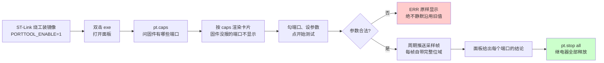

# M4 · 产线工装

**外面的人能让这块板做什么**：硬件工程师烧一个固件、双击一个 exe，
就能**逐路测板上每个端口** —— 数字输入输出、继电器、模拟量、温度、RS232、RS485 ——
不用写一行代码，也不用记任何协议。

**这个模块管到哪为止**：从烧进工装固件，到面板上每个端口给出一个结论。
**逐板出厂要检查哪几项**不在这里，那是工程约束层的出厂检查单（`CHK-C1`–`CHK-C7`）。

---

## 1 · 一次工装会话是什么形状

> **完整的协议时序图（八条命令、四类应答行、热改参数、交权给 CAN 深度诊断）在 `docs/modules/M4/PORTTOOL-FLOW.md`「A.7 一次完整会话的时序」**，这里不抄。

**两条铁律**（参数写错就拒绝、`!` 帧带完整位域）见 [PORTTOOL-FLOW.md「A.6 两条铁律」](M4/PORTTOOL-FLOW.md#a6-两条铁律)。

## 2 · 功能表

| # | 阶段 | 要做到什么 | 谁证明 | 状态 |
|---|---|---|---|---|
| **R4-01** | — | 硬件工程师能烧一个固件、双击一个 exe，就逐路测板上每个端口 | `T4-01` `T4-02` `T4-04` `T4-05` | 🔨 |
| **R4-02** | — | 工装（`PortTool`）在 Windows、Linux、macOS 上都能运行，三个平台的可执行文件一条命令一次生成（用户 2026-09-30 定） | `T4-03`（Linux）；macOS 还没有用例，见 [工装在 Linux / macOS 上运行](../../maps/porttool-on-linux-and-macos/map.md) | ❌ |
| **R4-03** | — | 串口列表每个口显示它是什么芯片 / 设备；对端串口由用户选、记在本机，方案文件不写口名（[DECISIONS.md](../tables/DECISIONS.md) 第 73 条） | `T4-03`（单元测试 `$TOOL/internal/serialx/sysfs_test.go`、`$PORTTOOL/TestCase/host/porttool_plan/plan_test.go` 的 `TestSerialPeer*`；实机见 [XPT-03](../../maps/porttool-on-linux-and-macos/issues/XPT-03-which-real-machines-and-what-the-test-case-is.md)) | ✅ |

**共 3 条。**

> ⚠️ **`🔨` 没有定义**：`docs/tables/STATUS.md` 只定义了 ✅ ⚠️ 🟡 ❌ ⬜ ⛔ 六个，这里原样照抄；要么补进定义表，要么换成已定义的一个。

`R4-01` 是这张表里唯一一条**还在做**的需求，期一、期二已完成：
八个会话（`din` `dout` `relay` `ain` `aout` `temp` `rs232` `rs485`）、
14 个交权目标、`pt.echo` 回环、逐路参数、浏览器面板、自动回环应答、多 COM 对端绑定。
**期三是 CAN / KNX / SD 的硬件层抽取 + 产线。**

## 3 · 测试怎么跑

**编号按「先协议后界面」排** —— 协议契约不成立的话，面板测什么都没意义。

| # | 对应需求 | 测什么 | 判据 | 跑法 | 条件 | 状态 |
|---|---|---|---|---|---|---|
| `T4-01` | `R4-01` | 端口工装的**协议契约** | C harness 拿真实固件源码跑，产出能力表并逐项比对 ¹ | `$PORTTOOL` 里 `TestCase/test.sh t4-01`（`go test -race ./TestCase/host/porttool_caps/ -args -build`，要 gcc/clang） | 主机侧 | ✅ |
| `T4-02` | `R4-01` | 面板在**真浏览器**里点一遍 | 按段 ①–⑫，见 ² | `go run ./TestCase/host/porttool_panel --port sim`（模拟板）或 `--port COMx`（真板子），要 Chrome | 主机侧 ³ / 真板子 | ✅ |
| `T4-03` | `R4-02` `R4-03` | **Linux 版**面板在真浏览器里点一遍，接真板子 | 同 `T4-02`，加一条：带 VID 的串口行都写着它是什么（Linux 上是厂商 / 产品名和驱动名）⁴ | 串口先用 `usbipd` 挂进 WSL，再 `go run ./TestCase/host/porttool_panel --wsl Debian --port /dev/ttyUSBx` | 真板子 + WSL | ✅ |
| `T4-04` | `R4-01` | **方案执行器与面板接口** | 六个通用字段的语义（`execute_condition` 的门、重试、前后延时、超时）、四种步骤类型、报告每次尝试都留、面板拒跑不合固件的方案（决策 77）；工装完整测试的记录、续跑、停下和安规卡片，校准值经 ST-Link 烧录 | `$PORTTOOL` 里 `go test ./TestCase/host/porttool_plan/`，本仓 selfcheck 的 GO-TEST 一步包含它 | 主机侧（假板子、ST-Link 替身），测不到真板子上的时序和 CubeProgrammer 的真实擦写 | ✅ |
| `T4-05` | `R4-01` | 第 6 步的 **demo 和工装固件讲同一套协议**（决策 93） | 同一份 Go 测试对工装固件的模拟板和 demo 的主机版各跑一遍，用 `src/ptproto` 解析：`pt.id`、`pt.caps` 表头与 demo 标记、demo 每个端口的形状和固件一致、拒绝原文一致、回环计数、帧字段和 `pt.run` 应答字段（差别只许是 [PORTTOOL-FLOW.md](M4/PORTTOOL-FLOW.md)「A.9」列的那些）、`pt.cal` 长度、RS232 切波特率的应答和切过去后的帧、ETH 满速率回送原样送回；另把测试项目录里用户级的每一项（目标和默认判据方案的判据步骤）在两边各跑一遍，判据要的字段缺了就不过（[决策 127](../tables/DECISIONS.md)；RS485 的 `overrun` 带 `if_present`，demo 不报时不判，STG-07） | `$PORTTOOL` 里 `TestCase/test.sh t4-05`（`go test ./TestCase/host/porttool_demo/ -args -build`，要 gcc / g++） | 主机侧：demo 的协议核心原样编译，板卡包 API 换成桩，所以测不到板卡包 API 本身（那部分只由 `P5` 编译）、USB 的满速率回送，以及真的 PHY、SD 卡、SDRAM、校准值区、串口切波特率 | ✅ |

**共 5 条。**

¹ 判据贴着代码放在 `$PORTTOOL:TestCase/host/porttool_caps/PORTTOOL-CAPS-TEST.md`，**没有搬进文档仓**。

² 判据在 [HOW-TO-RUN-PORTTOOL-TESTS.md](../engineering/HOW-TO-RUN-PORTTOOL-TESTS.md)「T4-02 的判据」，这里不抄。

³ ⚠️ `--port sim` 过不等于真板子过，模拟板测不到什么见 [HOW-TO-RUN-PORTTOOL-TESTS.md「T4-02 的判据」](../engineering/HOW-TO-RUN-PORTTOOL-TESTS.md#t4-02-的判据)。

⁴ 面板跑在 WSL 里，浏览器是 Windows 上的 Chrome。**测不到**：桌面 Linux 上双击打开、`xdg-open` 开浏览器、udev 和串口权限。

## 4 · 为什么这里没有「证据日期」和「最近结果」

状态一列的规矩见 [M1 §5](M1-firmware-upgrade.md)。

## 5 · 这个模块的边界

**测得了什么**：八个会话端口 + 14 个一次性目标，2026-09-08 在真板子上跑过 ——
SDRAM 三项、SD 认卡、以太网 PHY、CAN 内外回环、RS232 自回环、温度、DI、高侧、继电器逐路、AO。

**测不了什么**：

- **三条没在真环境验过**：USB-RS232 驱动（要干净机器插真适配器）、面板整套没在真板子上点过（T4-02 对真板子，[TODO-fixture.md](../../work/TODO-fixture.md) 第 24 条）、DO 高侧开关的 PWM 上限（见 [PORTTOOL-FLOW.md B.6「坑 · 高侧开关」](M4/PORTTOOL-FLOW.md#b6-dout--数字输出会话-)）
- **交权给 CAN 深度诊断是一条不归路** —— 进去之后**只有复位才能回到工装**
- **`🔨` 状态本身说不清还差多少**（见功能表下面那条警告）

**和其他模块的关系**：

| 关系 | 去哪看 |
|---|---|
| 工装镜像怎么烧进去、为什么它不受 128K 限制 | [M1 固件升级](M1-firmware-upgrade.md) |
| 这些端口给 app 用的时候是什么样 | [M3 应用运行环境](M3-app-runtime.md) |
| 逐板出厂要检查哪七项 | 工程约束层的出厂检查单 `CHK-C1`–`CHK-C7` |

> 引用别的模块只写指针，不抄内容，规矩见 [M1 §6](M1-firmware-upgrade.md)。

## 7 · 这个模块的细节文档

在 `M4/` 子目录里，这里只是指针。

| 文档 | 讲什么 |
|---|---|
| [PORTTOOL-FLOW.md](M4/PORTTOOL-FLOW.md) | 工装的控制模型与逐端口测试规程，**含完整的协议时序图** |
| [PRODUCTION-FRAMEWORK.md](M4/PRODUCTION-FRAMEWORK.md) | 产线测试框架：方案文件的结构与步骤序列 |
| [PROD-CONFIG-ITEMS.md](M4/PROD-CONFIG-ITEMS.md) | 产测配置项总表 |
