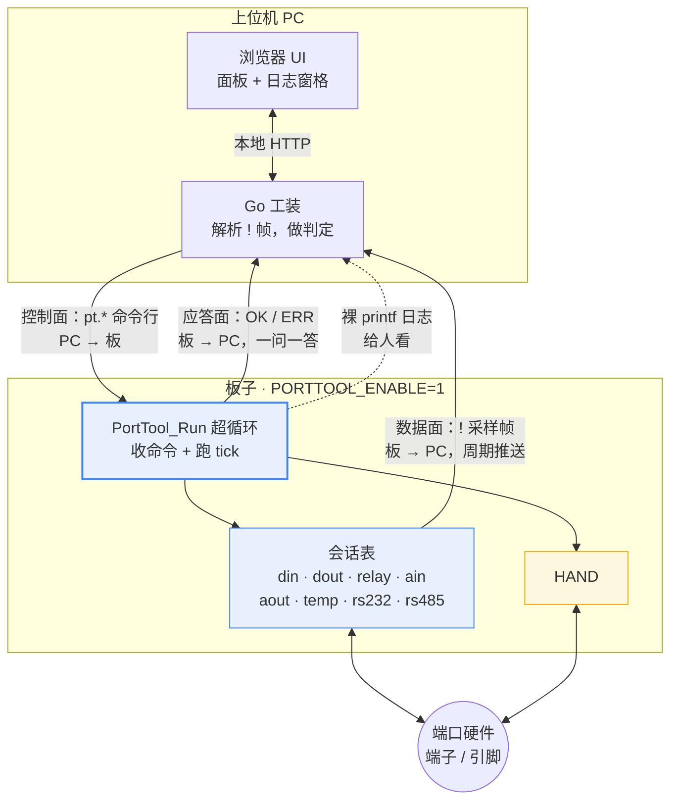
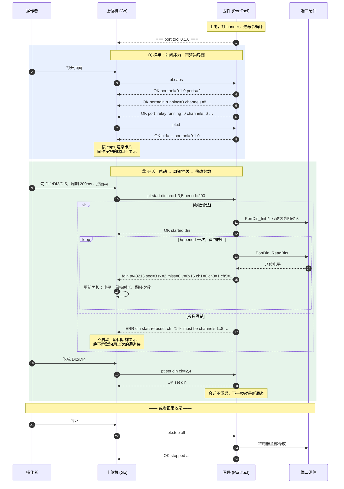
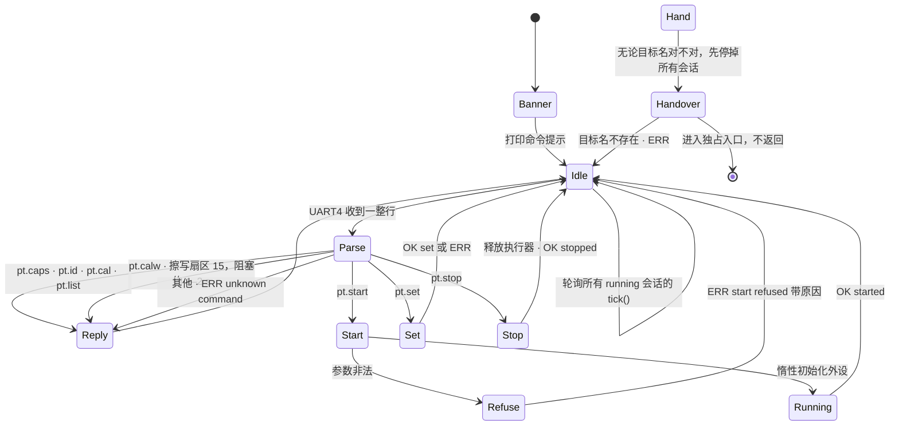
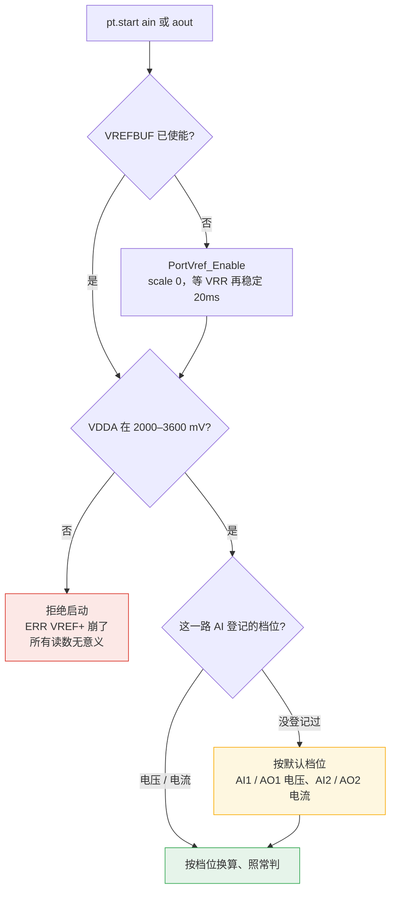
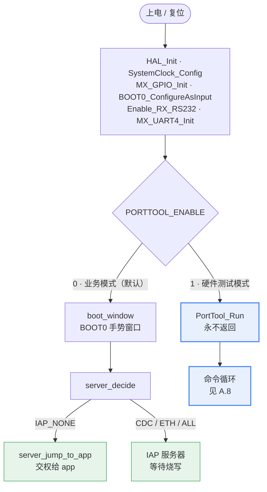
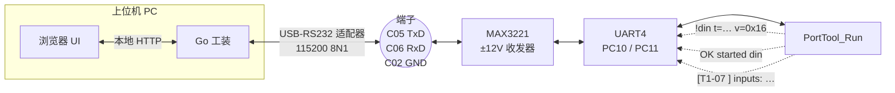
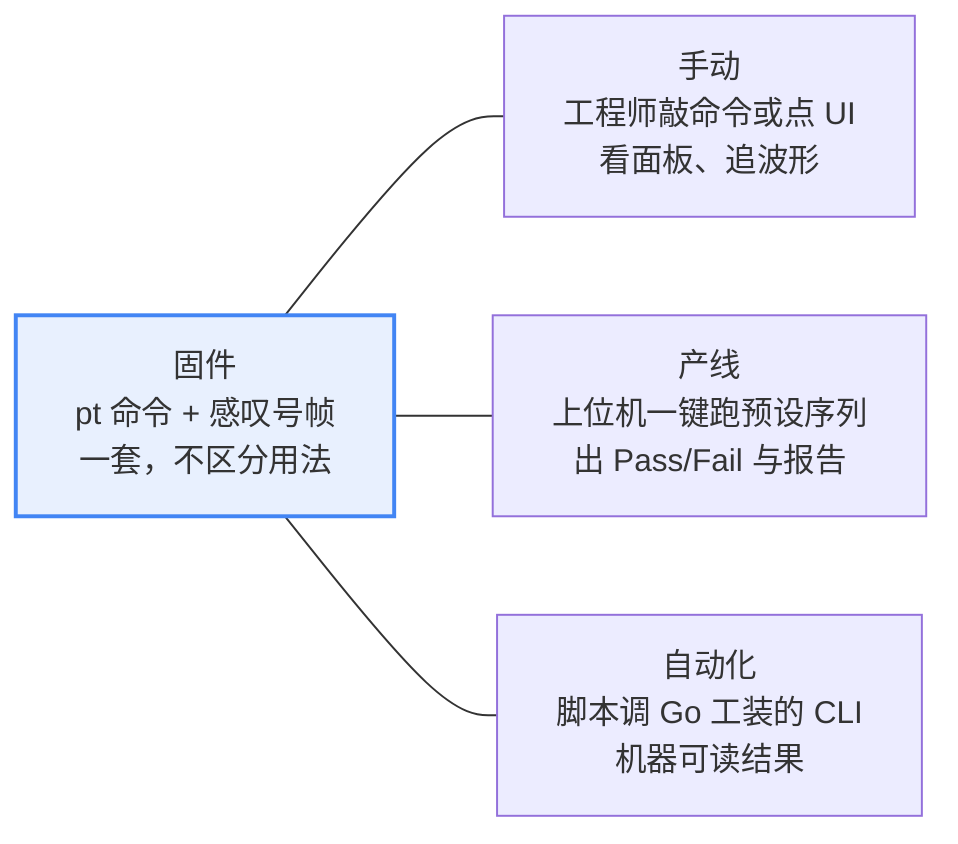
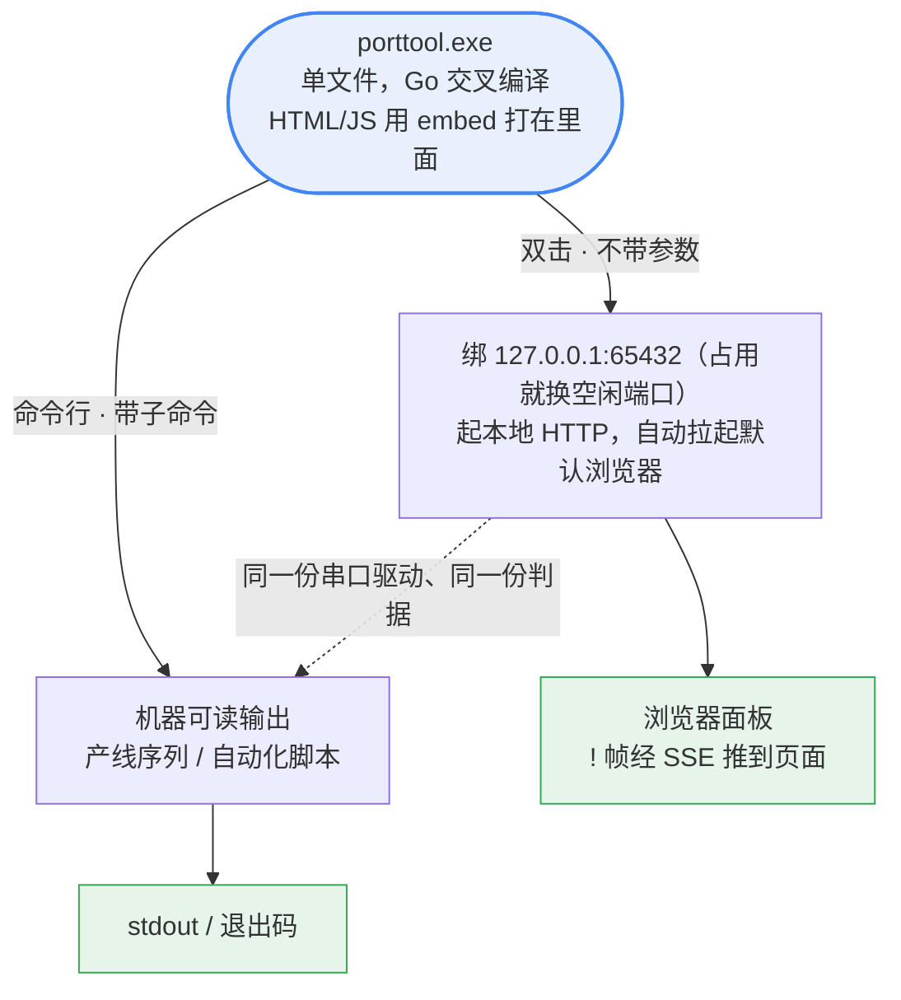

# 端口测试工装 —— 控制模型与逐端口测试规程

**总分两部分。** [A 部分](#a-总--上位机怎么控制板子)讲**上位机和板子之间的完整契约**：控制什么、怎么控制、如何响应、响应什么 —— 只看这一部分就够写上位机。[B 部分](#b-分--每个端口怎么测)讲**每一个端口具体怎么测**：怎么接、敲什么、看到什么算过、哪些坑会让判据静默失效。[C 部分](#c-附--镜像开关物理连接用法)是环境与前提。

代码在 `TestCase/porttool/`（固件侧）和 `$PORTTOOL` 的 `src/pt*` + `src/cmd/porttool`（上位机侧）。形态与分发方式见 [C.4](#c4-上位机怎么分发怎么起来)。**待办不在本文** —— 见 `$PROD/work/TODO.md` 和 `$PROD/maps/INDEX.md`。

> 本文描述当前固件（版本见 `$PORTTOOL/Output/fixture/VERSION`）。取舍理由在 [DECISIONS.md 第 9–15 条](../../tables/DECISIONS.md)。
引脚事实以 [HARDWARE-FACTS.md](../../hardware/HARDWARE-FACTS.md) 为准，本文不重复推导，只引用结论。
端口测试只有工装这一套：`TestCase/` 里原来一次烧一个的旧端口测试已删（[决策 87](../../tables/DECISIONS.md)）。

> 图是 Mermaid，渲染成 SVG，可任意缩放。VSCode 装 Markdown Preview Mermaid Support，或直接在 GitHub 上看。

---
---

# A 总 —— 上位机怎么控制板子

## A.1 一张图：一条串口，两个平面

上位机和板子之间只有**一条 115200 8N1 的 RS232**（测 RS232 时临时切到选定波特率，见 [B.7](#b7-rs232--和上位机收发可选波特率会话-)）。这条线上跑两个方向、三种行。



**判定和序列全在上位机** —— 固件只报原始采样，一个字都不判。改判据不用重烧固件。

## A.2 控制什么 —— 两类控制对象

板子上能被控制的东西有两类，**行为完全不同，上位机必须分开对待**：

| | ✅ **会话** | 🎯 **一次性动作** |
|---|---|---|
| 是什么 | 一个可启停的周期采样器，`porttool_port_t` 结构（porttool.h:52-77（`$BOOT/TestCase/porttool/porttool.h`）） | 一个跑完就返回、把量到的数写成一行 `OK` 的函数 | 一个独占的传统 bring-up 测试入口函数 |
| 现有几个 | **13 个**：`din`、`dout`、`relay`、`ain`、`aout`、`temp`、`rs232`、`rs485`、`can`、`knx`、`eth`、`usb`、`sd` | **8 个**：见 [A.3](#a3-怎么控制--全部-8-条命令) 的 `pt.run` 表 |
| 怎么启动 | `pt.start <port> [k=v …]` | `pt.run <target>` |
| 能并存吗 | **能**，多个会话同时跑，主循环轮流 tick | 跑的时候独占 CPU，跑完就还回来 |
| 参数能热改吗 | **能**，`pt.set` 不重启会话 | **不收参数**，尺度编在固件里并写进应答 |
| 怎么退出 | `pt.stop <port>` 或 `pt.stop all` | 自己就结束了 |
| 输出什么 | `!<port> …` 结构化帧，机器可解析 | 散文若干行 + **一行 `OK <target> k=v …`** |
| 主机能判吗 | **能** | **能** —— 产线序列就是拿这一类搭的 |
| 副作用 | `stop` 负责恢复（继电器全释放） | 自己按需初始化用到的外设 |

⚠️ **`pt.caps` 里两类各占自己的行**（`kind=session` / `kind=run`），但**一块硬件只占一行** —— 见 [DECISIONS.md 第 17 条](../../tables/DECISIONS.md)。

**惰性初始化**：外设只有在 `pt.start` 到达时才配置（各个会话自己的 `*_inited` 标志），没启动过的端口保持复位状态。

## A.3 怎么控制 —— 全部 8 条命令

**一行一条，`\r` 或 `\n` 结尾，不回显。**PC 发来的一行上限 256 字节（`PORTTOOL_LINE_MAX`，为放下六路各不相同的继电器参数，决策 123），超长整行丢弃并回 `ERR line too long`；板子发出的每一行（应答、caps、帧）上限仍是 192 字节（`PORTTOOL_REPLY_MAX`） —— 不截断成另一条含义的命令。空行忽略。

派发在 porttool.c:191-233（`$BOOT/TestCase/porttool/porttool.c`）。

| 命令 | 参数 | 干什么 | 前置条件 | 不满足会怎样 |
|---|---|---|---|---|
| `pt.caps` | 无 | 报固件版本 + 每个会话端口的通道数与当前参数 | 无 | — |
| `pt.id` | 无 | 报 MCU 96 位 UID + 工装版本 | 无 | — |
| `pt.cal` | 无 | **只读**，原样报出扇区 15 校准值区的前 56 字节（`calib_area_t`），PC 用 `calarea.Decode` 解；固件不判、不写 flash（[决策 102](../../tables/DECISIONS.md)） | 无 | — |
| `pt.calw` | `<112 位十六进制>`：56 字节的 `calib_area_t`，和 `pt.cal` 报的同一种写法 | 把校准值区写进扇区 15：整扇区读进 RAM → 前 8 KiB 换成这条记录加 `0xFF` → 擦扇区 15 → 只写不全是 `0xFF` 的 flash word → 整扇区读回比对。阻塞约 1–2 s（擦一个扇区），板子不复位（[决策 142](../../tables/DECISIONS.md)） | 记录的 magic、版本、路数、CRC 都对，UID 是这块板的 | `ERR calw refused: <原因>`，flash 一个字节都没动；擦写中出错回 `ERR calw failed: <哪一步>` |
| `pt.list` | 无 | 报哪些会话正在跑 | 无 | — |
| `pt.start` | `<port> [k=v …]` | 启动一个会话 | 端口名存在；**所有给出的参数都合法** | `ERR no such port` / `ERR <port> start refused: <原因>`，**会话不启动** |
| `pt.set` | `<port> k=v …` | 改一个**正在跑**的会话的参数 | 端口名存在 **且正在跑**；参数合法 | `ERR no such port` / `ERR <port> is not running` / `ERR <port> set refused: <原因>` |
| `pt.stop` | `<port>` 或 `all` | 停会话并恢复副作用 | 端口名存在（`all` 总是合法） | `ERR no such port` |
| `pt.echo` | `<port> <数>` | **把板子刚发的那个数原样送回去**，板子在此基础上累加。这是需求 R4 的回环 | 端口存在、**正在跑**、且 `loop=ctrl` | `ERR no such port` / `ERR <port> is not running` / `ERR <port> takes its echo on its own link, not on this one` |
| `pt.run` | `<target>`，**或不带参数** | 不带参数 = 列出全部一次性动作；带参数 = 跑一次、**回到命令循环**、用一行 `OK <target> k=v …` 报出量到的数 | 目标名存在 | `ERR no such run target "<name>" - run pt.run with no argument to list them` |

**`pt.run` 现有八个目标**（`TestCase/porttool/porttool_run.c` 里的表），按硬件归成四组：

| 目标 | 报什么 | 注意 |
|---|---|---|
| `sdram.probe` | `base` `size` `ready` `databus` `addrbus` | 自己按需 `MX_FMC_Init()` —— 工装镜像跑在 Phase 1，那里 FMC 还没起来 |
| `sdram.sweep` | `ready` `patterns` `words_each` `mismatches` `first_bad` `bad_pattern` `write_ms` `verify_ms` | **整片 64 MiB 四种花样**，产线要的那个「压力测试零错误」。⚠️ 2026-09-08 实测 6.5 s，方案里的 `timeout_ms` 要留够 |
| `sdram.crc` | `ready` `offset` `bytes` `crc` | 只读，算一段窗口的 CRC32。固件留着，面板和随附方案都不调用（[决策 141](../../tables/DECISIONS.md)） |
| `sd.probe` | `detected` `ready` `blocks` `block_size` `mib` `v2x` `class` | `detected=0` 是没插卡，`detected=1 ready=0` 是接口 |
| `sd.integrity` | `mounted` `wrote` `read_back` `identical` `bytes` 两个 CRC `fresult` | 一轮 4 KiB |
| `sd.put` / `sd.get` / `sd.ls` / `sd.rm` / `sd.eject` | `ok` `name` `size` `crc` `count` `error` | 卡上 `PORTTOOL` 文件夹的文件传递，数据走网口或 USB，见 B.11（决策 120） |
| `rtc.read` | `init` `clk` `date` `time` | 自己按需 `MX_RTC_Init()`。**只读不写** —— 备份域 `DR3` 里住着 bootloader 的 VBAT 见证值 |
| `led.blink` | `pin` `pulses` `half_ms` `observed=unknown` | PE2 闪六次。**没有回读，`observed` 永远是 unknown**，看没看见是人的判断 |
| `knx.edges` | `busy` `bus` `shots` `moved` `edges` `dropped` `first_us` `width_us` | 发 `shots` 个单脉冲（默认 3），逐个记 KNX_RX 的每个边沿；每个脉冲的边沿序列（`H@+3us L@+38us` 这种，相对 TX 起点）打成散文行，`OK` 行给汇总：`moved` 有反应的脉冲数，`first_us` / `width_us` 第一个边沿的平均时刻和前两个边沿的平均间隔。KNX 会话在跑时不跑、回 `busy=1`；总线没电回 `bus=dead`、不发。逐边沿时序（[决策 87](../../tables/DECISIONS.md)） |
| `knx.hist` | `busy` `bus` `tx` `rx` `miss` `w_min` `w_avg` `w_max` `d_min` `d_avg` `d_max` `w_hist` `d_hist` | 发 `bursts` 串、每串 200 个脉冲（默认 3 串，串间 1 s），报收发计数、KNX_RX 脉宽和 TX→RX 延迟的最小 / 平均 / 最大（µs）和两张 8 格直方图（逗号分隔的计数，格界在 `$BOOT/TestCase/KNX/knx_test.c` 的 `KNX_W_EDGES` / `KNX_D_EDGES`）。脉宽 / 延迟直方图（决策 87） |
| `knx.pullup` | `busy` `bus` `pu_tx` `pu_rx` `pu_miss` `pu_w_avg` `np_tx` `np_rx` `np_miss` `np_w_avg` | PA10 内部上拉开 / 关各发一串 200 个脉冲，`pu_` 是开、`np_` 是关；跑完上拉留在开。板上 /KNX_RX 没有上拉电阻（[HARDWARE-FACTS.md](../../hardware/HARDWARE-FACTS.md)「KNX 接口」）。上拉开关对比（决策 87） |

面板：三个 `knx.*` 目标是 KNX 卡片上的一次性用例，执行后结果区把 `OK` 行里的数按中文摆出来（`tx` `rx` `miss` 在这里是脉冲，不是帧）；`busy=1` 说先停会话，`bus=dead` 说总线没电。方案里没有这三步，所以只给读数、不给结论。

> ⚠️ **`pt.run` 的结果主机能判**（[DECISIONS.md 第 22 条](../../tables/DECISIONS.md)：判定一律在上位机）。
>
> ⚠️ **上位机等 `pt.run` 的应答最多 180 s，其余命令 3 s**（`$PORTTOOL/src/ptboard/board.go:27-34` 的 `RunTimeout`、`DefaultTimeout`）：2026-09-08 实测 `sdram.sweep` 6.5 s、`sd.integrity passes=64` 9.1 s，按 3 s 等会把好板判成超时。等待由目标自己的 `OK` 行结束，上限放宽不拖慢正常的板子，只让慢一点的卡不被误判。
>
> ⚠️ **`pt.run` 的应答里是量到的数，不是结论。** 没有任何目标打 PASS 或 FAIL。限值住在上位机的方案文件里，这才是「改一个限值不用重烧板子」成立的原因。
>
> ⚠️ **它执行的检查会先打自己的散文**（例如 `SDRAM_TEST: data bus OK …`），**然后**才是那一行 `OK`。上位机必须按「裸日志行不结束应答」来读 —— 这正是 `ptproto` 的四类行分流本来就做的事。⚠️ `pt.run` **不停掉正在跑的会话**，中间可能夹着 `!` 采样帧。
>
> ⚠️ **`pt.echo` 对 `loop=link` 的端口刻意拒绝**：那些端口从被测链路上取回复，在控制口上答会让计数在链路死掉时照样涨，就是假通过。取舍见 [DECISIONS.md 第 9 条](../../tables/DECISIONS.md)。


### 参数语法

`k=v`，空格分隔，值可以用双引号包住（引号内的 `=` 不会被当成下一个参数）。解析器在 porttool_cmd.c（`$BOOT/TestCase/porttool/porttool_cmd.c`）。三种值类型：

| 类型 | 写法 | 合法范围 | 例 |
|---|---|---|---|
| 通道掩码 | 逗号分隔的十进制 | `1..<channels>`，**不能为空集** | `ch=1,3,5` |
| 无符号整数 | 纯十进制数字 | 见各端口 | `period=200` |
| 枚举 | 裸字符串 | 见各端口 | `mode=cycle` |
| **逐路取值** | `<路>:<值>` 逗号分隔 | 路 `1..<channels>`，值见各端口，**同一路不能出现两次** | `duty=1:20,5:75` |

**逐路取值的参数同时接受单值写法**（`duty=100` = 所有选中路都设成 100），解析器是共用的 `PortCmd_GetPairs()`。

⚠️ **拒绝就是「什么都没变」**：参数先写进临时变量，整行都合法才提交，所以在第三个参数上被拒的命令前两个也没生效。

**没给的参数保持上次的值**，给了但写错**拒绝整条命令** —— 见 [A.6 铁律 1](#a6-两条铁律)。

## A.4 如何响应 —— 四类行，看第一个字符就能分

**串口上回来的每一行都属于且只属于以下四类之一。**上位机按第一个字符分流，不需要状态机。

| 行首 | 类别 | 何时出现 | 谁消费 |
|---|---|---|---|
| `OK ` | 成功应答 | 每条命令之后，**可能多行**（`pt.caps` / `pt.list` / `pt.run` 无参） | 上位机，配对到刚发的命令 |
| `ERR ` | 失败应答 | 命令被拒 | 上位机，**原文显示给人**，不要改写 |
| `!` | 采样帧 | 会话周期到点，**与命令无关地异步冒出来** | 上位机解析，进面板 |
| 其他 | 裸日志 | 开机 banner、检查自己打的散文 |

### 每条命令的确切应答

照 porttool.c（`$BOOT/TestCase/porttool/porttool.c`） 的 `printf` 抄的，格式串不要自己猜。

```text
pt.caps
  OK porttool=0.5.0 ports=17 lines=45
  OK port=din kind=session blk=D term=D02-D09 channels=8 loop=ctrl params=ch,period running=0
  OK vals=din ch=1,2,3,4,5,6,7,8 period=200
  OK limits=din ch:1..8 period:50..
  OK port=relay kind=session blk=B term=B01-B12 channels=6 loop=ctrl params=ch,mode,on,close,open,count running=0
  OK vals=relay ch=1,2,3,4,5,6 mode=hold on=1:0,2:0,3:0,4:0,5:0,6:0 close=2000 open=2000 count=10
  OK terms=relay B01+B02,B03+B04,B05+B06,B07+B08,B09+B10,B11+B12
  OK port=can kind=session blk=C term=C07,C08 channels=1 loop=link params=baud,mode,period running=0
  OK port=sdram kind=run blk=- term=U6 channels=1 loop=none runs=sdram.probe,sdram.sweep,sdram.crc
  OK port=led kind=run blk=- term=- channels=1 loop=none runs=led.blink
  …
    ^ 表头声明 lines=<n>，后面**恰好**跟 n 行。**行数不等于 1 + ports** ——
      一个端口可能占 2~3 行（port= 形状、vals= 当前取值、terms= 端子标签），
      而以后还会有更多。**上位机读固定行数，不要靠「读到没有了」判断结束** ——
      这条链上没有结束标记，而正在跑的会话会把 ! 帧插到回复中间。

  为什么形状和取值分两行：**一个逐路参数就塞不进 192 字节的应答行**（dout 光 `duty=1:0,…,8:0`
  就占 31 个字符，合成一行 195 字节），被截断的 caps 行就是面板永远不会渲染的那个参数；T4-01 查行长。

pt.id
  OK uid=00340041XXXXXXXXXXXXXXXX porttool=0.5.0

pt.cal
  OK cal=4F43414C01000400…    <- 56 字节按 flash 里的顺序，每字节两位大写十六进制，共 112 位
  OK cal=FFFFFFFF…FF          <- 擦除后没烧过：照样原样报，PC 解出来是「没有校准值」，不是错误

pt.calw 4F43414C01000400…    <- 112 位十六进制，就是 pt.cal 报的那 56 字节；一行 120 字节，在 256 的命令行上限之内
  OK calw words=2 ms=1180    <- 写了几个 32 字节 flash word、擦写读回一共多少毫秒
  ERR calw refused: crc does not match
  ERR calw refused: uid is not this board's
  ERR calw failed: erase err=0x00000100   <- HAL_FLASH_GetError()

pt.list
  OK running=din          <- 每个在跑的一行
  OK running=relay
  OK running=none         <- 一个都没跑时的唯一一行

pt.start din ch=1,3,5 period=200
  OK started din
  ERR no such port "dinn"
  ERR din start refused: ch="1,9" must be channels 1..8 separated by commas
  ERR din start refused: period="abc" is not a number

pt.set din ch=2,4
  OK set din
  ERR din is not running

pt.stop din  /  pt.stop all
  OK stopped din
  OK stopped all

pt.start rs232 baud=19200        <- 控制口要换波特率的命令，应答末尾多一个 line=
  OK started rs232 line=19200    <- 这一行还是旧波特率；发完板子才切，PC 读到它再切
pt.stop rs232
  OK stopped rs232 line=115200   <- 这一行还是 19200；发完两边切回
  !line t=48213 baud=115200 reverted=1   <- 切换后 3 s 没收到任何字节，板子自己切回

  …共 14 行

  OK handing over to can - this does not come back, reset the board to return to the port tool
  （之后是那个测试自己的裸 printf，再也不回命令循环）

（未知命令）
  ERR unknown command "pt.foo"
```

**`pt.cal` 只报原始字节，判读全在 PC**：一行 119 字节，在 192 字节的应答行上限之内；地址和长度取自 `$BOOT/IAPServer/calib_area.h`，字段布局见 [SECTOR-15.md](../M1/SECTOR-15.md)「校准值区的格式」。原样报是为了格式只归 `calib_area.h` 一处，固件里不多一份解析（[决策 102](../../tables/DECISIONS.md)）。PC 侧（`ptproto.ParseCal`）：magic 不对是「没有校准值」，照常返回、不算错误；CRC 或版本不对返回 `calarea.ErrCorrupt`，和应答格式不对分得开。

**`pt.calw` 只发 56 字节**：校准值区其余字节按格式就是 `0xFF`，所以一行装得下、不用分段；PC 侧 `ptproto.CalWriteCommand` 发之前查镜像是 8 KiB、56 字节以后全是 `0xFF`、记录解得开（[决策 142](../../tables/DECISIONS.md)）。固件照 `calib_area.h` 的结构体查 magic、版本、路数、CRC 和本机 UID，不对就拒，不碰 flash。**能擦写的只有扇区 15**：擦除的扇区号写死（bank 2 扇区 7），每次写 flash word 前查地址在 `CALIB_AREA_ADDR` 起的 128 KiB 以内，别的地址一律拒（`$BOOT/TestCase/porttool/porttool_calw.c`）。扇区 15 里校准值区以外的东西（根区、metadata）原样写回；擦完到写完之间掉电或出错，它们只剩 RAM 里那一份。

**`OK info=<port> k=v …`**：`pt.caps` 里只读的硬件事实，不是参数，`pt.set` 改不了，计入表头的 `lines=`。现在只有 `can` 有一行（[决策 87](../../tables/DECISIONS.md)）：`clk=` 内核时钟源（`HSE` / `PLL1Q` / `PLL2Q`，读 RCC 当时的选择）、`clk_hz=`、当前 `baud=` 对应的位时序 `presc=` `seg1=` `seg2=` `sjw=`、每位的 tq 数 `tq=`（1 + seg1 + seg2），以及按这些算出来的实际位速率 `bps=`（`clk_hz / (presc × tq)`；时钟不是 HSE 时 `clk_hz=0`、`bps=0`，位时序表只对 HSE 成立）。

面板：CAN 卡片会话那段的配置区底下一行只读文字（数据是 `/api/state` 每个端口的 `info`），实际位速率和当前波特率不等时标黄；时钟不是 HSE 时不摆那串 0，改说「位时序表只对外部晶振成立」。


## A.5 响应什么 —— 采样帧的字段

```text
!<port> t=<ms> <字段…>
```

`t` 是 `HAL_GetTick()`，板子开机以来的毫秒数，**会在 49.7 天回绕**。生成在 porttool.c:39-49（`$BOOT/TestCase/porttool/porttool.c`），整帧上限 192 字节。

### `!din`

```text
!din t=48213 seq=3 rx=2 miss=0 v=0x16 ch1=0 ch3=1 ch5=1
```

| 字段 | 含义 |
|---|---|
| `v` | **八位全量位域**，端子序 bit0 = DI1 … bit7 = DI8。**无论选了哪几路都是全的** |
| `ch<n>` | 只有 `ch=` 选中的那几路，值 0/1，和 `v` 对应位一致 |

`mode=quad`（八个脚当四个编码器，第 n 组是 DI(2n−1)、DI(2n)）时不报 `ch<n>`，改报：

```text
!din t=48213 seq=3 rx=2 miss=0 v=0x00 mode=quad g1=400 d1=1 g2=400 d2=1 g3=400 d3=1 g4=400 d4=1 err=0 moved=0xFF
```

| 字段 | 含义 |
|---|---|
| `g<n>` / `d<n>` | 第 n 组的带符号计数和最后一次的方向；会话开始清零 |
| `err` | 两相同时变的次数，四组合计：采样跟不上或缺一相时涨 |
| `moved` | 会话开始以来变过电平的脚，位域同 `v`。不报每个脚的跳变次数：八个计数放进一帧会超过 192 字节（决策 107） |

### `!relay`

```text
!relay t=48213 seq=3 rx=2 miss=0 mode=cycle ch1=1 n1=12 ch2=0 n2=12 done=0
```

| 字段 | 含义 |
|---|---|
| `mode` | `hold` 或 `cycle` |
| `ch<n>` | 选中的那几路，**每路这一刻命令的电平**（`on=1:1,2:0` 设，和 dout 的 `duty=` 共用 `ch:值` 解析器） |
| `n<n>` | 只在 `mode=cycle`：这一路已完成的开合次数（吸合一次再断开一次算一次），会话开始清零 |
| `done` | 只在 `mode=cycle`：选中的每一路都跑满 `count` 时为 1，之后不再翻转（决策 123） |

`mode=cycle` 下任何一路翻转就发一帧，会话开始时也发一帧；`mode=hold` 每秒一帧。

> ⚠️ **没有单独的 `level=` 字段**：六路各自独立，一个数只在它们恰好一致时才对，其余时候是静默的错（[DECISIONS.md 第 12 条](../../tables/DECISIONS.md)）。

> ⚠️ **`!relay` 报的是「驱动成什么」，不是「触点真的动了没有」** —— 继电器是 HF41F 干接点，板上没有回读。要证明触点动作必须在触点上接负载、看负载的反馈（[决策 130](../../tables/DECISIONS.md)），见 [B.2](#b2-relay--继电器输出会话-)。

### 每一帧都带的回环三个字段

```text
!<port> t=<ms> seq=<n> rx=<n> miss=<n> <该端口自己的字段…>
```

| 字段 | 含义 | 上位机拿它干什么 |
|---|---|---|
| `seq` | 本帧发出的数 | 显示计数 |
| `rx` | 板子最近一次**真正收回来**的数 | `seq - rx` 恒为 1 就是闭环正常 |
| `miss` | 连续没等到有效回复的拍数 | 一直涨 = 回程断了 |

**上位机每收到一帧就回一次 `pt.echo <port> <seq>`**（`loop=ctrl` 的端口），板子在收回来的数上加一继续。

⚠️ **三条容易读错的**：

1. **没回复时 `seq` 不动。**只有 `miss` 涨。一个还在往上爬的 `seq` 会让断掉的回环看起来是活的，所以宁可让它停住。
2. **过期回复算 miss，不算闭合。**收回来的数和当前 `seq` 不相等，说明它回答的是更早那一帧。
3. **第一帧的 `miss` 是 0。**那一拍上位机还没机会回复，判它 miss 会让每个健康的回环都从 1 起步。

⚠️ **`loop=ctrl` 的端口，这三个数不是该端口的判据。**它们只说明控制口和循环还活着。DI 的判据永远是 `v=` 位域，AOUT 的判据永远是端子上的电流。面板必须把它们和读数分区显示（[DECISIONS.md 第 9 条](../../tables/DECISIONS.md)）。

### `!dout`

```text
!dout t=51200 seq=3 rx=2 miss=0 mode=hold res=8 tick=256000 ch1=51 ch5=191
```

| 字段 | 含义 |
|---|---|
| `mode` | `hold`、`blink` 或 `quad` |
| `res` | 占空比的位数，八路共用（[DECISIONS.md 第 101 条](../../tables/DECISIONS.md)） |
| `tick` | 八路共用的中断率，Hz，= 最快那一路的 `freq` × 2^res。每路实际落到的频率在 `caps` 的 `freq=` 里。`caps` 的 `freq=` 八路都列、不只列勾选的：面板按这一行填每一路，缺一路就成了 `freq=0`，低于下限（`$BOOT/TestCase/porttool/porttool_dout.c:433-436`） |
| `ch<n>` | 选中那几路**此刻正在驱动的占空比**，原始计数 0..2^res−1。`blink` 的暗半周期里这里是 0，不是设定值 —— 帧要说的是引脚上现在是什么 |

`mode=quad`（给被测板 DI 送正交脉冲，决策 107）的帧不带 `res`、`tick`、`ch<n>`：

```text
!dout t=51200 seq=3 rx=2 miss=0 mode=quad cycles=100 sent=400 done=1
```

| 字段 | 含义 |
|---|---|
| `cycles` | 要送的圈数 |
| `sent` | 每组已送出的边沿数，一圈 4 个；四组同步，所以只报一个 |
| `done` | 1 = 送完了，八路都已拉低；送完的那一刻立刻发一帧，不等周期 |

### `!ain`

```text
!ain t=48213 seq=1 rx=0 miss=0 vdda=3287 ok=1 ch1=21850/2071 ch2=530/50
```

| 字段 | 含义 |
|---|---|
| `vdda` | 用 VREFINT 量出来的 VDDA，毫伏 |
| `ok` | **1 = VDDA 量到了且落在合理带内**。`ok=0` 时这一帧所有读数都没有意义 |
| `ch<n>` | `原始码/引脚毫伏`。**是 MCU 引脚上的值，不是端子上的值** |

⚠️ **端子换算不在固件里算**，因为它取决于板子焊成了哪个档位 —— 那是一次性的焊接选择，固件读不回来。上位机做换算，并且要说清自己假设的是哪个档。

⚠️ **`ok=0` 时读数照样报。**藏起来的话就没有东西可诊断了 —— 而板上没有基准芯片，VREFBUF 没使能时 ADC 会返回 `0x8000` 这类**看起来完全像真数据**的值。所以判据是 `ok`，不是读数本身。

### `!aout`

```text
!aout t=48213 seq=1 rx=0 miss=0 ch1=500/488/4883 ch2=1500/1465/14648
```

| 字段 | 含义 |
|---|---|
| `ch<n>` | `请求值/量化后的值/预期微安`。三个都报：只报请求会藏掉几毫伏的量化误差，只报量化值会让面板看起来没理会输入 |

⚠️ **微安那个数是「应该是多少」，不是测量值** —— 板上没有任何通道能读回那个电流。**万用表串在回路里才是唯一的判据**，这个端口存在的意义就在这里。

⚠️ **它只在跳线 JP3/JP4 开路时成立。**闭合的话 VREF 经 40k2 灌进 XTR111 的求和节点，输出变成 4–20 mA live-zero（DAC 设 0 时已有约 4.85 mA）。那也是固件读不回来的焊接选择，所以这个数假设开路。

### `!temp`

```text
!temp t=48213 seq=1 rx=0 miss=0 vdda=3287 ok=1 ch1=738/238 ch2=751/251
```

| 字段 | 含义 |
|---|---|
| `ch<n>` | `毫伏/十分之一摄氏度`。用十分之一度而不是整度，是为了让缓慢漂移看得见，同时不让浮点数上串口 |

板上两个 LM50：ch1 在短路保护上，ch2 在高侧开关上。**它们不是端子**，接不了外部东西 —— 值得看的是 DO 驱动带载发热，所以它是独立会话而不是 dout 上的一个字段：正好在别的端口被大力驱动时最该看它。

## A.6 两条铁律

从现有代码那条「不许假通过」来的，上位机必须跟着守：

1. **参数给了但写错，拒绝启动，并把原因说清楚** —— 不静默沿用旧值。沿用了就是在读别的引脚，而面板上看不出来（porttool_din.c:30-32（`$BOOT/TestCase/porttool/porttool_din.c`） 的注释就是这条）。上位机**必须原样显示 ERR 文本**，不要归纳成「启动失败」。
2. **`!` 帧永远带完整位域** —— 一条采样自己就说得清来自哪个脚，不依赖上位机记得当初选了什么。

## A.7 一次完整会话的时序



## A.8 固件主循环



**控制口 UART4 用中断收进 512 字节的环形缓冲，不轮询**（`$BOOT/TestCase/porttool/porttool.c:65-66`、`:694-719`）：`printf` 逐字节阻塞发送，一帧就是上百次阻塞调用，轮询接收在这期间不看线，命令字节就丢了。2026-09-08 轮询时实测：会话开着发 8 条命令，一条应答整条丢、一条被改成 `ppt.id`，`rx_errors` 到 9；会话停着同样 8 条全对。缓冲满了丢最新的字节、不覆盖读了一半的行。

**采样周期下限 50 ms**（`PORTTOOL_PERIOD_MIN_MS`）：115200 ≈ 11.5 KB/s，而 `printf` 是阻塞的，周期太小会把主循环拖死。小于 50 的请求被**静默夹到 50**，不报错 —— 上位机想知道实际周期就读 `pt.caps` 回来的 `period=`。

## A.9 第 6 步的 demo 讲同一套协议

第 6 步板子上跑的不是工装固件，是板卡包例程 `FixtureDemo`（`$CORE_REPO/libraries/OpenPLC_Ports/examples/FixtureDemo/`）。它只用板卡包 API，所以测到的是用户 app 走的路径（[STG-07](../../../maps/fixture-test-stages/issues/STG-07-how-the-arduino-demo-speaks-the-fixture-protocol.md)、[决策 93](../../tables/DECISIONS.md)）。协议在它里面另有一份实现，是一条跨仓镜像（[ARCHITECTURE.md](../../repo/ARCHITECTURE.md)「跨仓镜像的代码」第 15 条），由 `T4-05` 对两边各跑一遍同一份测试兜住。

控制口仍是 RS232 端子 C05 / C06、115200 8N1：demo 走 `RS232`（USART3），工装固件走 UART4，两者在同一对引脚上（[HARDWARE-FACTS.md](../../hardware/HARDWARE-FACTS.md)「app 侧三条通道各走哪个外设」）。core 的系统日志不在这条线上，走 USB 口 1（`R3-22`）；demo 用 `OPENPLC_SYSTEM_LOG(OFF)` 把它关掉，口 1 只做 USB 测试，日志仍记在 SRAM4，用 `IAPTool log <ip>` 读（用户 2026-10-20）。

**怎么认出 demo**：`pt.caps` 表头和 `pt.id` 多一个 `demo=<例程版本>`，工装固件没有这个键。`porttool=` 是 demo 照着讲的协议版本，`T4-05` 要求它等于工装固件的 `PORTTOOL_VERSION`。

**跑哪些项**：完整测试（功能 / 老化 / 用户级）要跑的每一项 demo 都跑得了（[决策 127](../../tables/DECISIONS.md)）；`T4-05` 拿测试项目录里用户级的每一项、按判据方案的步骤对 demo 的主机版跑一遍，查判据要的字段都在。用户级没有的项（编码器计数、KNX、复位原因、LED、SDRAM 长时间读写、RS485 引脚自检、SD 文件传递；SDRAM 长时间读写功能测试也有，[决策 139](../../tables/DECISIONS.md)）demo 没有。

| 命令 | demo |
|---|---|
| `pt.caps` `pt.id` `pt.cal` `pt.list` `pt.start` `pt.set` `pt.stop` `pt.echo` `pt.hold` `pt.led` `pt.run` | 有，应答和拒绝的原文与工装固件一致 |
| `pt.run` 的目标 | `eth.link`、`sd.probe`、`sd.integrity`、`sd.speed`、`sdram.probe`、`sdram.sweep`；别的回 `ERR no such run target` |

`pt.id` 没有 `rx_errors=` / `rx_dropped=`：`RS232` 不报接收错误。`pt.cal` 照工装固件回扇区 15 校准值区的原始字节。`pt.calw` demo 没有，回 `ERR unknown command`：烧校准值只在研发测试，第 6 步不烧（[决策 142](../../tables/DECISIONS.md)）。

| 端口 | demo 收的参数 | 和工装固件不同的地方 |
|---|---|---|
| `din` | `ch` `period` | 没有 `mode=quad`（编码器计数只在研发测试）；帧里照样带 `mode=level` |
| `dout` | `ch` `mode` `duty` `period` | 没有 `mode=quad` / `cycles`（只有标准机送正交脉冲用，决策 107）；`duty` 只收 0 或 255：DO1/DO5 这样的一对共用一个定时器通道，`analogWrite` 的中间值会把另一路关掉（见例程 `DO_PWM`）。`res` 固定 8，帧里没有 `tick` |
| `relay` | `ch` `mode` `on` `close` `open` `count` | 无 |
| `ain` | `ch` `period` | 原始码按 16 位读（和工装固件同一刻度，面板的换算照用），读完 ADC 回 12 位。多 `cal=`（校准值状态）和 `ai1_mv=` / `ai2_ua=`：经 `openplcReadAI1_mV` / `openplcReadAI2_mA` 套用扇区 15 校准值后的端子值，只记录 |
| `aout` | `ch` `mv` `period` | `mv=` 同义（DAC 引脚毫伏）：demo 把它折成标称电流、按板上校准值正算一遍交给 `openplcWriteAO_mA`，API 反算回同一个 DAC 值，所以端子上和工装固件一样，走的是用户 app 的路径。正算后超出 0–20 mA 的被 API 夹住（`mv=0` 遇到负的偏移时 DAC 不是 0）。多 `cal=` |
| `temp` | `ch` `period` | 无 |
| `rs232` | `baud` `period` | 无：切控制口波特率的做法同 B.7（决策 104），`rxlines=` 是 demo 收到的命令行数 |
| `rs485` | `baud` `period` | 帧里没有 `overrun`：板卡包的串口中断自己清掉溢出标志，sketch 数不到；判据「无溢出」带 `if_present`，只在帧里有这个字段时判，所以只判工装固件（[STG-07](../../../maps/fixture-test-stages/issues/STG-07-how-the-arduino-demo-speaks-the-fixture-protocol.md)「引出了什么新的未知」） |
| `can` | `baud` `mode` `period` | `mode` 只有 `normal`、`echo`；没有 `info=` 行 |
| `eth` | `mode` `port` `ip` `period` | `mode` 只有 `echo`、`mirror`（没有 `sink` / `source`，所以 `eth.xfer` 的上下行两步不跑，只跑回送，C.3.6「一项跑哪几步」）；`ip=` 同工装固件（`dhcp` 或固定地址，网关 .1）。`eth.link` 经板卡包 `OpenPLC_Net` 的 `ETH_PHY_IO_ReadReg` 读 PHY，网络此时已由 core 起好 |
| `usb` | `mode` `period` | `mode` 只有 `echo`、`mirror`、`info`（没有 `sink` / `source`，`usb.xfer` 的上下行两步不跑） |
| `sd` | `period` | `sd.probe` 经 `OpenPLC_SD` 的 `Sd2Card` 识别卡，没有 `err=`：板卡包不给 SDMMC 的错误码。`sd.integrity` / `sd.speed` 用 `SD.begin()` 挂卡、FatFs 读写；`SD.begin()` 不成功时 `fresult=-1`（板卡包不给挂载的 FRESULT） |
| `sdram` | — | 只有 `pt.run` 一行（`kind=run`）：`sdram.probe`、`sdram.sweep`，经 `OpenPLC_SDRAM`；没有保持会话（研发、功能测试才有，跑在工装固件上）。`ready=` 是 `SDRAM.begin()` 的结果，它自带一遍读回，所以数据线、地址线坏时多半报 `ready=0`，不是 `ready=1 databus=0` |
| `knx` | 不在 demo 里 | 只在研发测试 |

---
---

# B 分 —— 每个端口怎么测

图例：**✅ 会话**（`pt.start`，可并存可启停） · **🎯 一次性动作**（`pt.run`） · **⬜ 未实现**

**通用前置**（每一项都成立，下面不重复）：`PORTTOOL_ENABLE=1` 的镜像，ST-Link 烧进去，USB-RS232 适配器接端子 **C05(TxD) / C06(RxD) / C02(GND)**，115200 8N1。见 [C.2](#c2-物理连接一条串口两种行)。

## B.1 `din` —— 数字输入（会话 ✅）

Klemmblock D，Upper Deck。代码 porttool_din.c（`$BOOT/TestCase/porttool/porttool_din.c`） + port_din.c（`$BOOT/TestCase/common/port_din.c`）。

| | |
|---|---|
| **测什么** | 八路数字输入的**电平**、**保持时长**、**翻转次数**。前级是 LM339 比较器 + 分压，耐 24 V 现场电平 |
| **端子 / 引脚** | D02–D09 → `PC6 PB5 PB6 PB7 PH10 PH11 PI5 PI6`（bit0 = DI1 起算） |
| **怎么接** | 要么不接（验高阻输入本身），要么把 24 V 现场信号接上。也可以**从 DO 引一根 8 芯线过来**（DO 输出 24 V，DI 耐 24 V，一根线覆盖 16 个通道）。⚠️ 未接线时读 0 还是读 1 取决于有没有接 24 V，两种都不是故障，见 [HARDWARE-FACTS.md「Digital In 八路」](../../hardware/HARDWARE-FACTS.md) |
| **敲什么** | `pt.start din ch=1,3,5 period=200`<br/>参数：`ch=` 1..8 逗号分隔（默认全 8 路）、`period=` 毫秒（默认 200，下限 50）<br/>热改：`pt.set din ch=2,4`　停：`pt.stop din` |
| **看到什么算过** | `!din` 帧的 `v=` 位域跟着外部驱动变；DI\<n\> 拉高时对应 bit 为 1，拉低为 0，**和实际驱动逐位一致** |
| **坑** | ⚠️ MCU 侧有外部 10k 上拉，固件配 `GPIO_NOPULL`，**不开内部上拉**。<br/>⚠️ **「恒读 0」和「恒读 1」是两个不同故障**（[HARDWARE-FACTS.md:152](../../hardware/HARDWARE-FACTS.md)）：恒 0 = 有 24 V 但那一路没接线；恒 1 = **整个 24 V / 模拟供电没上来**。上位机必须分开报，不能都说成「低电平」 |

**同一组引脚上的编码器计数**：`mode=quad` 把八个脚当四个编码器（第 n 组是 DI(2n−1)、DI(2n)），主循环里软件采样解码，不是定时器编码器模式（`porttool_din.c`）；帧字段见 A.5。测试时由标准机的 `dout mode=quad` 送脉冲（B.6、C.3.6「DI 编码器计数」）。

## B.2 `relay` —— 继电器输出（会话 ✅）

Klemmblock B，Lower Deck。代码 porttool_relay.c（`$BOOT/TestCase/porttool/porttool_relay.c`） + relay.c（`$BOOT/Core/Src/relay.c`）。

| | |
|---|---|
| **测什么** | 六路继电器的**吸合 / 释放**，以及**按次数开合**：每路自己的吸合时长、断开时长、总次数，板子计时、计数、跑满自己停（决策 123） |
| **端子 / 引脚** | B01–B12 → `PI8 PI10 PI11 PG7 PG3 PD3`（HF41F 干接点） |
| **怎么接** | 判「驱动到了」：量 MCU 引脚或 Lower Deck T2–T7 的栅极。<br/>判「触点真的动了」：某一路触点串电压源 + 限流电阻，探头量电阻两端（触点是干接点，直接量看不到任何变化）。<br/>工装完整测试：被测板 DOn → RYn 触点 → 标准机 DIn（n = 1–6，[决策 133](../../tables/DECISIONS.md)），DO 给电压源、标准机 DI 读负载反馈，见 C.3.6「DO、继电器一条链」。<br/>⚠️ **必须接 24 V**：线圈的 5 V 由 24 V 降下来，只靠 ST-Link 供电时哪一路都吸不动 |
| **敲什么** | 保持某个电平：`pt.start relay ch=1,2 mode=hold on=1`<br/>按次数开合：`pt.start relay ch=1,2 mode=cycle close=1:2000,2:1500 open=3000 count=1:50,2:120` |
| **参数** | `ch=` 1..6（默认全 6 路）、`mode=hold` 或 `cycle`（默认 hold）、`on=0` 或 `1`（hold 时的电平，默认 0）；`close=` 吸合保持、`open=` 断开保持，毫秒，下限 1000（手册没给最高动作频率，见 [HARDWARE-FACTS.md](../../hardware/HARDWARE-FACTS.md)「继电器 RY1–RY6」）；`count=` 总开合次数 1..1000000。这三个参数可一个值管全部选中的路，也可 `ch:值` 每路各给 |
| **caps** | `pt.caps` 的 `vals=relay`：选中各路这三项相同时各报一个值，不同时三项都不报（六路各不相同放不进 192 字节的应答行） |
| **看到什么算过** | `mode=cycle` 下每路从断开开始：断开保持 `open` → 吸合 → 吸合保持 `close` → 断开，`n<n>` 加 1；跑满 `count` 的那一路停在断开，全部跑满时帧里 `done=1`。串了负载的那一路，探头上电压跟着翻<br/>运行中 `pt.set`：改 `mode` 或 `ch` 时从断开、计数清零重新开始；只改 `close` / `open` / `count` 时当场生效、计数不清 |
| **坑** | ⚠️ **`!relay` 只报驱动意图，不报触点状态** —— 板上没有回读通道。<br/>⚠️ **`pt.start` 会先把六路全部释放再驱动选中的**（`relay_release_all()` 后 `relay_drive()`），所以重启会话 = 未选中的路必定回到释放态。<br/>⚠️ 判据是触点上负载反馈的实际开合次数，`n` 不算（[决策 130](../../tables/DECISIONS.md)）：研发里人数，工装测试里标准机 DI 数（[决策 133](../../tables/DECISIONS.md)） |

## B.7 `rs232` —— 和上位机收发，可选波特率（会话 ✅）

Klemmblock C。代码 porttool_rs232.c（`$BOOT/TestCase/porttool/porttool_rs232.c`）。

| | |
|---|---|
| **测什么** | 端子 C05/C06 这条通道**持续**双向通 —— 不是开机时通一次 |
| **端子 / 引脚** | C05 TXD / C06 RXD → `PC10 · PC11`，`PB10` = MAX3221 EN |
| **怎么接** | 就是工装自己那条线，GND 接 C02 / C11 / C12 |
| **敲什么** | `pt.start rs232 baud=19200 period=3000`。`baud=` 只收 9600 / 19200 / 38400 / 57600 / 115200 / 230400（默认 115200 = 不切）；230400 能不能用看 USB-232 转换器（收发器 MAX3221 约 250 kbps，转换器未选型）。决策 104 |
| **怎么切** | 板子先用旧波特率回 `OK started rs232 line=<新>`，发完再切；PC 读到 `line=` 跟着切。切过去以后，**板子收到第一个字节之前不发任何帧**（PC 还没跟上时发的帧只会是乱码）。`pt.stop rs232` / `pt.stop all` 回 `line=115200`，发完两边切回。⚠️ 切换期间**任何收到的字节都算 PC 还在**：PC 每 0.5 s 发一个空行（`ptboard` 自动做），板子 3 s 一个字节都没收到就自己切回 115200 并报 `!line … reverted=1` —— 不这样 PC 一死，板子就停在一个没人知道的波特率上 |
| **看到什么算过** | 在选定波特率下，`!rs232` 帧的 `seq − rx` 恒为 1、`miss` 保持 0。`rxlines=` 跟着涨说明接收方向一直在过真流量；帧里 `baud=` 报当时线上的波特率 |
| **坑** | ⚠️ **`loop=self`，不是 `loop=ctrl`。**回环确实走控制口，但对这个端口来说那正是重点：字节双向穿过端子、MAX3221 和 PC10/PC11。**别的端口那个计数器只说明控制口活着；这里它就是判据。**<br/>⚠️ 面板上**没有**那个进去就没有命令循环了，只能按复位键。命令行敲得到，那是刻意的行为而不是一次点击 |

## B.8 `rs485` —— RS485 链路回环（会话 ✅）

Klemmblock C。代码 porttool_rs485.c（`$BOOT/TestCase/porttool/porttool_rs485.c`） + port_rs485.c（`$BOOT/TestCase/common/port_rs485.c`）。

**这是第一个真正的 `loop=link`** —— 回环走被测的那对差分线，所以这个计数器是**那对线的判据**，不像 `loop=ctrl` 只说明控制口活着。

| | |
|---|---|
| **测什么** | A/B 差分对双向通：板子发一个数，从**同一对线**上收回来，在此基础上累加 |
| **端子 / 引脚** | C10 / C11 (A/B) → `PD5 TX · PD6 RX · PD4 DIR`，USART2 |
| **怎么接** | **必须有对端。**USB-RS485 适配器 A 接 **A10**（J11-3）、B 接 **A11**（J11-2）。对端把收到的那行原样送回去 —— 上位机的链路应答器 |
| **敲什么** | `pt.start rs485 baud=115200 period=3000`。`baud=` 只收 9600 / 19200 / 38400 / 57600 / 115200 |
| **看到什么算过** | `!rs485` 的 `seq − rx` 恒为 1、`miss` 保持 0。`junk=` 保持 0（有数说明线上有东西但不是应答） |
| **坑** | ⚠️ **`pt.echo` 对这个端口是被拒绝的**（`ERR rs485 takes its echo on its own link, not on this one`）。在控制口上答它会让计数器在这对线已经死掉时照样往上涨 —— 那是这套工装绝不允许的假通过。<br/>⚠️ **半双工，而且是一条网络**：`PD4` 同时驱动 /RE 和 DE，发送时接收器是关的，**板子听不到自己**。没有对端就永远闭合不了 —— 那是接线不对，不是会话有问题。<br/>⚠️ **状态仍然从控制口上报。**上位机在一个地方读所有端口的状态；用 RS485 汇报 RS485 的健康，恰好在最需要的时候读不到。<br/>⚠️ 同一块硬件还有一个深度入口（五项引脚级诊断），它挂在**同一张卡**上，`pt.caps` 的会话行带 `targets=rs485` |
| **坑 · 收窗口** | ⚠️ **发完在 tick 里限时 20 ms 收应答，`printf` 不能落在收窗口里**（`porttool_rs485.c:33`、`:192-204`）：115200 下一个字节 87 µs，USART2 不开 FIFO 只存一个字节，打一帧的 `printf` 要 10 ms 以上，应答的第二个字节就溢出了。2026-09-09 三种波特率 265 个周期只闭合一次，线是好的 |
| **坑 · 读寄存器** | ⚠️ **接收直接读寄存器，先清错误标志再取字节**（`port_rs485.c:91-118`）：`HAL_UART_Receive` 溢出后不清 ORE，之后每次都报错。2026-09-09 一次 stop / start 后 `rxbytes=0` 一直到复位，对端明明在回 |
| **坑 · 每次重配** | ⚠️ **每次 `pt.start` 都重新初始化 USART2，不只第一次**（`porttool_rs485.c:91-98`）：`pt.run rs485.pins` 把 PD4 / PD5 切成 GPIO 去读，不重配复用的话会话照报发出、计数永不闭合，看起来像接线坏了（2026-09-14）。重配只要几微秒 |

## B.4 模拟量 —— 三个会话 ✅

Klemmblock D，Upper Deck 与板载。三个会话：`ain`（porttool_ain.c（`$BOOT/TestCase/porttool/porttool_ain.c`））、`aout`（porttool_aout.c（`$BOOT/TestCase/porttool/porttool_aout.c`））、`temp`（porttool_temp.c（`$BOOT/TestCase/porttool/porttool_temp.c`）），共用层是 `TestCase/common/port_adc.c` / `port_dac.c` / `port_vref.c`。

**敲什么**：`pt.start ain period=500` · `pt.start aout ch=1,2 mv=1:500,2:1500` · `pt.start temp period=1000`。

⚠️ **三个都在启动时先过 VREFBUF 这道闸**：使能不了就**拒绝启动**，而不是启动后报一堆看起来像真数据的数。帧格式与各自的坑见 [A.5](#a5-响应什么--采样帧的字段)。

| 端口 | 端子 | 引脚 | 测什么 | 换算 |
|---|---|---|---|---|
| Analog IN 1 | D12 | `PC3_C · ADC3_INP1` | 原始码 + 引脚 mV，**电压档** | 端子 V = 引脚 mV × 4.0089 |
| Analog IN 2 | D13 | `PA6 · ADC1_INP3` | 原始码 + 引脚 mV，**电流档** | 端子 µA = 引脚 mV × 1000 / 124 |
| Analog OUT 1 | D14 | `PA4 · DAC1_OUT1` | 设定电流 | `Iout = Vin × 10 / 1024`；设 500 / 1500 mV 应读到 **4.883 / 14.648 mA** |
| Analog OUT 2 | D15 | `PA5 · DAC1_OUT2` | 同上 | 同上 |
| AOUT 故障反馈 | — | `PI4 / PE3` | XTR111 开路 / 过载报警 | — |
| 板载温度 ×2 | — | `PA0 · ADC1_CH16`（短路保护）<br/>`PA3 · ADC1_CH15`（高侧开关） | LM50 | `T = (mV − 500) / 10`，合理带 −25…+100 °C |

**怎么接**：可调电压源接 Analog In 1（J3-4）或 In 2（J4-1），地接 Analog GND（J4-4 / J4-5）；电流表串在 Analog Out → 表 → Analog GND 的回路里。

### 模拟量启动前必须先过这道闸



> ⚠️ **四个会静默毁掉判据的坑**（[HARDWARE-FACTS.md:154-222](../../hardware/HARDWARE-FACTS.md)）：
> 1. **VREFBUF 不使能** → ADC 读出 `0x8000` / `0x4000` 这类**看起来像真数据**的值。板上没有基准芯片
> 2. **模拟跳线 JP1–JP9 出厂全开路** → `PC3_C` 和 `PA6` 彻底悬空，读到的只是悬空脚。**焊上去不可逆**。产线每块板都必须焊，没焊是坏板：读数项照常判（判不过），校准拟合的增益不在 0.5–1.5 就拒存。不从读数推跳线：悬空读数两次测得不一样（[决策 106](../../tables/DECISIONS.md)）
> 3. **`SYSCFG_PMCR.PC3SO` 复位默认闭合** → 数字单元加载该节点，读数差约 16%。模拟采样一律置开
> 4. **AOUT 的电流公式只在 JP3 / JP4 开路时成立** —— 那两个跳线把 VREF 经 40k2 灌进 XTR111 的 VIN 求和节点，闭合后变成 4–20 mA live-zero（DAC 设 0 时已有约 4.85 mA）

## B.6 `dout` —— 数字输出（会话 ✅）

Klemmblock A，Lower Deck。代码 porttool_dout.c（`$BOOT/TestCase/porttool/porttool_dout.c`） + port_dout.c（`$BOOT/TestCase/common/port_dout.c`）。

| | |
|---|---|
| **测什么** | 八路 24 V 输出的**开关**与**各自独立的 PWM 占空比** |
| **端子 / 引脚** | A03–A10 → `PB13 PB0 PH15 PE4 PA8 PA9 PI7 PE5`，前级 U3/U4 两颗 VNQ5160K-E 智能高侧开关，各管四路 |
| **怎么接** | 万用表或示波器量端子。一种省事的接法是一根八芯线把 A03–A10 接到 D02–D09（DO 出 24 V、DI 耐 24 V）。⚠️ **它是工位的夹具选择，不是面板里的用例**（[DECISIONS.md 43](../../tables/DECISIONS.md)）。<br/>工装完整测试：DO1–6 经被测板继电器 RY1–RY6 触点到标准机 DI1–6（[决策 133](../../tables/DECISIONS.md)，C.3.6「DO、继电器一条链」）；DO7、DO8 不经继电器，直接到标准机 DI7、DI8（[STG-36](../../../maps/fixture-test-stages/issues/STG-36-do-relay-chain-into-reference-di.md)） |
| **敲什么** | 逐路占空比：`pt.start dout ch=1,5 duty=1:51,5:191 freq=1000`（8 位下 20 %、75 %）<br/>全部开：`pt.start dout duty=255`<br/>翻转给 DI 看：`pt.start dout ch=1,2,3,4,5,6,7,8 mode=blink duty=255 period=500` |
| **正交脉冲** | 标准机给被测板 DI 送（决策 107）：`pt.start dout mode=quad cycles=100 period=100` —— 八路两两一组（DO1/DO2 … DO7/DO8），四组同时、固定 100 Hz、偶数路先于奇数路 1/4 周期，送够 `cycles` 圈拉低停下；`ch` / `duty` / `freq` 不起作用。一次主循环最多走一个边沿，主循环慢了脉冲变慢，不丢边沿 |
| **参数** | `ch=` 1..8、`mode=hold|blink`、`res=` 1..16 位（默认 8，八路共用）、`duty=` 单值或逐路（原始计数 0..2^res−1，满值常通）、`freq=` 1..256000/2^res Hz（默认 1000）、`period=` blink 半周期毫秒（[DECISIONS.md 第 101 条](../../tables/DECISIONS.md)） |
| **看到什么算过** | 端子电压随占空比变；`blink` 下 DI 会话的 `v=` 位域跟着 DO 翻转逐位对应 |
| **坑** | ⚠️ **软件 PWM，不是硬件定时器通道。**八路引脚确实都在定时器通道上，但**两两共用一个比较单元**（DO1/DO5 = TIM1_CH1 及其互补输出、DO2/DO6 = TIM1_CH2、DO3/DO7 = TIM8_CH3、DO4/DO8 = TIM15_CH1），硬件方案只能给 4 个独立占空比。理由见 [DECISIONS.md 第 10 条](../../tables/DECISIONS.md) |
| **坑 · 频率上限** | ⚠️ **中断跑在 TIM7 上**，频率 = 最快一路的 `freq` × 2^res，封顶 256 kHz，所以 `freq` 上限随位数变：8 位 1000 Hz、7 位 2000 Hz、16 位 3 Hz。超了板子拒收，报错里给出该位数下的上限。<br/>⚠️ **改 `res` 不换算 `duty`**：从 8 位改到 10 位，`duty=128` 就从 50 % 变成 12.5 %，要同时给新的 `duty` |
| **坑 · 高侧开关** | ⚠️ **VNQ5160K-E 的 PWM 上限没有数据手册可查**（智能高侧开关，内部有电荷泵和保护逻辑）：`freq` 刻意放开让工程师扫频量出来，**实测结果要补进 [HARDWARE-FACTS.md](../../hardware/HARDWARE-FACTS.md)**。 |

## B.9 `eth` / `usb` —— 满速率回送（会话 ✅）

代码 porttool_eth.c / porttool_usb.c（`$BOOT/TestCase/porttool/`），PC 端 `$PORTTOOL/src/ptecho`。两个会话已有的 `echo` / `sink` / `source`（`usb` 另有 `info`）见各自文件头；本节只讲 `mode=mirror`（[决策 98](../../tables/DECISIONS.md)）。

| | |
|---|---|
| **板子做什么** | 收到的每个字节原样、按序送回，不解析。`seq` / `rx` / `miss` 不动（没有板子发的数） |
| **PC 做什么** | 对端（`ptecho`）带序号尽力发定长包，收回来的逐包核对，一次得出三个数：**速率**（送回的字节 / 时间）、**丢包**（发出未回的包）、**延时**（每包往返，最小 / 平均 / 最大） |
| **敲什么** | `pt.start eth mode=mirror` · `pt.start usb mode=mirror`；PC 端在同一时刻开始发（面板按命令里的 `mode=` 切，方案步骤按 `params.mode`） |
| **帧** | 沿用各自的帧；`usb` 多一个 `drop=`：板子环形缓冲满了丢掉的字节数（只在 `mirror` 下会涨） |
| **板子丢不丢** | `eth` 不丢：发送缓冲放不下时把收到的数据退给 lwIP，lwIP 稍后重投，TCP 自己限流。`usb` 的 OUT 端点收完立刻重新接收，送回跟不上时只能丢，所以记在 `drop=`；PC 端限制在途字节不超过板子缓冲，正常不会丢 |
| **方案里怎么判** | 三个数在 PC 上算，不在帧里。`PtSession` 步骤 `mode=mirror` 且有 `peer` 时，执行器把它们并进被判的那一帧，字段名 `peer_*`，见 [PRODUCTION-FRAMEWORK.md](PRODUCTION-FRAMEWORK.md)「判据」 |
| **面板上** | 会话那段的结果区摆「电脑这一端量到的」八个数（`/api/state` 的 `links[<port>].flood`，跑着时每来一帧刷新一次）；会话停了留着最后一次的数，因为停的同时 PC 端就不发了。对端在会话起来之后才接上（`eth` 要等板子拿到 IP，`usb` 要等 CDC 枚举），所以**接上时跟随会话当时的模式**，不然 `mirror` 下 PC 端还在回送、一个包都不发 |

⚠️ **mirror 下 PC 端不能再回送**：板子已经在回送，两头都回会来回打转。

**上下行分开测**（[决策 151](../../tables/DECISIONS.md) 第 1 条）：回送速率是两个方向挤在一条线上的结果，看不出哪个方向慢，所以另用两种模式各测一个方向。

| | 下载（电脑 → 板子） | 上传（板子 → 电脑） |
|---|---|---|
| 板子 | `mode=sink`：只收、数字节 | `mode=source`：尽力发、数交出去的字节 |
| PC 端（`ptecho`） | `Push`：一直写 4 KB 块，写不进去就等 | `SetDrain`：只读、只数，不回送 |
| 速率怎么算 | 执行器取这一步第一帧和最后一帧的 `rx_bytes`、`t` 之差，`down_kbps` | 同上取 `tx_bytes`，`up_kbps` |
| 判 | 板子收到 ≥ 1 字节；速率只记录 | 板子发出 ≥ 1 字节；速率只记录 |

⚠️ **`source` 每轮主循环最多发 8 包**（64 字节一包，`porttool_usb.c:345-352`）：真板上 `CDC_Transmit_FS` 忙时自己会停，但一个一直收的端点会饿死别的会话和命令通道 —— 2026-09-08 模拟板就这样卡死过。按主循环的频率，一轮 512 字节已超过线路能送的量。

速率用板子帧里的字节数算，不用 PC 端写出去的字节数：PC 写进系统缓冲就算写完，比真正到板子的多。面板手动选 `sink` / `source` 时 PC 端同样按这两行做（`ptpanel/link.go`）。

⚠️ **模拟板的 `usb` 没有 PC 端可接**：模拟板的 USB 是假的 CDC，PC 上没有对应的串口，`usb mode=mirror` 在模拟板上只验板子那半（T4-01），三个数要真板子 —— 面板在模拟板上选了它时，卡片直接说「模拟板量不了、要真板子」。`eth` 在模拟板上走本机 TCP，PC 端那半照样跑。

## B.10 `can` —— 总线模式：CAN 分析窗口用（会话 ✅）

代码 porttool_can.c（`$BOOT/TestCase/porttool/porttool_can.c`） + port_can.c（`$BOOT/TestCase/common/port_can.c`）。`normal` / `listen` / `loopback` / `extloop` / `echo` 五种模式见文件头；本节只讲给分析窗口用的 `mode=bus`（[决策 111](../../tables/DECISIONS.md)）。

| | |
|---|---|
| **板子做什么** | 控制器开 NORMAL，**自己不发计数帧**：只发 `pt.set can tx=` 叫它发的那一帧，收到的每一帧（任何 ID）原样报出来 |
| **敲什么** | `pt.start can mode=bus baud=500000 period=500`；发一帧 `pt.set can tx=123:112233`（ID 和数据都是十六进制，数据 0–8 字节，只有 ID 写 `tx=123`）。`tx=` 只在 `mode=bus` 下收 |
| **事件帧** | 板子发出一帧：`!can.tx t=… id=0x123 dlc=3 data=112233 ok=1`（`ok=0` 是发送队列没收下）；收到一帧：`!can.rx t=… id=0x123 dlc=3 data=112233`。没有数据时 `data=-` |
| **周期帧** | 照常的 `!can`（`tx=` 是发出的帧数、`rx_frames=` 是收到的帧数、`tec` `rec` `lec`），多两个字段：`lost=` 收到了但没报出来的帧数（每次主循环最多报 8 帧，控制口 115200 跟不上满负荷的 CAN）、`bus=active｜warning｜passive｜off`（控制器的错误状态，FDCAN `PSR`） |
| **只收标准帧发送** | `tx=` 的 ID 只到 `0x7FF`（11 位）：`PortCan_Send` 只发标准帧。收的方向全局滤波器标准帧、扩展帧都收，但 `PortCan_Receive` 不报帧类型，扩展帧按收到的 ID 报 |
| **判不判** | 不判，只记录。端口结论照旧由 `can.peer` 等项给（决策 111） |

⚠️ **回环模式下发前清 `have`、发后最多等 20 ms 收回**（`porttool_can.c:384-398`，`CAN_RX_WAIT_MS`）：发送只是放进 TX FIFO，马上收必然收不到；不清 `have` 的话等待会拿到上一帧的回复，回环永远慢一帧。两种情况 2026-09-08 都在好的收发器上测到 `miss` 按 0、1 交替。

⚠️ **自动重发是关的**（和其余模式一样，`PortCan_Open(..., 0)`）：总线上没有别的节点应答时，这一帧只发一次、`lec=3`（应答错误），不会无限重发把总线占死。进了 `bus=off` 要停了重开会话才恢复。

## B.12 `knx` —— 整帧模式：KNX 分析窗口用（会话 ✅，`tx=` 未上板）

代码 porttool_knx.c（`$BOOT/TestCase/porttool/porttool_knx.c`）+ knx_test.c（`$BOOT/TestCase/KNX/knx_test.c`）。`loopback` / `listen` / `frames` 三种模式见文件头；本节只讲分析窗口怎么用 `mode=frames`（[决策 151](../../tables/DECISIONS.md) 第 8 条）。

| | |
|---|---|
| **板子做什么** | `ga=none` 时不按周期发，只发 `pt.set knx tx=` 叫它发的那一条 GroupValueWrite（源地址是会话的 `src=`）；收到的每条报文和确认字节照常报出来 |
| **敲什么** | `pt.start knx mode=frames ga=none period=500`；发一条 `pt.set knx tx=1/2/3:1`（组地址 主/中/子，值 0–63，放进 APDU 的 6 位短值）；改源地址 `pt.set knx src=1.1.250`。`tx=` 只在 `mode=frames` 下收 |
| **事件帧** | 发出 `!knx.tx … dst=1/2/3 val=1 idle=1 raw=…`；收到 `!knx.rx … crc=raw｜inv｜bad … raw=… inv=…`，单字节是确认（`crc=ack｜nak｜busy｜bad`）。面板按 `raw=`（`crc=inv` 时按反相那份）自己解源地址、目的地址、类型和值 |
| **周期帧** | 照常的 `!knx`：`bus` `vcc` `pulses` `dropped` `chars` `bad` `w_avg` `d_avg`，frames 模式多 `rx_frames` `tx_frames` `crc_raw` `crc_inv` `crc_bad` `acks` `ack_other` `partial` |
| **判不判** | 不判，只记录；KNX 端口结论照旧由 `knx.loop` 给 |

板子在同一对线上收得到自己发的那条，所以板子每发一条，表里多一行板子自己的「收」。

## B.11 SD 文件传递：经网口 / USB 写进卡、读回来（`pt.run sd.*` ✅）

代码 porttool_sdfile.c（`$BOOT/TestCase/porttool/`）+ `SD_File_*`（`$BOOT/TestCase/SD/sd_test.c`），PC 端 `$PORTTOOL/src/ptsdfile`（[决策 120](../../tables/DECISIONS.md)）。

| | |
|---|---|
| **数据走哪** | `eth` 或 `usb` 会话的 `mode=file`：会话不发计数，收到的字节交给 SD 写，读出的文件字节从这条线发回。控制口只走命令和结果 |
| **写** | `pt.start eth mode=file`（或 `usb`）→ `pt.run sd.put name=<名> size=<字节>` 回 `OK sd.put ok=1 …`（打开 `0:/PORTTOOL/<名>` 等数据）→ PC 每次最多发 4096 字节，等板子在数据线上回 `A<已写总数>\n` 再发下一块 → 写满 `size` 后板子关文件、整份读回算 CRC32，报 `!sd.put name=… size=… wrote=… crc=0x… ok=1`。10 s 没收到数据报 `ok=0 error=timeout` |
| **读** | `pt.run sd.get name=<名>` 回 `ok=1 size=… crc=0x…`，随后板子从数据线发出整份文件，发完报 `!sd.get name=… sent=… ok=1` |
| **列 / 删 / 拔** | `sd.ls`：每个文件一行 `!sd.file name=… size=… date=YYYY-MM-DD time=HH:MM`，再回 `ok=1 count=N`；`sd.rm name=…`；`sd.eject`：停掉进行中的传递、卸下卷，之后可以拔卡（下一个 `sd.*` 自动重新挂） |
| **名字** | 只收 ASCII，1–64 个字符，不能有 `/\:*?"<>|`：FatFs 的代码页是 850（`$BOOT/TestCase/common/ffconf.h`），中文名会乱 |
| **判** | 上位机判：写入字节数等于文件大小，板子读回的 CRC32 等于电脑上算的 |

⚠️ **模拟板只有网口这条路**：模拟板的 USB 是假的 CDC，电脑上没有对应的串口；网口走本机 TCP 照样跑全程。

## B.5 其余未实现的端口 ⬜

这些还没有任何入口，列在这里是为了说清**工装当前覆盖不到哪里**。怎么测的规程等实现时再写。

### Klemmblock A —— 数字输出（Lower Deck）

| 端口 | 端子 | 引脚 | 要测什么 |
|---|---|---|---|
| ~~Digital Out 1–8~~ | ~~A03–A10~~ | — | **已实现，移到 [B.6](#b6-dout--数字输出会话-)** |

前级是 **VNQ5160K 智能高侧开关**，输出 24 V。DI 耐 24 V，所以 **DO→DI 线束互接是可行的一种接法**，一根 8 芯线覆盖 16 个通道 —— 但那是工位自己决定的夹具（[DECISIONS.md 43](../../tables/DECISIONS.md)）。

### Bridge 板自带接口

| 端口 | 引脚 | 要测什么 |
|---|---|---|
| ~~USB-C（仅 Device）~~ | — | **已实现，`usb` 会话，见 [B.9](#b9-eth--usb--满速率回送会话-)** |
| ~~以太网~~ | — | **已实现，`eth` 会话和 `eth.link`，见 [B.9](#b9-eth--usb--满速率回送会话-)** |
| RTC 电池 | VBAT + 32.768 kHz | 走时、备份域是否失效 |
| 状态 LED | `PE2`（高亮低灭） | 目视 |

### Junction Link —— DIN 导轨扩展口（J4，20 pin）

| 端口 | 引脚 | 要测什么 |
|---|---|---|
| UART4 | `PH13 TX · PH14 RX` | TX↔RX 短接自环 |
| SPI2 | `PI1 SCK · PI3 MOSI · PC2_C MISO · PI0 NSS` | MOSI↔MISO 短接自环 |
| SPI6 | `PG13 SCK · PG14 MOSI · PB4 MISO` | 同上 |
| I2C2 | `PH4 SCL · PH5 SDA · PH6 SMBA` | 需要从设备（一颗 24C02 即可） |
| Debug Trigger | `PC7` | 逻辑分析仪触发点 |

> ⚠️ `PH13 / PH14` 也是 **UART4**，和 RS232 端子的控制台共用同一个外设 —— **同一个 UART 只有一个句柄槽，最后一次 `begin()` 赢**。扩展口上用 UART4 就会顶掉工装自己的控制通道。

---
---

# C 附 —— 镜像开关、物理连接、用法

## C.0 一条范围规矩：**工装镜像里没有 bootloader 这件事**

用户 2026-09-08 定。工装是一个独立的镜像，ST-Link 整片烧、自己有链接脚本（`FLASH` 拿满 2048K）。所以：

- **不许用「反正产线那一站会烧 bootloader」来论证任何测试怎么做**（例如把 USB 测试推到主机侧看 CDC 枚举）：那是把 bootloader 拉进了工装的世界。
- 工装要测某个外设，就**在工装镜像里把那个外设跑起来**。尺寸不再是理由（见 [DECISIONS.md 第 14 条](../../tables/DECISIONS.md) 的 2026-09-08 补充）。
- 反过来也成立：工装镜像里的东西不进 bootloader，`PORTTOOL_ENABLE` 就是那道墙。

## C.1 `PORTTOOL_ENABLE` 怎么把业务线整条绕开

这个宏决定这块板是业务模式还是硬件测试模式。**默认 0。**



**测试模式下 `PortTool_Run()` 永不返回**，所以 BOOT0 手势、启动决策、跳 app、IAP 服务器**一个都不执行**。

调用点在 main.c（`$BOOT/Core/Src/main.c`） 的 `USER CODE BEGIN SysInit` 块里，紧跟 `MX_UART4_Init()` 之后 —— UART4 起来了，工装要的就只有这个，它既是命令通道也是日志。`main.c` 里的测试入口只剩这一个（旧端口测试的宏已删，[决策 87](../../tables/DECISIONS.md)）。

> ⚠️ **`PORTTOOL_ENABLE` 不在任何构建配置里，要在 CubeIDE 的工程属性里手工加**（2026-09-07 定，[DECISIONS.md 第 14 条](../../tables/DECISIONS.md)）。**忘了改回 0 就发出一个开不了机的 bootloader** —— 那块板永远到不了 IAP 服务器，USB 和以太网都升不了级。所以 `PORTTOOL_ENABLE=1` 时编译会打一条 `#warning` 把这件事写进构建日志。
不涉及烧写工具、不涉及授权 —— ST-Link 直接烧固件，开串口看结果。

`PORTTOOL_ENABLE=0` 时 `TestCase/porttool/` 的每个 `.c` 整个函数体都被宏关掉，**一个字节都不进镜像**。

## C.2 物理连接：一条串口，两种行



⚠️ **端子是真 ±12V，必须用 USB-RS232 适配器，接 TTL 适配器可能烧掉**（[HARDWARE-FACTS.md:17](../../hardware/HARDWARE-FACTS.md)）。
⚠️ **这条通道就是 RS232 端子本身的测试**：工装占用它正好让字节双向穿过端子和 MAX3221；测别的波特率时控制口一起切 —— 见 [B.7](#b7-rs232--和上位机收发可选波特率会话-)。
⚠️ `PB10` 拉低 = MAX3221 整片关断，printf 一个字节都出不来。`main.c` 在 `MX_UART4_Init()` 前已 `Enable_RX_RS232()`。

## C.3 三种用法，固件只有一套



判定和序列都在上位机（[A.1](#a1-一张图一条串口两个平面)），所以产线和研发用同一份固件。

### C.3.1 面板怎么体现板子的异常（决策 77）

| 异常 | 面板怎么发现 | 面板做什么 |
|---|---|---|
| 固件拒绝一条命令 | 回的是 `ERR` 行 | 原文显示在日志窗（A.6 铁律 1） |
| 持续测试里判出不过 | 「开始」的排程（`ptlib`）判出不过 | 停掉所有端口、点故障灯、页面顶上写明哪个口为什么不过（`ptlib.Holder.Fault`） |
| 持续测试中板子复位 | 某个端口的毫秒计数往回跳（`ptproto.TickUnwrapper`），或者它的帧停了超过三个自身周期加 5 秒 | 同上，原因写「板子复位了」或「某口多少秒没数据」 |
| 控制口断了（适配器拔了、板子掉电） | 串口读循环结束 | 状态栏变红写「控制口断了」，停掉持续测试 |
| 方案和固件对不上 | `CheckAgainstCaps` 报出问题 | 拒跑，列出哪一步、为什么（和 CLI 一样） |
| 模拟板进程退出了 | 连上时 `pt.caps` 没回答、或控制口断了，而模拟板进程已退出 | 提示写「模拟板退出了」和退出码，并给出模拟板程序的路径；不说固件、波特率、接线 |

单次测试的「不过」不点灯：结果就摆在卡片上，人就在跟前。

**毫秒计数往回跳，回绕还是复位**（`$PORTTOOL/src/ptproto/proto.go:153-176`，`TickUnwrapper`）：只有上一帧的计数在上半段（≥ 2³¹ ms，约 24.8 天）时往回跳才算回绕，其余一律算复位。持续测试就是为了抓复位，不能把复位吸收成回绕；代价是开机 24.8 天以后的复位会漏掉，产线一次只跑几小时。

### C.3.2 校准存档和扇区 15 镜像

研发测试里的校准卡拟合完一路，研发点「存到本地」，PortTool 把结果按板子 UID 存到 PC 上；四路都齐了，再生成扇区 15 校准值区的镜像。研发在校准卡片上点「烧进板子」，PortTool 经控制口发 `pt.calw`，工装固件自己擦写扇区 15、读回比对（[决策 142](../../tables/DECISIONS.md)，取代决策 97 里经 ST-Link 烧；命令见 [A.3](#a3-怎么控制--全部-8-条命令)）。**工装固件只写扇区 15 的校准值区**，别的 flash 不写。

| 项 | 定案 |
|---|---|
| UID 从哪来 | 存档时现发一次 `pt.id`，取 `uid=` 那 24 位十六进制，就是芯片 UID 的 w0 w1 w2 |
| 模拟板 | 照样拟合、照样显示，**不存档**：读数是假的，存在一个 UID 底下就像是真板子的结果 |
| 目录 | exe 旁边的 `calibration/<UID>/`，和 `runlogs/` 同样的放法 |
| 档位登记 | `calibration/<UID>/ranges.json`，研发测试 AI / AO 卡片最上面的「档位与换算」里改（[决策 136](../../tables/DECISIONS.md)）。只管研发测试和标准机；工装完整测试测被测板不按它，按配置里三种测试共用的那份档位（C.3.6「配置里的 AI / AO / DI / DO」，[决策 139](../../tables/DECISIONS.md)）。标准机按它自己的 UID 单独登记，连接区「标准机」一行能看、能改（下面「连接区」） |
| ↳ 有哪些档 | AI1、AI2 各是电压档（0–10 V，单位 mV，满量程 10000）或电流档（0–20 mA，单位 mA，满量程 20），AO1、AO2 是电压档（0–10 V，单位 mV，满量程 10000）、0–20 mA 或 4–20 mA（满量程都按 20 mA，[决策 134](../../tables/DECISIONS.md)「量程目标」）。AO 电压档必须有板上校准值 k、b 才输出读数 / 输出项和手动输出，没有就记「没校准」并说明。没有「没焊」档：产线每块板都必须焊（[决策 106](../../tables/DECISIONS.md)） |
| ↳ 默认档位 | 被测板和标准机没登记过时都按默认档位 AI1、AO1 电压，AI2、AO2 电流（AO2 是 0–20 mA）显示并生效，登记改过就按登记（[决策 134](../../tables/DECISIONS.md)「默认档位」，取代决策 102 的产品默认）。所以 AO1 默认是电压档，没有板上校准值时照上面的规矩不输出 |
| ↳ 模拟板 | 也按它的 UID 登记：档位是焊接事实，不是读数。两块模拟板 UID 相同，所以模拟板当标准机时两边共用一份登记 |
| 档位与换算 | 每个档位带自己的跳线、标称公式和满量程，代码里只有一份：`$PORTTOOL/src/calstore/spec.go` 的档位表（`calstore.SpecsFor`），跳线和公式照 [HARDWARE-FACTS.md](../../hardware/HARDWARE-FACTS.md)「模拟输入前端」「模拟输出 AOUT1 / AOUT2」，那里改了这里跟着改（[决策 136](../../tables/DECISIONS.md)）。面板从 `/api/analog`、`/api/refboard` 拿这张表显示，执行器正算 AI 标称、反算 AO 的 DAC mV 都按所选档位的公式，换档就换公式 |
| ↳ 最终换算和下限 | AI 读数 = k × 标称 + b；AO 标称 = (目标 − b) / k，再按档位公式反算 DAC mV（板子量化成 0–4095 码值）。每档能设的最小值也从这张表算（`Range.Min`）：一般是档位下限，AO 4–20 mA 档是码值 0 时实际出的电流（约 4.86 mA），低于它按下面「填数超量程」拒收，不悄悄出最小值 |
| ↳ 显示 | 三处、内容一样：研发 AI / AO 卡最上面（可改档位）、标准机设置页「模拟量」点一行展开、工装测试配置卡每路一个档位下拉加一行摘要、点开看全（[决策 139](../../tables/DECISIONS.md)；都不改档位以外的东西）：档位、跳线（开 / 合）、标称公式（带元件值）、满量程、板上 k / b（`pt.cal` 读回；没烧标出来；本机存档里校准时的档位和现在不一致标出来，要重新校准（按档位比，0–20 mA 换 4–20 mA 也算不一致））、最终换算 |
| ↳ 收起和注意 | 研发卡和标准机设置页里，档位以下的内容默认收起，档位下拉（标准机页是通道名）右边一个小按钮展开 / 收起；没烧校准值、校准时档位不一致这两个标记收起时也显示在下拉旁边（[决策 137](../../tables/DECISIONS.md)）。两条注意照写：AO 电压档「现在的电路最高约 2.5 V，目标 0–10 V，电路调整后换公式」；AO 4–20 mA「码值 0 时约 4.86 mA，到不了 4 mA」 |
| 存档 | 拟合和存档分开：「开始」测完只拟合（`/api/analog/fit`），研发点「存到本地」才写（`/api/cal/store`，服务端按同一批点重算）。增益不在 0.5–1.5 的拟合拒存，写「读数不跟着输入变，多半跳线没焊」：悬空脚的读数不跟着信号源走，拟合出的增益离 1 很远，好板只差几 %（决策 106）。`calibration.json`：每路一项，记档位、单位（跟档位走）、各点原始读数（`want` 是板子的标称值，`got` 是仪表读数）、增益、偏移、最大残差及所在点、均方残差、最大残差占档位满量程的百分比、测量时间，以及 PortTool 版本、方案名和 `limit_version` |
| 重测 | 写之前若已有 `calibration.json`，先改名成 `calibration.<YYYYMMDD-HHMMSS>.json` 留着，再写新的；新的那份带上没重测的那几路 |
| 镜像 | `calarea.bin`，8 KiB：前 56 字节是校准值区记录（格式归 `$BOOT/IAPServer/calib_area.h`，见 [SECTOR-15.md](../M1/SECTOR-15.md)「校准值区的格式」），其余 `0xFF`。四路都有就写，不看残差（[决策 99](../../tables/DECISIONS.md)） |
| 镜像作废 | 每次存档先把已有的 `calarea.bin` 改名成 `calarea.<YYYYMMDD-HHMMSS>.bin` 留着，再按新存档重写；四路不齐就不写，不留一份和存档对不上的镜像 |
| 点数 | 每路 3–6 点（决策 117，放宽决策 90 的 3–5；点表 6 行，空行不算），人可改数值和个数；不在这个范围不开始。校准卡默认 AI 5 点（满量程的 0 / 25 / 50 / 75 / 100 %），AO 3 点（0 / 10 / 20 mA，[决策 94](../../tables/DECISIONS.md)） |
| ↳ 测试点 | 读数 / 输出项的测试点默认取相邻两个校准默认点的中点，不到 3 个再补满量程的 90 %（AI 电压档 1250 / 3750 / 6250 / 8750 mV，AO 0–20 mA 5 / 15 / 18，4–20 mA 从这一档能输出的最小值约 4.86 mA 起算：校准 4.86 / 12.43 / 20，测试点 8.65 / 16.22 / 18）：和拟合点重合就只验到残差（[决策 107](../../tables/DECISIONS.md)）。测试点和拟合点重合时卡片上黄字提示，不拦；研发比这一路校准卡上的点，其他测试比校准默认点 |
| 烧进板子 | AO、AI 卡片上一直有「烧进板子」按钮：烧的是当前连着的板子（现发 `pt.id`）存档里的 `calarea.bin`，经控制口发 `pt.calw`（[决策 142](../../tables/DECISIONS.md)），不要 ST-Link 和 STM32CubeProgrammer；四路不齐、模拟板（不存档，所以没有镜像）时不烧，说明原因。固件读回比对；面板再现发 `pt.cal` 读回，和镜像里的 k、b 一致才算烧成，四路的 k、b 写在结果里。板子不复位。实现在 `$PORTTOOL/src/ptpanel/calburn.go` |
| 面板显示 | 校准卡片画出测得的点和拟合直线，写明最终的 k、b（`实测 = k × 标称 + b`）；最大残差和它占满量程的百分比照样显示，不判（决策 99）。点表里每点的「误差（占满量程）」按 ±1 % FS 标 ✅ / ❌，AI、AO 一样，只当参考、不拦存档（[STG-12](../../../maps/fixture-test-stages/issues/STG-12-per-point-tolerance-on-calibration-cards.md)）。「存到本地」「烧进板子」两个按钮一直在，不能用时灰掉并写原因：还没拟合、模拟板、四路不齐 |
| 系数方向 | `实测 ≈ gain × 标称 + offset`，和校准值区同一个方向：AO 的标称是板子要出的值、实测是表读到的；AI 的标称是板子读到的值、实测是信号源给的 |
| AI 的走查 | AI1、AI2 各一张校准卡，单位按登记的档位，和 AO 卡同一套：每一点人用信号源给出标称值，面板取板子在那一点的若干帧求平均，填 `got` 的是信号源那个值 |
| AI 的标称怎么算 | **照 app 的算法从原始读数算**，不用帧里的毫伏：引脚 mV = raw × 2500 / 65535（固定 2.5 V 基准；工装是 16 位、app 是 12 位，比例相同），电压档 = 引脚 mV × 90.6 / 22.6（mV），电流档 = 引脚 mV / 124（mA），两路电路相同（[HARDWARE-FACTS.md](../../hardware/HARDWARE-FACTS.md)「每个通道两条路，结构相同」）。理由：app 套系数时用的是这个标称（`$CORE_REPO/libraries/OpenPLC_Ports/src/openplc_analog.c`）；帧里的毫伏是按实测基准换算的，拿它拟合，系数里会混进基准误差 |
| 读数 / 输出项 | 各类测试都有（[决策 97](../../tables/DECISIONS.md)），由服务端的「开始」排程跑（`$PORTTOOL/src/ptlib/analog.go`），研发和第 2 / 4 / 6 步走同一条路。每次测之前现发 `pt.cal` 读板上的 k、b（`ptproto.ParseCal`）。被测板的档位：研发按这块板的登记，第 2 / 4 / 6 步按配置里共用的那份（[决策 139](../../tables/DECISIONS.md)）。点数和点照卡片 / 配置（默认见上面「点数」一行，不和校准点重合） |
| ↳ 逐点 | AI 人用信号源给出标准值后填进问人框，面板取 8 帧原始读数求平均，标称按档位从原始读数算，`k × 标称 + b` 和人填的值比；AO 写给板子的标称是 `(目标 − b) / k`，再按这一路档位的公式反算成 DAC mV（上面「档位与换算」；电压档只在有校准值时），和人填的表读数比 |
| ↳ 判据和报告 | 每点偏差占档位满量程的百分比交给方案步骤 `ai1-read` / `ai2-read` / `ao1-out` / `ao2-out` 的判据，由 `ptcheck` 判 ±1 %（决策 30、44、90、99：限值住方案）。结果和报告里每路记这次用的档位、单位和 k、b（`ptreport.StepResult` 的 `analog`，对端是标准机时那一路也记） |
| ↳ 对端 | 研发只有人工（[决策 133](../../tables/DECISIONS.md)）；功能 / 老化 / 用户级是标准机，不问人；标准机「不用」时没有本板自回环，勾着不让开始（[决策 135](../../tables/DECISIONS.md)）。标准机（[STG-31](../../../maps/fixture-test-stages/issues/STG-31-ai-ao-items-with-the-reference-board-as-peer.md) 选 A）：标准值由标准机按它自己的 `pt.cal`、UID 和档位登记换算，自动填、不问人 |
| ↳ 标准机接线 | 按「标准机设置」里登记的（[决策 135](../../tables/DECISIONS.md)，下面「标准机设置页」）：AI 读数时接到这一路的标准机 AO 按 `(目标 − b) / k` 输出、标准值就是目标；AO 输出时接到这一路的标准机 AI 读，取 8 帧原始读数平均后按标准机的 k、b 换算成标准值 |
| ↳ 测不了 | 对接的两头（标准机 AO 和被测板 AI、标准机 AI 和被测板 AO）要同是电压档或同是电流档（[决策 134](../../tables/DECISIONS.md)），不一致记「档位不匹配，测不了」；登记里这一路没接标准机记「没接标准机，测不了」；这两种完整测试勾着不让开始（`Server.configWhy`）；连接区没接标准机记「先接上标准机」，标准机没校准记「标准机没校准」，都是 ERROR、不判。板上没写过、写坏了、或 UID 不是这块板的，都记「没校准」（ERROR），不判 |
| 板上有没有校准值 | `(*ptpanel.Server).CalibratedChannels` 现发 `pt.id`、`pt.cal`，返回板上带着这块板自己校准值的那几路；工装完整测试的门槛调它（决策 97）。校准值区四路一起写，所以要么四路都有、要么一路没有 |

### C.3.3 工装完整测试：逐板记录、续跑、停下

定案在 [逐板结果记在哪](../../../maps/fixture-test-stages/issues/STG-08-where-per-board-results-go-in-a-full-run.md)、[决策 89](../../tables/DECISIONS.md)、[决策 96](../../tables/DECISIONS.md)；这里写实现。

| 项 | 做法 |
|---|---|
| 入口 | 左栏测试类型里的「工装完整测试」：在右侧第 ② 层的四块里勾第 2、4、5、6 步跑哪几步，点第 ① 层的「配置完成，开始测试」（`#shellstart`，运行中变「停止」），按步号顺序跑；某步没通过，后面的不跑（[STG-01](../../../maps/fixture-test-stages/issues/STG-01-what-each-stage-needs-to-start-and-end.md)、[决策 125](../../tables/DECISIONS.md)）。页面的三层见 C.3.6「工装完整测试页」 |
| 校准门槛 | 开始前按勾选的第 2、4、6 步各自保存的配置算出要测哪几路 AI / AO（`ain` / `aout` 的项按通道，通道 0 算两路），和 `Server.CalibratedChannels` 比；缺了就不开始，列出缺哪几路，给「去研发测试」按钮跳到那个端口（决策 97：没有校准公式，读数比对没有意义）。实现在 `$PORTTOOL/src/ptpanel/full.go` 的 `calGate` |
| 第 2、4 步 | 按保存的功能 / 老化配置跑（C.3.6「三种配置」） |
| 第 6 步能不能勾 | 交付包 `stage6/` 里 bootloader、IAPTool、demo 三个文件齐了才能勾，缺了灰掉并列出缺的路径；控制口是模拟板时也灰掉：模拟板没有 ST-Link 和 bootloader（C.3.5「第 6 步的输入」） |
| 记录 | 运行结束时（全过、某步没过、停下）写一份 `records/<UID>/<YYYYMMDD-HHMMSS>[-<SN>].json`，在 exe 旁边；时间是开始时间，从不覆盖。格式是 `ptreport` 的报告，每一步的 `items` 列出这一步里编了号的每一步（C.3.6「步号」）。SN 原样进报告的 `sn`；文件名里只留字母、数字和 `.` `_` `-`，其余换成 `_` |
| 每一步 | 报告里一条 `StepResult`：`type` 是步号 `2` / `4` / `5` / `6`，`id` 是步名 `functional` / `aging` / `safety` / `user` |
| 进度 | `records/<UID>/progress.json`：`{"uid": …, "passed": [{"step": 2, "report": "<报告文件名>"}]}`。运行结束时把这次通过的步并进去；勾选的步全都通过了就删掉它 |
| 续跑 | 点「开始」时，勾选的步里第一个没通过的不是第一步，就问「从第 N 步继续」还是「从头」。继续：前面已通过的步在这次报告里记 `SKIPPED`，原因写它通过时的报告文件；从头：先删进度 |
| 停下 | 按「停止」、控制口断了、点「断开」都算停：正在跑的那一步记 `STOPPED`，后面的记 `SKIPPED`；某步没通过时后面的也记 `SKIPPED`。ST-Link 擦写不打断，写完再停 |
| 模拟板 | 照样跑，不写记录、不写进度：读数是假的（同 C.3.2）。校准门槛照样查：模拟板开机带校准值，`sim.cal 0` 擦掉后门槛拦下 |
| 单独跑某一步 | 不写（决策 89） |
| 进度 | `GET /api/full` 的 `picked`（这次勾了哪几步）、`status`（每步结论）、`current`、`pct`（每步 0–100）。`pct`：一步里挨个跑的项每跑完一项算一份，带时长的那段按已过时间 ÷ 时长算一份；安规、第 6 步的烧录和上传不算份；一步结束记 100 | 第 ② 层每块显示等着 / 在跑 / 结论 / 没勾跳过和进度条（决策 125） |
| 页面 | 第 ① 层「开始 / 停止」，第 ② 层勾步骤、时长、状态，下面是续跑的问题、安规卡片、上次的结论；第 6 步留下产线的根时红字（决策 96）。正在跑什么、每一步的结论和日志在右侧（C.3.6「正在进行、结果、日志」）。运行中要人回答的项走通用的问人框（C.3.6「问人」）。`web/js/flows.js` 画第 ①② 层，`web/js/full.js` 画其余，`web/js/runview.js` 画右侧 |

**制作标准机**不再是单独的测试类型（[决策 128](../../tables/DECISIONS.md)）：研发测试里逐个端口校准、烧校准值、手动测，就是手动做一台标准机。

### C.3.4 安规卡片

定案在 [安规测试预留什么](../../../maps/fixture-test-stages/issues/STG-09-what-the-safety-test-stage-reserves.md)。完整测试跑到第 5 步时出现，人测完填好点「提交」才往下走。

| 项 | 做法 |
|---|---|
| 题目 | 面板顶上「判据」选的那份方案的 `safety.questions`（[PRODUCTION-FRAMEWORK.md](PRODUCTION-FRAMEWORK.md)「安规问卷」）；没有题目时只有 SN 和结论 |
| 输入 | SN（扫码枪当键盘扫进输入框，可空）；每题「是 / 否」必选，备注可空；结论「合格 / 不合格」必选 |
| 进报告 | SN → 报告顶层 `sn`，也进文件名；第 N 题 → 这一步那次尝试的 `extra`：`qN` 是 `yes` / `no`，`qN.text` 是题目，`qN.note` 是备注（有才写）；结论 → `outcome` 的 `PASS` / `FAIL` |

### C.3.5 ST-Link 擦写

定案在 [六步各自的进出条件](../../../maps/fixture-test-stages/issues/STG-01-what-each-stage-needs-to-start-and-end.md)、[决策 94](../../tables/DECISIONS.md)、[决策 97](../../tables/DECISIONS.md)。用 `STM32_Programmer_CLI`，找法和交付包 `start.cmd` 一样（`$PORTTOOL/tools/delivery/start.cmd`）；Linux 上 ST 的安装器不进 PATH，另看 `~/STMicroelectronics/STM32Cube/STM32CubeProgrammer/bin` 和 `/usr/local/STMicroelectronics/STM32Cube/STM32CubeProgrammer/bin`（前者是 Zephyr 的 runner 认的默认位置，后者是以 root 安装时的位置；ST 文档没写死）；每次调用都是 `-c port=SWD mode=UR`。地址出自 [SECTOR-15.md](../M1/SECTOR-15.md)。

| 操作 | 做法 |
|---|---|
| 烧校准值（校准卡片「烧进板子」） | 不走 ST-Link：工装固件 `pt.calw` 自己擦写（[决策 142](../../tables/DECISIONS.md)，C.3.2「烧进板子」） |
| 烧 bootloader（第 6 步开头） | 擦扇区 0–14 → 写 bootloader 镜像，`-v` 校验 |
| 恢复出厂（第 6 步结尾；没通过、停下也做） | 读出校准值区 8 KiB → 先存进 `calibration/<UID>/calarea.readback.<YYYYMMDD-HHMMSS>.bin` → 擦扇区 1–15 → 写回校准值区 → 读回比对 |
| 恢复出厂没做成 | 第 6 步的 `reason` 写 `board still carries the production root`，面板红字「这块板带着产线的根」（决策 96） |
| 写回只写非空格子 | 只写不全是 `0xFF` 的 32 字节 flash word，连续的并成一段：空格子要保持擦除状态，bootloader 以后才能往根区和 metadata 里 append（格子大小见 SECTOR-15.md「布局」） |
| 擦扇区的写法 | `-e 1 2 … 15` 逐个列扇区号。⚠️ 未在本板核实：CubeProgrammer 对 H743 第二个 bank 是否按 8–15 编号 |

**第 6 步的输入**（[决策 103](../../tables/DECISIONS.md)、[STG-14](../../../maps/fixture-test-stages/issues/STG-14-what-the-panel-needs-to-run-stage-6.md)；实现在 `$PORTTOOL/src/ptstages/userlevel.go`）：

| 输入 | 做法 |
|---|---|
| bootloader 镜像 | exe 旁边的 `stage6/bootloader.hex`。放子文件夹：`start.cmd` 烧工装固件时认「文件夹里唯一的 `.hex`」 |
| IAPTool | exe 旁边的 `stage6/IAPTool.exe`（Linux / macOS 是 `IAPTool`） |
| demo | exe 旁边的 `stage6/FixtureDemo.ino.bin`（Arduino 编出来的文件名，不改名），源码是例程 `FixtureDemo`（[A.9](#a9-第-6-步的-demo-讲同一套协议)）；`LocateUserLevelFiles` 和另两个一起找。交付包从板卡包编出它放进来（C.4「交付包」） |
| 上传和认领 | `IAPTool cdc <demo.bin> <板子的 USB CDC 口>`：Arduino IDE 默认上传方式（CDC Transfer、不勾 Force flash）的同一条命令（`$CORE_REPO/platform.txt` 的 `tools.cdctransfer.upload.pattern`）。板子刚烧 bootloader、没有根，这次上传就认领（决策 72）。CDC 口由调用方找，烧完 bootloader 后最多等 10 s 让它出现 |
| 产线根 | 产线电脑上 IAPTool 的本机私钥，没有就由 IAPTool 生成（[M2-ownership.md](../M2-ownership.md)「私钥放在哪」）。PortTool 不读不写它；板子恢复出厂后不带这个根 |
| 缺了哪样 | 第 6 步不碰板子，记 `ERROR` 并写明缺哪个文件 |

### C.3.6 面板的五块布局和测试项目录

定案在 [决策 97](../../tables/DECISIONS.md)、[决策 102](../../tables/DECISIONS.md)、[决策 125](../../tables/DECISIONS.md)（界面改第 97 条）、[面板怎么选测试类型、测试项和时长](../../../maps/fixture-test-stages/issues/STG-10-how-the-panel-picks-stages-levels-and-durations.md)、[每个端口有哪些测试项](../../../maps/fixture-test-stages/issues/STG-03-what-each-port-tests-at-each-level.md)；这里写实现。

**布局**（[决策 128](../../tables/DECISIONS.md)；页面在 `$PORTTOOL/src/ptpanel/web/`，`index.html` 只放骨架，脚本按块拆成 `js/*.js`）：

| 块 | 放什么 | 实现 |
|---|---|---|
| 左 · 连接 | 最上「第一步：连接 RS232 串口」：控制口下拉（模拟板排最后）、连接 / 断开、刷新，下面是板子时间；中间其余连接：板子 USB、网口、RS232 / RS485 / CAN 转换器、KNX USB 接口、标准机、ST-Link、专业设备（预留）；最下测试类型 | 见下面「连接区」。右边缘可拖宽（200–640 px），拖定的宽度记在这台电脑的浏览器里（`localStorage`），下次打开还是它（决策 112） |
| 左下 · 测试类型 | 研发测试、工装完整测试两项，没连上时灰着；工装完整测试在跑时不能换 | 只是菜单：点了换中间和右边的内容，不发任何命令 |
| 研发测试 | 中间端口列表（按板分组，单选，没有测试项的端口变灰）；右边选中端口的测试项卡片：一般的卡每组自带「开始」（见下面「两组「开始」」），AI / AO / DI / DO 四张卡没有组上的「开始」，读和出由卡里的按钮起停（下面「AI / AO 卡片」「DI / DO 卡片」，[决策 137](../../tables/DECISIONS.md)）；按时长跑的项正在测什么、已用、轮次照旧写在各自卡片上 | 卡片来自 `/api/items` |
| ↳ 页头和日志 | 卡片上面只有一块页头：端口名、端子、测完的统计（「测完了：通过 n 项…」）、最近一次测试时间和存下的结果、日志（下面「离开端口页」）都在这一块（[决策 139](../../tables/DECISIONS.md) 第 1 条，取代决策 137 的单独一块）。这一块左右两半：左半是端口名和端子，右半从上到下是测完的统计、最近一次测试时间和结果标签、「上次的日志」；还没测过的端口右半只写「还没测过。」（用户 2026-10-17 认可预览 `E:\tmp\porttool-demo\preview-porthead.html`）；最右整页日志，沿用原来的日志窗：面板发给板子的命令原文（如 `pt.start ain …`）和板子的回复都写，不写采样帧（用户 2026-10-16 选 A：工程师要看得到面板替他发了什么） | |
| 工装完整测试 · 中间 | 上面第 ①② 层（下面「工装完整测试页」）；下面左边是选中子测试的端口列表，右边第 ③ 层 | `flows.js`、`shell.js` |
| 工装完整测试 · 最右 | 「正在进行」框和「结果」「日志」两页，见下面「正在进行、结果、日志」 | `runview.js` |

改版前的逐端口卡片已删（决策 105）；方案页按决策 102 去掉，只留页头的判据选择。

**工装完整测试页**（[决策 125](../../tables/DECISIONS.md)、[决策 128](../../tables/DECISIONS.md)，实现在 `web/js/flows.js`、`shell.js`）：

| 层 | 放什么 | 为什么 |
|---|---|---|
| ① | 「工装完整测试」、将依次跑哪几项（带各自的时长）、「配置完成，开始测试」（`#shellstart`，运行中变「停止」）。**整页只有这一个启动按钮** | 决策 125：配置页带「开始」像能直接跑，用起来别扭 |
| ② | 功能、老化、安规、用户级四块并排：勾（这次跑不跑它）、时间、已选几项；点哪块，下面就配哪项。时间：功能只跑单次，写「单次」、没有下拉（[决策 139](../../tables/DECISIONS.md)）；用户级「单次 / 10 分钟 / 30 分钟 / 1 小时」下拉，老化「1 / 2 / 4 / 8 小时」下拉，安规没有时间、写「人工：扫码、问卷、选结论」。不可用的步（第 6 步，见 C.3.3）勾灰掉并写原因。运行中每块显示等着 / 在跑 / 结论 / 没勾跳过和进度条（C.3.3「进度」） | 时长是整个子测试共用的，在子测试名这一级设 |
| ③ | 「子测试 · 端口」标题和这个端口在这个子测试里的测试项卡片：勾选、测什么、对端、可调参数、人要填什么、判据（项目 / 预期，只列选中对端的那几条）、「在这项测试里怎么跑」一句（按下面「功能 / 老化 / 用户级有什么不同」），**没有「开始」、没有各组时长、没有测得的数值**；AI / AO / DI / DO / 继电器的卡同样写这几样。端口没勾时只写一句怎么勾上。选用户级时顶上写明真板子上跑的是 demo。选安规时只写一句「跑到这一步时扫码、问卷、选结论」。运行中和跑完照样画，运行中不能改 | 决策 125：这一层只是配置；结果看第 ② 层和右侧。每一项写全五样，人不用去研发测试里对照（用户 2026-10-14） |

续跑的问题、校准门槛的拒绝、安规卡片和上次的结论在第 ② 层下面（C.3.3、C.3.4）。

第 ③ 层左边的端口列表：每个端口一行，勾（这个子测试测不测它）、名字、「已勾 / 共几项」；跑起来以后每行一个灯，按这一个子测试里这个端口编了号的步：有一步在跑是蓝，有一步没过（不过、超时、出错）是红，跑完的全过是绿。

**正在进行、结果、日志**（[决策 128](../../tables/DECISIONS.md)；数据来自 `GET /api/full` 的 `run`，实现在 `$PORTTOOL/src/ptpanel/journal.go`、`web/js/runview.js`）：

| 块 | 放什么 | 为什么 |
|---|---|---|
| 正在进行 | 子测试和它的时长、端口、测试项（逐路的项带通道）、测什么（目录里那一句，决策 151 第 2 条）、对端、第几步 `#n / 共几步`、最新数据（带时长的段里前面写「第 n 轮 · 上一轮通过 / 不过」，轮的算法同研发「时长测试看得懂」）、判据（逐路的项只写这一路的）、本项用时、子测试已用 / 时长、总用时、子测试进度条、通过 / 不过 / 没跑几步。没跑时写一句说明，跑完写「全部跑完」和总数。**框的高度固定**，内容变了不改高度，放不下的值截断（鼠标停上去看全文）。同时跑几项时显示最近开始的那一项，并写还有几项同时在跑 | 用户 2026-10-14：「最右 正在进行这个部分高固定，不要总调整」 |
| 结果 | 每一步一行：步号、位置、结论（通过 / 不过 / 超时 / 出错 / 停下 / 只记录 / 在跑）、最新数据（AI / AO 是最后一个点的目标、实测和偏差，报告的 `value` 同）、用时；「只看不过」只留不过、超时、出错。点一行：中间跳到那个子测试和端口、那张卡片标红框，切到「日志」并只看这一步（日志上方一个可点掉的标签） | 从一个没过的结论直接找到它的配置和经过 |
| 日志 | 每行：时间（到毫秒）、位置（点了同上，定位）、级别（信息 / 通过 / 不过 / 超时 / 问人）、内容。开头几行写板子 UID、SN（安规测试里扫码，开始时还没有）、工装固件版本、记录放在哪；每个子测试开始一行分隔；带时长的段每一项每一轮一行（第几轮、结论、关键数，决策 151 第 2 条）；结尾一行写总数和报告路径。勾「只看不过 / 超时」只留不过、出错和超时；协议原文默认不显示，勾「显示协议原文」后缩进显示在它那一步下面（发给板子的命令和应答都显示，采样帧每一步每 5 s 最多一行）。出错算「不过」级别，但内容写「出错」 | 超时与不过分开写，同 `ptreport` 的规矩：前者多半是接线，后者多半是板子 |
| 跑完 | 结果和日志留在页面上，直到下一次开始；按钮回到「配置完成，开始测试」 | |

**步号**（[决策 128](../../tables/DECISIONS.md)）：

| 项 | 做法 |
|---|---|
| 编号 | 一次完整测试从 #1 起，按开始的先后编，跨子测试不重来 |
| 一步是什么 | 一项跑一遍（单次、或带时长时先挨个跑的那段），多路的项每一路一步（下面「多路的项」）；带时长时同时跑满时长的每一项各一步；安规问卷一步；一个子测试没通过、却没有哪一步没过（第 6 步烧录或上传失败、配置里一项都没有），补一步「整步」写原因。没跑到的项不编号，算进「没跑」 |
| 位置 | `#n 子测试 › 端口 › 测试项 › 通道`，缺的部分省掉；面板上按页面语言写，报告里写英文 |
| 共几步 | 开始时按勾的子测试和配置算（多路的项按要走的路数）；跑的过程中多出来的（第 6 步按 demo 的 `pt.caps` 重挑项）照实加上 |
| 报告 | `ptreport` 每一步（`StepResult`）的 `items`：`[{"no", "where", "item", "port", "channel", "outcome", "value", "started_at", "duration_ms", "analog", "fail_code"}]`，和面板上的同一个编号；`analog` 是 AI / AO 项每路这次用的档位、单位和 k、b（`[{"board", "channel", "range", "unit", "k", "b"}]`，[决策 136](../../tables/DECISIONS.md)）；多路的项每路一条（`channel` 是第几路）。研发的运行报告里多路的项另有 `channels`：`[{"ch", "name", "outcome", "reason", "fail_code"}]`。`fail_code` 见下面「失败码」 |
| 接口 | `GET /api/full?log=<seq>&run=<id>` 的 `run`（`run` 不是这一次的 id 时从头给）：`{"id", "header", "total", "started", "stages", "steps": [...], "log": [seq 大于给的那些行], "log_first"}` |

**失败码**（[决策 150](../../tables/DECISIONS.md)；拼法只在 `$PORTTOOL/src/ptreport/failcode.go`）：

| 项 | 做法 | 为什么 |
|---|---|---|
| 格式 | `<端口>.<测试项>[.<通道>].<原因>`：前两段就是测试项 id（`rs485.peer`），通道是报告里那一路的名字（`DI3`、`AO2`、`RY1`；编码器组 `DI1+DI2`）。没有测试项的用步骤 id 代替前两段：`porttool run` 跑方案时是方案步骤 id（`eth-link`），完整测试的子测试是步名（`functional`） | 不维护码表，码从判据和原因码拼出来，判据改了码跟着变 |
| 不过 | 原因是第一条没过的判据：`<字段>-<算子>`（`miss-count_zero`、`v-eq`；字段里的 `[n]` 写成 `_n`，如 `ch1_0-range`）。多路的项取点名这一路（`ch<n>`）的第一条，没有就取整项第一条没过的。没有判据可指（人答「否」、板子拒绝命令、人工比对不符）取原因码，再没有写 `fail` | 一个码指到一条判据，硬件工程师看码就知道是哪一行限值 |
| 出错 / 停下 / 超时 | 已有的原因码（`ptlib` 的 `Reason*`，如 `no_ref`、`not_calibrated`、`no_reading`、`stopped`）；没有原因码的写 `error` / `stopped` / `timeout` | 同一个原因码面板上已经译成大白话 |
| 通过 / 跳过 / 只记录 | 没有码，不写 `fail_code` | 只有没过的才要码 |
| 报告里 | `StepResult`、`ChannelResult`、`ItemRun` 各一个 `fail_code`；多路的项整项不带，码在每一路上（[决策 129](../../tables/DECISIONS.md)：多路没有整项）；完整测试的子测试带它第一条有码的步的码。报告顶上 `fail_codes` 按出现顺序汇总、不重复 | 产线工站记「结果和失败码」，一份报告一眼看全 |
| 例子 | `rs485.peer.miss-count_zero`（RS485 丢了回复）、`din.level.DI3.v-eq`（DI3 读到的不对）、`aout.load.AO2.no_reading`（AO2 没填读数）、`ain.read1.not_calibrated`（AI1 板上没校准值）、`eth.xfer.peer_lost-eq`（网口回送丢包）、`led.blink.operator_no`（人答指示灯没闪）、`sdram.sweep.timeout`、`eth-link.link-eq`（`porttool run` 的方案步骤） | |


**功能 / 老化 / 用户级有什么不同**（[决策 97](../../tables/DECISIONS.md)、[决策 102](../../tables/DECISIONS.md)、[决策 123](../../tables/DECISIONS.md)、[决策 125](../../tables/DECISIONS.md)、[STG-07](../../../maps/fixture-test-stages/issues/STG-07-how-the-arduino-demo-speaks-the-fixture-protocol.md)、[STG-26](../../../maps/fixture-test-stages/issues/STG-26-how-a-timed-stage-runs-its-items.md)；AI / AO / DI / DO / 继电器的对端固定是标准机，[决策 129](../../tables/DECISIONS.md)）：

| | 功能测试（第 2 步） | 老化测试（第 4 步） | 用户级功能测试（第 6 步） |
|---|---|---|---|
| 板子上跑什么 | 工装固件 | 工装固件 | **FixtureDemo**：第 6 步先烧 bootloader、上传 demo，测完恢复出厂（C.3.5）。demo 只用板卡包 API，测的是用户 app 走的路径（A.9） |
| 有哪些项 | 目录里 `stages` 含 `func` 的项 | 功能那些（SDRAM 读写测试除外，[决策 139](../../tables/DECISIONS.md)只给了功能），加 AO 带负载 | 和功能一样（[决策 127](../../tables/DECISIONS.md)），SDRAM 读写测试除外：demo 没有（A.9）。demo 每一项都要跑得了，demo 怎么做见 A.9 |
| 时长 | 只跑单次，没有时长下拉；存过别的时长的旧配置读成单次（[决策 139](../../tables/DECISIONS.md)） | 1 / 2 / 4 / 8 小时，默认 4 小时 | 单次 / 10 / 30 分钟 / 1 小时，默认单次 |
| 单次怎么跑 | 勾的项按目录顺序各跑一遍，第一次不过就停 | 老化没有单次 | 同功能 |
| 选了时长怎么跑 | 功能没有时长（[决策 139](../../tables/DECISIONS.md)）；老化、用户级：先挨个跑「只测一次」的项和 DO 带负载；其余项同时跑满时长、每一轮都判，第一次不过全停。继电器和 AO 带负载不先跑，和其余项一起开始：继电器按时长跑完总次数、按标准机 DI 数到的实际次数判（[决策 130](../../tables/DECISIONS.md)），AO 带负载开着电流到时长结束、不问人。DO 带负载和继电器在同一条链上（下面「DO、继电器一条链」），不能同时跑：DO 先跑一遍，是决策 102「同时满载」的例外 | 同 | 同 |
| 对端 | AI / AO / DI / DO 和继电器的对端固定是标准机（DO 带负载和继电器经一条链测，见下面「DO、继电器一条链」；标准机「不用」时没有本板自回环，[决策 135](../../tables/DECISIONS.md)），跑的时候不问人；勾了要标准机的项而连接区没接标准机，或某项在工装测试里没有自动测法（「标准机设置」里这一路没接标准机、继电器没串在 DO 上、对接的档位不匹配，多路的项是勾着的路一路都测不了，下面「标准机设置页」；标准机「不用」时所有要标准机的项），完整测试里那一步灰着、写明哪一项，不让开始（[决策 129](../../tables/DECISIONS.md)） | 同 | 同 |
| 挑哪些项 | 按跑的那一刻板子的 `pt.caps`：板子没报的端口不测 | 同 | 按 demo 的 `pt.caps`：上传 demo 后现问一次 |
| 模拟板上 | 能跑 | 能跑（时长最短 1 小时） | 第 6 步灰掉：模拟板没有 ST-Link 和 bootloader（C.3.3）。配置页照样能改，列出的项来自模拟板，也就是工装固件 |

**每个端口每一项**（「对端」「人填什么」两列是研发测试的，研发全人工（[决策 133](../../tables/DECISIONS.md)）；功能 / 老化 / 用户级里 AI / AO / DI / DO 固定由标准机测，不问人，见上表「对端」和下面「哪几项要标准机」。判据出自页头选的判据方案，默认 `station6-poweron.json`）：

| 端口 · 项 | 测什么 | 对端 | 人填什么 | 判据 | 三种测试里 |
|---|---|---|---|---|---|
| ETH 链路检查 `eth.link` | 读 PHY 型号、连接、协商速率 | 电脑网口（网线接电脑） | 无 | `eth-link`：PHY ID `0x0007C131`、连上、自协商、100 Mbit/s、全双工、MDIO 无错 | 三种都有，只测一次 |
| ETH 数据收发 `eth.xfer` | 先测下载（电脑 → 板子，`mode=sink`）、再测上传（板子 → 电脑，`mode=source`），各显示一个速率；再满速率回送：电脑尽力发，板子原样送回，算回送速率、丢包、延时（[决策 151](../../tables/DECISIONS.md) 第 1 条，做法见 B.9「上下行分开测」） | 电脑（TCP） | 可改端口号、IP（默认 DHCP） | `eth-down`：板子收到 ≥ 1 字节；`eth-up`：板子发出 ≥ 1 字节；`eth-throughput`：连上、板子不丢、电脑发出 ≥ 1、丢 0、错 0。上下行和回送速率只记录，下限上板定（TODO-fixture 第 41 条） | 三种都有；选了时长一轮轮重跑 |
| USB 枚举信息 `usb.info` | 不传数据，读板子的 USB 枚举状态和枚举过几次 | 电脑 USB（线接电脑） | 无 | `usb-enum`：枚举状态 `cfg`（STG-03「标准值」） | 三种都有，只测一次；和数据收发同属一个互斥组，但只测一次的项不和可重复的项互斥（先后跑），配置默认两项都勾（[决策 128](../../tables/DECISIONS.md)） |
| USB 数据收发 `usb.xfer` | 同 ETH（下载、上传、回送三段），走 USB 虚拟串口 | 电脑 USB | 无 | `usb-down`：板子收到 ≥ 1 字节；`usb-up`：板子发出 ≥ 1 字节；`usb-link`：枚举 `cfg`、不丢、电脑发出 ≥ 1、丢 0、错 0；速率只记录，下限上板定 | 三种都有；选了时长一轮轮重跑 |
| SD 识别卡 `sd.probe` | 插卡检测、卡的识别信息、容量、文件系统 | 无 | 无 | `sd-card`：插着、就绪、文件系统不是 `none` | 三种都有，只测一次 |
| SD 读写 `sd.rw` | 写 1 MB 测试文件读回逐字节比对；写卡速率、读卡速率分开显示（`sd.speed` 的 `write_bps` / `read_bps`，单位字节/秒，决策 151 第 1 条） | 无 | 无 | `sd-integrity`：挂上、一致、无错；`sd-speed`：挂上、无错，速度只记录 | 三种都有；选了时长一轮轮重跑 |
| SDRAM 总线检查 `sdram.probe` | 起内存控制器，查数据线、地址线断没断、短没短 | 无 | 无 | `sdram-buses`：64 MB、就绪、数据线和地址线都好 | 三种都有，只测一次 |
| SDRAM 全片扫描 `sdram.sweep` | 64 MB 四种图案各写一遍读回比对；显示写速率、读速率（MB/s，按 `patterns × words_each × 4` 字节除以 `write_ms` / `verify_ms` 算，执行器加在结果里，字段 `write_mbps` / `read_mbps`） | 无 | 无 | `sdram-stress`：就绪、4 种图案、0 处不符；速率只记录 | 三种都有；研发里只测一次、不随时长重跑（目录 `once_rd`，决策 151 第 3 条）；老化 / 用户级选了时长一轮轮重跑（功能只跑单次，[决策 139](../../tables/DECISIONS.md)） |
| SDRAM 长时间读写 `sdram.hold` | `sdram` 保持会话：随机地址写、放 `wait` 毫秒、读回核对，一轮接一轮；卡上显示轮数、查过的、失败的、第一个出错的地址 | 无 | 可改放多久（`wait`，≥ 1000 ms：不刷新的单元也能保持几十毫秒，更短的话刷新没开也会测过；固件拒收、不夹到下限，`$BOOT/TestCase/porttool/porttool_sdram.c:33-34`、`:76-83`）、帧间隔（`period`） | `sdram-refresh`：就绪、轮数 ≥ 1、失败 0。帧数不够跑完一轮时执行器按 `wait` / `period` 补足（`ptlib` 的 `holdFrames`） | 研发、功能（[决策 139](../../tables/DECISIONS.md)）；功能里单次跑一整轮（写、放 `wait`、读回）就判。研发 SDRAM 的「可重复」组只有它，选了时长时会话一直开着、每帧都判 |
| DI 逐路电平 `din.level` | 被测板读 DI1–8 每路的 0 / 1：逐路只给这一路 24 V，只有这一路读到高 | 人工 | 不填数：照提示逐路把 24 V 接到这一路；可只走几路（`ch`） | 每路按判据步 `digital-in` … `digital-in-8`（这一路 = 1，其余 = 0），连续 3 帧对上算过 | 三种都有；工装测试里由标准机 DO 逐路给（[决策 129](../../tables/DECISIONS.md)） |
| AI 读数 `ain.read1` / `read2` | 每个测试点：人把信号源调到这一点，板子读数按板上 k、b 换算后和它比 | 人工 | 每个点信号源给的值；测试点 3–6 个可改 | 每点偏差 ±1 % 满量程（`ai1-read` / `ai2-read`） | 三种都有；工装测试里由「标准机设置」里接到这一路的标准机 AO 给（两头同档才测，[决策 134](../../tables/DECISIONS.md)）；没接的勾着不让开始（[决策 129](../../tables/DECISIONS.md)） |
| AO 输出 `aout.out1` / `out2` | 每个测试点：板子按板上 k、b 输出，人量 | 人工 | 每个点表上的读数；测试点可改 | 每点偏差 ±1 % 满量程（`ao1-out` / `ao2-out`） | 三种都有；工装测试里由标准机 AI1 / AI2 读（两头同档才测，[决策 134](../../tables/DECISIONS.md)） |
| AO 带负载 `aout.load` | 两路接负载，按填的值输出，每路量一次 | 人工 | 每路一个输出值（AO1、AO2 各一格，[STG-38](../../../maps/fixture-test-stages/issues/STG-38-ao-load-one-value-two-ranges.md)；单位跟这一路登记的档位：电流档 mA、电压档 mV；研发和老化配置里都必填，没有默认值，[决策 129](../../tables/DECISIONS.md)、[决策 134](../../tables/DECISIONS.md)）；对端人工时每路量到的读数 | 和 AO 输出同一判据：每路偏差 ±1 % 满量程（`ao1-out` / `ao2-out`，标准值是设的电流） | 只在老化：选了时长时开着电流跑满时长，时长到了、输出还开着时量这一次 |
| RS232 `rs232.peer` | 电脑和板子互发、逐帧比对；就是控制口 | 电脑（控制口的转换器） | 波特率、帧间隔 | `rs232-loopback`：不丢、收到 ≥ 1 行 | 三种都有；用户级 demo 一样切控制口波特率（A.9） |
| RS485 `rs485.peer` | 电脑经 USB-485 和板子互发、逐帧比对 | 电脑（连接区绑 RS485 转换器） | 波特率、帧间隔 | `rs485`：不丢、无乱码、无溢出 | 三种都有；选了时长一轮轮重跑。用户级：demo 的帧没有 `overrun`，「无溢出」只在帧里有这个字段时判（STG-07）；判据写「板子报了才判」，没报时结果写「板子没报，不判」 |
| CAN 对发 `can.peer` | 经收发器和线与对端互发帧 | 电脑（CANable） | 波特率、帧间隔 | `can-pc`：收到 ≥ 4 帧、无乱码、无总线错误 | 三种都有；选了时长一轮轮重跑 |
| DO 带负载 `dout.load` | 逐路只开一路（24 V 带负载），人量压降 | 人工 | 每路 24 V 电源和端子之间的电压；可只走几路 | `high-side-drop`：压降上限上板量良品后定（[决策 128](../../tables/DECISIONS.md)，TODO-fixture 第 27 条） | 三种都有；工装测试里经继电器由标准机 DI 读高 / 低，不判电压（下面「DO、继电器一条链」） |
| 继电器开合 `relay.cycle` | 每路按吸合 / 断开时长开合到总次数，触点上接负载 | 人工（看负载） | 每路勾选、总次数；单次时另填吸合 / 断开时长或规定时长；跑完每路填负载实际开合了几次 | 每路负载反馈的实际次数 = 设定次数（[决策 130](../../tables/DECISIONS.md)） | 三种都有；选了时长时按时长跑完总次数（决策 123）；工装测试里由标准机 DI 数（下面「DO、继电器一条链」） |
| 温度 `temp.read` | 读两路板载温度和基准电压 | 无 | 帧间隔 | `temperature`：基准 2400–2600 mV、两路 0–60 °C | 三种都有；选了时长时会话一直开着，每帧都判 |
| 断开恢复 `eth.recover` / `usb.recover` / `rs232.recover` / `rs485.recover` / `can.recover` / `knx.recover` | 收发着的时候人拔线、再插回，记恢复用时和断开期间丢的帧（下面「断开恢复」） | 同这个口的收发项（KNX 无） | 不填数：照提示拔线、插回 | `<口>-recover`：恢复用时 ≤ 10 s、断开期间不复位（暂定，正式值由硬件工程师改方案文件）；丢帧只记录。方案里没有这一步就只记录（[决策 150](../../tables/DECISIONS.md)、决策 44） | 只在研发，只测一次 |

模拟板上 ETH 数据收发、USB 数据收发记「不过」（电脑这头发出 / 没回来是空的），RS485、CAN 对发记「出错」：对端是电脑上的真网口、USB 口和转换器，模拟板不碰它们（下面「模拟板」）。

**测试项目录**（`$PORTTOOL/src/ptitems`，`/api/items` 把它按当前板子的 `pt.caps` 过滤后交给页面）：

| 字段 | 是什么 | 为什么 |
|---|---|---|
| `id` | `<端口>.<项>`，如 `eth.xfer`；AI / AO 每路一项（`ain.read1`、`ain.cal1`） | 配置和记录按它记，换语言不变 |
| `port` | `pt.caps` 的端口名 | 板子没报的端口，它的项整条不出现 |
| `targets` | 要跑的固件目标：会话（端口 + 固定参数，如 `mode=mirror`）或一次性目标（如 `sd.probe`），可以几个 | 一项就是「怎么让固件做这件事」，参数里人能改的另列在 `params` |
| `once` | 只测一次，不随时长重复 | 决策 89 / STG-03 |
| `once_rd` | 只在研发里当 `once`；老化 / 用户级照旧随时长重复（SDRAM 全片扫描；功能只跑单次，[决策 139](../../tables/DECISIONS.md)） | 决策 151 第 3 条：研发看一遍速率和错误就够，老化要的是一遍遍压 |
| `stages` | 出现在哪几类：研发总有，另有功能 / 老化 / 用户级 | 研发是测试库，其余是从库里选的配置（决策 97） |
| `peers` | 对端：无 / 上位机 / 标准机 / 人，第一个是默认，见下一行。标准机只在功能 / 老化 / 用户级：研发的对端是去掉标准机后的那几个（`Item.RDPeers`，`/api/items` 的 `rd_peers`），研发收到标准机对端拒跑 | STG-03 的对端表；要人回答的项在选了时长时先挨个跑（决策 102）；研发全人工（[决策 133](../../tables/DECISIONS.md)） |
| 默认对端 | 研发：`rd_peers` 的第一个 —— AI / AO / DI / DO / 继电器是人工，CAN 对发是上位机；页面 `defaultPeer`（`shell.js`）。功能 / 老化 / 用户级：AI / AO / DI / DO / 继电器固定标准机（[决策 129](../../tables/DECISIONS.md)）；CAN 对发在配置里没选过的，每次按跑的那一刻接没接标准机定（`ptitems.DefaultPeer`，页面 `cfgDefaultPeer`（`stagecfg.js`）照它） | 决策 112、[决策 133](../../tables/DECISIONS.md)；CAN 没接标准机时默认标准机只会记 ERROR（TODO-fixture.md 开头，用户 2026-10-14） |
| `ref` | 对端选标准机时，标准机上同时跑的目标（如 DI 逐路读电平时标准机跑 `dout`） | 标准机是面板的第二条板子连接，目录写明它跑什么（决策 103） |
| `human` | 对端选人工时人给什么：一个数（`number`，按判据判）或是 / 否（`yes_no`） | 人工填数是方案里的一种步骤（决策 103） |
| `exclusive` | 互斥组：同一端口里同组、且同为「只测一次」或同为可重复的项一次只能选一个；只测一次的和可重复的先后跑，不互斥（`ptitems.Excludes`，页面 `excludes`） | 同一个会话不能同时是两种模式（决策 102）；先后跑不会同时开两个会话（[决策 128](../../tables/DECISIONS.md)） |
| `criteria` | 判据出自哪几步：判据方案里的步骤 id，空表示数值还没定 | 判据只住方案文件，判只走 `ptcheck`，目录不存第二份（决策 77） |
| `pending` | 固件还没改好、或限值还没定时的说明 | 卡片上写明，不假装能测 |
| `recover` | 断开恢复项（下面「断开恢复」） | 它不按判据步跑，按自己的拔插流程跑，判据步只取 `checks`；`criteria` 里的步判据方案里没有时，`/api/items` 和排程把它当只记录（`ptlib.ForPlan`） |

RTC 不是测试项：连上后在连接区显示板子时间（STG-03），目录用 `NotItems` 记下这类端口，测试查「`pt.caps` 的每个端口要么有项、要么在这里」。

**测试项怎么跑：研发测试各组的「开始」和工装完整测试的「配置完成，开始测试」**（[决策 97](../../tables/DECISIONS.md)、[决策 102](../../tables/DECISIONS.md)、[决策 103](../../tables/DECISIONS.md)、[STG-26](../../../maps/fixture-test-stages/issues/STG-26-how-a-timed-stage-runs-its-items.md)；排程在 `$PORTTOOL/src/ptlib`，HTTP 在 `src/ptpanel/library.go`、`ask.go`，页面 `web/js/library.js`）：

| 项 | 做法 | 为什么 |
|---|---|---|
| 一项跑哪几步 | `criteria` 列的判据方案步骤原样拿来，卡片上改过的参数盖掉同名参数，交给执行器 `ptseq`；`criteria` 为空的项照 `targets` 发命令、只记读数不判。按对端挑步：前面那条 `on: "ref"` 陪跑步只在对端是标准机时带上；`UserReading` / `UserConfirm` 只在对端是人时跑；带 `peer` 的步只在对端是上位机时跑，这时有陪跑步的那条不跑。步骤的 `mode` 不在板子 `pt.caps` 的 `limits=` 里时这一步不跑（demo 没有 `sink` / `source`，A.9） | 判据只住方案文件、只由 `ptcheck` 判（决策 77）；一项的几种对端在方案里各有各的步 |
| 参数 | 只有目录 `params` 列的能改；开始前按板子 `pt.caps` 的取值范围查，不合就不开始并说出哪一项。范围是一串可选值的（波特率、`val`）在卡片上是下拉框，RS232 的 230400 旁写「看转换器」 | 和方案离线校验同一个出处 |
| 对端选「人」 | `yes_no`：跑完问是 / 否（`reset.cause` 先问，要人先按复位键）；`number`：会话开着时问一个数，判据里有 `UserReading` 就按它判，没有只记 | 决策 103、STG-19 |
| 对端选「标准机」 | 只在功能 / 老化 / 用户级（研发拒跑，[决策 133](../../tables/DECISIONS.md)）；没有陪跑步、或没接标准机，记 ERROR，不拿被测板代跑 | 同执行器的规矩（PRODUCTION-FRAMEWORK.md「在标准机上跑」） |
| AI 读数 / AO 输出 | `ain.read*`、`aout.out*` 研发逐点问人，第 2 / 4 / 6 步由标准机自动给标准值，都按板上 k、b 换算后判，见 C.3.2「读数 / 输出项」 | 一条服务端路径，第 2 / 4 / 6 步也能跑 |
| 校准项 | `ain.cal*`、`aout.cal*` 只在研发测试里有，在 AI / AO 卡的「校准」块上由页面逐点做（下面「AI / AO 卡片」）；服务端收到校准项记 SKIPPED | 走查和拟合归 C.3.2（决策 97） |
| 单次 | 勾的项按目录顺序各跑一遍 | |
| 选了时长 | 先挨个跑「只测一次」和要人回答的项（只在研发；继电器开合除外，见下面「继电器开合」，决策 123）；再让其余项同时跑满时长：被测板上不带对端、端口上只有它一项的会话一直开着，等够那一步的 `frames` 帧后每帧都判；其余项（`pt.run`、带对端、陪跑、同一端口几项）在各自端口上一遍遍重跑。工装测试里 DO 带负载不进这一段，先挨个跑（「DO、继电器一条链」）。第一次不过就全停、点故障灯；看门狗、复位 / 断帧检测、倒计时都用持续测试那一套（`hold.go`，C.3.1） | STG-26：时长内各端口同时满载 |
| 不过之后 | 研发测试单次跑：其余项照跑；功能 / 老化 / 用户级和时长段：停，没跑到的记 SKIPPED | 研发要看全貌；配置失败即停（决策 89） |
| 没勾的项 | 记 SKIPPED | 报告里看得出哪些没测 |
| 每项结论 | 通过 / 不过 / 超时 / 出错 / 只记录 / 跳过 / 停下 | `ptreport` 的结论加「只记录」 |
| 多路的项 | AO 带负载（AO1、AO2）、DO 带负载（DO1–8：人工逐路或工装链）、DI 逐路电平（DI1–8：人工逐路或标准机逐路）、继电器开合（勾了的 RY）、温度（温度1、温度2）、研发 AI / AO / DI / DO 卡的会话（AI1、AI2，AO1、AO2 两路都记，DI 逐路电平 DI1–8、编码器计数 4 组，DO 带负载 / 翻转计数 / PWM DO1–8，只记勾了的路，[决策 137](../../tables/DECISIONS.md)）每一路一个结果（通过 / 不过 / 停下 / 出错），没有整项的结果。AI / AO 读数 / 输出本来就是每路一项 | [决策 129](../../tables/DECISIONS.md)「多路」：用户 2026-10-15「多路的就没有整项，不要整项，就是每项有自己的状态」；[STG-37](../../../maps/fixture-test-stages/issues/STG-37-which-items-count-as-multi-channel.md) |
| ↳ 每路怎么记 | `ptlib.Channels` 列出路，`State.Chans` / 报告 `StepResult.Channels` 各路一条，卡片上每路一个结论标签、原因写在那一路后面（多路的项不再写整项原因），结果表、「正在进行」、日志、步号每路一行。用到结论的地方都看各路：端口结论、子测试过没过（有一路不是通过就不过）、完整测试的记录。带时长时每一路记最后一轮的结果，第一次不过就停 | |
| ↳ 测不了的路 | 整项还没跑就被拒（没接标准机、档位不匹配等）时每一路记同一个原因；只有一部分路没接时按路分开（如 AO 带负载 AO1 接了照常测、AO2 没接记「没接标准机」）；DI 逐路电平、DO 带负载、继电器开合同一条规矩：有一路能测，完整测试就放行，没接的路各记「没接标准机」、档位不匹配的路记「出错：档位不匹配」（[决策 134](../../tables/DECISIONS.md)），被测板这一路的校准档位和配置档位不一致的路记「出错：校准档位不一致」、不去测（[STG-40](../../../maps/fixture-test-stages/issues/STG-40-decisions-138-139-details-picked-during-build.md) 第 11 行的补充），能测的照常测；一路都测不了才不让开始（`refCannot`） | |
| 卡片布局 | 左边：测什么、对端、可调参数（没有可调参数就不画这一行，决策 117）；右边「测得的数值」是一张「项目 / 预期 / 结果」表：每条判据一行，只列选中对端的判据，同配置页（没跑时结果空着，跑完带 ✅ / ❌），板子回报的其余字段也各占一行、预期空着；表下是错误提示；不再单列判据框，也不再单列读数原文。工装完整测试的子测试里右边只有「判据」：「项目 / 预期」两列，没有结果和状态 | 决策 113、116：一个数只在一处看；决策 125：配置页不显示测得的数值 |
| 两组「开始」 | 卡片分两组（决策 115）：上组——目录里 `once`、问人、看 60 秒的项，没有组头；下组「按时长跑」——其余项，组头有测试时长。面板上不写「只测一次」：组头、卡片徽章、配置页提示里都没有这几个字（[决策 151](../../tables/DECISIONS.md) 第 2 条）。研发 AI / AO / DI / DO 四张卡不分这两组、没有「开始」（[决策 137](../../tables/DECISIONS.md)）。跑法照「测试项怎么跑」 | 一次性的检查和要跑一段时间的项分开，点下去就知道要跑多久；只测一次的项一次跑一张，少一步勾选 |
| ↳ 研发和完整测试里 | 研发测试里上组不要勾选框，每张卡片名字右边一个「开始」，只跑这一张，跑的时候这张卡的按钮变「停止」、其余灰掉（决策 116）；下组照旧勾选、组头时长和「开始（N 项）」，只跑本组勾了的（`/api/lib/start` 只把本组的项标 `on`），按选的时长跑，跑的时候卡上怎么写见下面「时长测试看得懂」。工装完整测试的子测试里两组只是标题、都留勾选框，组头没有「开始」和时长（[决策 125](../../tables/DECISIONS.md)，时长在第 ② 层） | |
| 时长测试看得懂 | 研发「按时长跑」组跑起来时，每张在跑的卡右边最上面一块写：正在测什么（项目名 + 目录里「测什么」那一句）、已用 / 总时长（`m:ss` 或 `h:mm:ss`，「一直」只写已用）、第几轮、上一轮的结论和关键数（板子回报的字段，没过的判据先列，最多 4 个）。一轮：一遍遍重跑的项跑完一遍算一轮；一直开着的会话每 60 s 算一轮（写这一轮判了几帧），中途不过立刻记这一轮。不写累计不过几轮：时长段第一次不过就全停。数据在 `ptlib.State.Round`（`/api/lib` 的 `states[id].round`，`total_s` 是总时长）。日志一轮一行（页面在轮数变了时写一行「面板」类的摘要）；时长测试进行中板子的采样帧和 OK 应答归「时长测试逐帧」那一类，默认不显示，勾上就回来，导出照样全有。继电器开合不算轮，卡上照旧写「已开合 k / N」 | 用户：「选择时长的测试，不知道测量时间和测试内容。（log快速的增加，但是对于人来说没什么可读性）」（[决策 151](../../tables/DECISIONS.md) 第 2 条） |
| AI / AO 卡片 | 研发测试里每个端口一张（[决策 117](../../tables/DECISIONS.md)，取代决策 114 的四张），做法见下面「AI / AO 卡片」 | 一路从设点、读数、误差到拟合、存档在一张卡上看完；点「开始」才读、按一下才出信号（决策 137）；校准和实测各自起停、不用勾，看按钮颜色就知道哪块在读、在出（决策 151） |
| DI / DO 卡片 | 研发测试里每个端口一张（[决策 119](../../tables/DECISIONS.md)），样子同 AI / AO 卡片，做法见下面「DI / DO 卡片」 | 四类端口一个样子，人学一次（2026-10-13 用户）；输入点「开始读取」才读、输出按一个按钮、通道用复选框（决策 137）；逐路电平一次看全八路，不用先勾（决策 151） |
| 页面记住什么 | 每种测试各记各的，切端口、切测试项、切测试类型、刷新页面、换语言、重开面板都不丢（2026-10-13 用户）：三种配置照旧记在 `porttool_stagecfg.json`；研发测试（勾选、可调参数、两组时长、AI / AO 的点和目标值和表上读数、DI / DO 的标准值、AI / AO / DI / DO 各表每路的勾选（`chk|<表>|<路>`）、DO 翻转计数填的次数和 PWM 行）和工装完整测试勾的步记在 exe 旁边的 `porttool_pagememo.json`，按测试类型分开存（`/api/memo`），一改就存；研发每个端口最近一次测试的时间、结果和日志也记在这里（下面「离开端口页」）。不记：安规的 SN 和答案（每块板不同） | 人切来切去时已选的不该没了 |
| 填数超量程 | 任何不合法的数（超出这一路档位的下限 / 满量程、不是数、格式不对；AI / AO 的点和目标值、表上读数，DI / DO 的标准值，PWM 的占空比 / 频率，可调参数，时长；研发和三种配置都算）：格子变红、下面用大白话写范围，**不记下、不发给板子**，红着的时候「开始」「输出」「记录该点」「输出该点」都拒绝；上次记下的好值留着（2026-10-13 用户：「非法数值提示，并无法记录」） | 用户截图里电压档收下了 200000 mV |
| ↳ 服务端再查 | `/api/memo` 只存合格的格子、拒绝的点名报回；`/api/stagecfg` 拒收超出这一路所有档位范围的测试点。页面按当前登记的档位查，服务端按这一路所有档位里最宽的范围查（服务端不为查一个数去问板子） | |
| ↳ 下限 | 这一档能设的最小值（C.3.2「档位与换算」）：AO 4–20 mA 档码值 0 时约 4.86 mA（从档位表算，不写死），比它低的目标值、测试点、AO 带负载的输出值同样标红，写「低于这一档能输出的最小值（约 4.86 mA）」；跑的时候服务端按这一路登记的档位再查一遍（读数 / 输出项的点、标准机 AO 要给的点、AO 带负载的输出值、手动输出），低于就拒收，记 ERROR、原因同一句（[决策 136](../../tables/DECISIONS.md)） | |
| 测试类型不编号 | 面板上测试类型只写名字：左边菜单不带序号，工装完整测试第 ② 层的四块写「功能测试」「老化测试」「安规测试」「用户级功能测试」，日志和续跑提示也写名字（[决策 122](../../tables/DECISIONS.md)）。文档、代码、`stage6/` 照旧用「第 N 步」 | 序号对看面板的人没有意义 |
| 配置里的 AI / AO / DI / DO | 功能 / 老化 / 用户级的配置页里，这四个端口也用研发那样的卡（[决策 121](../../tables/DECISIONS.md)，`web/js/cfgcard.js`），做法见下面「配置里的 AI / AO / DI / DO」 | 研发和配置一个样子，人学一次 |
| SD 文件传递 | 研发测试 SD 端口「只测一次」组的最上面一块，在读写测试之上（一次性的，2026-10-13 用户；[决策 120](../../tables/DECISIONS.md)，预览 `E:\tmp\porttool-demo\preview-sd-file.html`）：卡头「走哪条线」网口 / USB；「写文件到 SD 卡」选电脑上的文件、填卡上的名字（只收 ASCII），点「写入」，表里两行判：写入字节数、读回 CRC32，旁边写速度。协议见 B.11 | SD 卡要能和电脑互传文件才看得出读写真的通（2026-10-13 用户） |
| ↳ 卡上的文件 | 列名字 / 大小 / 修改时间，每个文件「查看」（文字显示前 4 KB，其余十六进制）、「存到电脑」、「删除」，「安全拔卡」后可拔卡插电脑。连接区那条线若接着对端，传递时先断开它并在日志里说 | |
| 离开端口页 | 研发测试的每个端口页（不只 AI / AO / DI / DO，[决策 137](../../tables/DECISIONS.md)）。离开（换端口、换测试类型、关页面）时：先停这一页的读数 / 输出会话，按勾了的路判并记下结果（关页面是尽力而为）；再把这一页这一轮的结果（各项的结论和每路结果）、日志（这次在这一页时日志窗里的行，不含采样帧，最多 200 行）和最近一次测试时间存进 `porttool_pagememo.json`；这一次在这一页没测过东西，就不覆盖上次存的 | 用户 2026-10-16：「离开窗口，之前填过的值还在，但是测试要重来」「各个端口的页面上都记一下最近一次的测试时间」；不能留一路 24 V 或电流在没人看的时候开着 |
| ↳ 存法和回来时 | 键 `snap|<板子 UID>|<端口>`：测试记录按板子分开，换板后这一页的结果、日志、时间是空的；填的值不分板、本来一改就存（[STG-39](../../../maps/fixture-test-stages/issues/STG-39-decision-137-details-picked-during-build.md)）。回来时页头那一块（端口名下面，[决策 139](../../tables/DECISIONS.md) 第 1 条）写最近一次测试时间、存下的结果和日志（日志默认收起），填过的值照旧；读数和输出都不开，要人重新点 | |
| KNX 收发报文 | `knx.frames` 开 60 秒，期间卡片上列出 `!knx.tx` / `!knx.rx` 的板子原文（最近 200 条），最后一帧的 `crc_raw` / `crc_bad` 等计数照常显示；只记录不判；地址和值（`ga` / `src` / `val`）在这一项上改 | 决策 105；TODO-fixture 第 25 条要 60 秒 |
| CAN 分析（高级窗口） | `can.bus` 只在研发测试，对端只有「电脑」（CANable），做法见下面「CAN 分析（高级窗口）」 | 决策 111：两边都看到，才说得清板子的 CAN 口好不好；决策 151 第 7 条：停发、关窗不用去找结束 |
| KNX 分析（高级窗口） | `knx.live` 只在研发测试，对端只有「电脑」（KNX USB 接口），做法见下面「KNX 分析（高级窗口）」 | 决策 151 第 8 条：电脑经 KNX USB 接口接进同一条总线，两边都看到才说得清板子的 KNX 口好不好；校验和确认计数是 TODO-fixture 第 25、26 条要看的数 |
| DI 编码器计数 | `din.quad` 只在研发测试、对端只有人工：DI 卡片的「编码器计数」块（上面「DI / DO 卡片」；原名「正交计数」，[决策 151](../../tables/DECISIONS.md) 第 4 条改名，项 id 不变），「开始读取」后数，四组计数和漏数随帧显示，人填自己送了几步，停止读取或离开时按它判（[决策 128](../../tables/DECISIONS.md)、[决策 133](../../tables/DECISIONS.md)、[决策 137](../../tables/DECISIONS.md)） | 研发全人工；「编码器」比「正交」更像人嘴里的叫法（决策 151） |
| 继电器开合 | 一张卡 `relay.cycle`，每种测试类型都有，做法见下面「继电器开合」 | [决策 123](../../tables/DECISIONS.md)：板子计时、计数、跑满自己停，电脑断开也不会多开合 |
| DO 翻转计数 / DO 方波 | 两项分开（[STG-33](../../../maps/fixture-test-stages/issues/STG-33-what-the-dout-square-item-judges.md)），都只在研发测试（STG-03），对端只有人工（[决策 133](../../tables/DECISIONS.md)），是 DO 卡上的块（上面「DI / DO 卡片」，[决策 137](../../tables/DECISIONS.md)） | 板上没有 DO 回读，翻转次数只能由对端数；PWM 频率远高于 DI 采样周期，只能看示波器 |
| ↳ 怎么跑 | `dout.blink` 让勾了的路 `mode=blink duty=255` 翻判据步 `dout-blink` 的 `frames` 次（6）后自己停，人填每路数到几次，按判据步 `dout-blink-seen`（5–7）判；`dout.square` 按勾了的路的 `res` / `duty` / `freq` 出 PWM（`mode=hold`，决策 101），人看示波器每路选对不对 | |
| 指示灯 | `led.blink`：先 `pt.run led.blink`（PE2 闪 6 下，判据步 `indicator-drive` 判驱动），再在问人期间由面板每 0.5 s 发一次 `pt.led fault=1` / `fault=0` 让灯一直闪，人答完关灯；卡片和问题都点名主控板（最上面那块）角上的绿灯 **LED3**（旁标 HBEAT），并说明 BOOT0 键旁常亮的一绿一黄是电源灯（[HARDWARE-FACTS.md](../../hardware/HARDWARE-FACTS.md)「主控板上的三个 LED」） | 只闪 6 下，人看的时候灯已灭（2026-10-13 真板子）；只说「系统指示灯」，人分不清三个灯里哪个 |
| DO 带负载（研发） | 只在研发测试（[决策 129](../../tables/DECISIONS.md)）。DO 卡「带负载输出」块（[决策 137](../../tables/DECISIONS.md)）：「输出」把勾了的路满占空比开着（`pt.set dout duty=n:255`，其余 0），人量每路端子和 24 V 之间的压降填进「测量值」，按判据步 `high-side-drop`（≤ 1 V）用 `ptcheck` 标对错，「停止输出」或离开时关掉并按勾了且填了的路记结果，没填的路不判（[决策 151](../../tables/DECISIONS.md) 第 9 条） | [STG-32](../../../maps/fixture-test-stages/issues/STG-32-dout-load-manual-reading-while-output-is-on.md) 选 A：输出开着带负载时量；决策 108「输出值显示」 |
| ↳ 其余 | 服务端逐路走的 `dout.load`（`$PORTTOOL/src/ptlib/drop.go`）还在，面板不再用。工装测试里改走「DO、继电器一条链」 | |
| DI 逐路电平（研发） | 只在研发测试（[决策 129](../../tables/DECISIONS.md)）。DI 卡「逐路电平」块（[决策 137](../../tables/DECISIONS.md)）：点「开始读取」开会话，八路全读，人给各路加或不加 24 V、每路选标准值，板子读到的和它相等就对；停止读取或离开时八路都记结果，没选标准值的路记「停下」，八路都没选也照样八路记「停下」（[决策 151](../../tables/DECISIONS.md) 第 4 条：没有勾选框；[STG-40](../../../maps/fixture-test-stages/issues/STG-40-decisions-138-139-details-picked-during-build.md) 第 1 行） | 读数在一张表上随帧看，比逐路问人直接（决策 137） |
| ↳ 其余 | 服务端逐路问人的 `din.level`（`$PORTTOOL/src/ptlib/dinwalk.go`）还在，面板不再用 | |
| AO 带负载输出 | `aout.load` 的「输出值」每路一个（参数名 `out1`、`out2`，取代两路共用的 `ma`：两路档位可以不同，[STG-38](../../../maps/fixture-test-stages/issues/STG-38-ao-load-one-value-two-ranges.md)；旧配置里的 `ma` 读进来时填进两格；单位跟这一路登记的档位：电流档 mA、电压档 mV；研发和配置里都必填，空着不让开始，决策 129、134；超出这一路档位的满量程也不让开始）是上位机的参数，不发给板子。实现在 `$PORTTOOL/src/ptlib/aoload.go` | [决策 106](../../tables/DECISIONS.md)；和 C.3.2「读数 / 输出项」同一条换算；判据同 AO 输出（[决策 128](../../tables/DECISIONS.md)，用户 2026-10-14） |
| ↳ 怎么跑和判 | 开始时现发 `pt.cal` 取两路 AO 的 k、b，按 `(目标 − b) / k` 算成 DAC mV（电流档再乘 102.4）发 `pt.start aout`；输出开着时每路量一次：对端人工（只在研发）时问人量 AOn 填读数，对端标准机时标准机 AI1 / AI2（电流档）读 AO1 / AO2、按它自己的 k、b 换算后自动填；偏差 =（读数 − 这一路设的值）÷ 满量程，按方案 `ao1-out` / `ao2-out` 判（±1 % FS），两路都过才过。选了时长时开着电流跑满时长，时长到了、输出关之前量这一次。板上没校准值就记「没校准」（ERROR） | |
| 没填和必填 | 研发测试里要人填的读数有一路没填，这一项记「停下」（有一路填了且不对，照样记「不过」；DO 带负载没填的路不判，[决策 151](../../tables/DECISIONS.md) 第 9 条）；功能 / 老化 / 用户级的目标值开始前必填（AO 带负载的输出值空着，研发「开始」拒绝、完整测试里那一步灰着不让选；测试点格子空着就显示默认点），实际值由端口自动输出、读入比对 | [决策 129](../../tables/DECISIONS.md) |
| DI / DO / AI / AO 一个规矩 | 研发测试里人加信号或量了填，面板自动判过 / 不过；功能 / 老化 / 用户级（[决策 129](../../tables/DECISIONS.md)）里标准机给信号或读数自动填入并判。没有只记录的 DI / DO / AI / AO 项（DO 带负载的数值先用「≥ 供电 − 1 V」，上板量良品后再定） | [决策 128](../../tables/DECISIONS.md)，用户 2026-10-14：「DO跟AO一样 DI AI也都是这样」；[决策 133](../../tables/DECISIONS.md) |
| 人代替标准机 | 研发测试里由人做标准机那一侧的事（[决策 108](../../tables/DECISIONS.md)、[决策 133](../../tables/DECISIONS.md)）：AI / AO / DI / DO 四张卡的读数和输出是一套会话（下面「研发四张卡的会话」），卡片随每帧刷新，人在表上填标准值，对错当场标出。离开这个端口页、「停止读取」或「停止输出」时只按勾了的路判（DI 逐路电平八路都判）：有一路不对算不过（编码器计数另要漏数为 0）；勾了没填的路记「停下」（用户 2026-10-15：「停止就停止呗」，[决策 129](../../tables/DECISIONS.md)；DO 带负载没填的路不判，[决策 151](../../tables/DECISIONS.md) 第 9 条）；每路都填了、全对上才算过；一路都没勾的表不记 | 演示前还没有第二块板当标准机 |
| 四张卡的会话只在研发里 | 工装完整测试里勾到 `ain.live` 这类会话项记 SKIPPED（原因「人工实时项只在研发测试和配置里跑」）；工装测试里 AI / AO / DI / DO 对端固定标准机，不问人（[决策 129](../../tables/DECISIONS.md)） | 完整测试是无人值守的门槛，一个等人的会话会卡住它 |
| 运行日志路径 | 持续运行期间，「开始」下面除了已测 / 还剩，再写运行日志文件的路径（`GET /api/lib` 的 `log`） | 决策 106：跑几小时的中途要能找到日志 |
| 发 / 收 / 丢计数 | `loop=ctrl` 端口的卡片上，这三个数旁边写明「只说明控制口活着，不是这个口的结论」 | [决策 9](../../tables/DECISIONS.md)：回环走控制口，这三个数和端口好坏无关 |
| 换判据方案 | 页头换方案后，服务端清掉所有卡片结果和端口结论，日志写一行；有测试在跑时拒换 | [决策 30](../../tables/DECISIONS.md)：旧结论是按旧限值判的，留着会被当成新方案的结果 |
| 端口结论 | 有一项（多路的项看每一路）不过就不过；全过才过；有没判的项就是「未判」。KNX 只记录的诊断（`knx.bus`、`knx.frames`）和判据方案里没有判据的断开恢复项不算进端口结论；有判据的断开恢复项同其他项 | 决策 103、STG-20；[决策 150](../../tables/DECISIONS.md)「限值」 |
| 断开恢复 | `<口>.recover`，做法见下面「断开恢复」 | [决策 150](../../tables/DECISIONS.md) |
| 问人 | 通用接口：`GET /api/ask` 读当前问题，`POST /api/ask {"id", "yes" \| "value" \| "stop"}` 回答；一次只有一个问题，页面在卡片外的固定框里问；`kind` 是 `wait` 的问题不要人填，只有「停止」，由板子的读数结束（`din.level` 人工逐路走） | 卡片随结果重画，输入框放里面会被冲掉 |
| 接口 | `POST /api/lib/start {"stage", "duration": "once" \| "1"–"4" \| "forever", "items": [{"id", "on", "params", "peer"}]}`；`GET /api/lib` 读进度和结果（运行中页面每 0.5 s 读一次）；`POST /api/lib/stop` 停。只有研发测试调它；工装完整测试走 `/api/full/start`（C.3.3） | 一个排程 |
| 工装完整测试 | 第 2、4 步经 `Server.RunItems`（`stagecfg.go` 的 `ItemRunner`）走同一套排程，结果同样上卡片 | 一份执行逻辑 |
| 模拟板 | 不开任何真串口、不找真 USB CDC：要这两种对端的项不过（电脑这头的数是空的）或出错（没绑转换器） | 模拟板自己演对端，开真口会碰到工位上别的东西 |

**AI / AO 卡片**（研发测试；为什么见上表同名一行）：

| 部分 | 做法 |
|---|---|
| 卡头 | 项目名，没有「数据来源」（研发全人工，[决策 133](../../tables/DECISIONS.md)），卡上没有统一的「开始读取」，校准块、实测块各一个「开始 / 停止」（[决策 151](../../tables/DECISIONS.md) 第 5、6 条，取代决策 137 在这张卡上的「开始读取」和勾选框） |
| 档位与换算 | 最上面每路一块（[决策 136](../../tables/DECISIONS.md)）：档位下拉就是档位登记，下面是跳线、标称公式、满量程、板上 k / b、最终换算和注意（C.3.2「档位与换算」），默认收起，下拉右边一个小按钮展开 / 收起，问题标记收起时也在下拉旁边；换档时正在读就按新档位重开读数会话 |
| 起停 | **AI 不自动读：校准块、实测块各一个「开始」，点了开读数会话（`ain.live`）、按钮变「停止」，再点或离开端口页就停；同一时间只开一块，开这一块先停另一块。AO 只在按按钮时输出。** |
| 按钮颜色 | 按作用上色（共用的类在 `web/panel.css`）：开始主色（橙）、停止红、「记录该点」「输出该点」蓝框，正在输出的点蓝底 |
| ① 校准 | 每路一块：6 行点表（点 / 实测值 / 误差占满量程 / 按钮），一行就是一个点、没有勾选框；「拟合」（最小二乘直线，给 k、b）、「存到本地」「烧进板子」不变。有实测值的行整行标绿、实测值加粗 |
| ① 校准 · AI | 每行「记录该点」：要先点校准块的「开始」，校准块没在读时按钮灰掉并写原因；人把信号源调到这一点后点它，取会话里接着来的 8 帧原始读数求平均、按档位换成标称值当实测值。拟合时取「点」当仪表值、读数当标称 |
| ① 校准 · AO | 每行「输出该点」：板子按标称输出这一点，同一时间只有一个点在输出，正在输出的那一行再点一次就取消（这一路回 0、停输出），人把表上的读数填进实测值。拟合时取帧里的标称输出当标称、人填的当仪表值 |
| ② 实测 | 每路一行，没有勾选框，两路都测；块头一个「开始 / 停止」。开始时现读板上 k、b（`pt.cal`）每路显示，没校准写「没校准，按标称」 |
| ② 实测 · AI | 通道 / 板上 k、b / 原始值 / 换算后（板上 k、b，没校准按标称）/ 目标值（人填）/ 误差 / 对上没有，读数随帧刷新；目标值随时可改，改了误差和对错随即重算 |
| ② 实测 · AO | 研发里实测和带负载并成这一块：通道 / 板上 k、b / 目标值（单位跟这一路登记的档位）/ 板子输出（DAC mV 和按 k、b 算出的端子值）/ 实际值（人填表读数）/ 误差 / 对上没有；「开始」要两路都填了目标值，开 AO 输出会话（`aout.manual`），按 `(目标 − b) / k` 给每路出各自的目标值（同「AO 带负载输出」的换算），输出中改目标值当场重出；实际值随时可改、误差随即重算；「停止」两路回 0 |
| 误差 | 换算后 − 目标值（AI）、实际值 − 板子输出（AO），占满量程的百分比按方案 `ai<n>-read` / `ao<n>-out` 的判据（±1 % FS）用 `ptcheck` 标对错；结果怎么记见下面「研发四张卡的会话」 |
| 研发以外 | 功能 / 老化 / 完整测试里不画这张卡，读数 / 输出项和 AO 带负载照旧（决策 107）；成员仍是目录里的单项（`ain.read1` … `aout.cal2`、`aout.load`），配置、校准存档和完整测试门槛不变 |

**DI / DO 卡片**（研发测试；为什么见上表同名一行）：

| 部分 | 做法 |
|---|---|
| 卡头 | 端口名，没有「数据来源」（研发全人工，[决策 133](../../tables/DECISIONS.md)），没有「开始」（[决策 137](../../tables/DECISIONS.md)），表头和格子居中，端子范围照旧写在端口标题旁。每张表每路（组）一行带勾选框（DI「逐路电平」除外，[决策 151](../../tables/DECISIONS.md) 第 4 条），参数只对勾了的路生效，块里没有「通道」参数 |
| DI · 开始读取 | 卡最上面一个「开始读取」：点了开一个 `din mode=quad` 会话（`din.quad`：帧里 `v` 是八路电平，`g1`–`g4` 是四组计数），按钮变「停止读取」，再点或离开端口页就停 |
| DI · 逐路电平 | 每路一行、没有勾选框，八路都读、都判：通道 / 板子读到（灯，随帧）/ 标准值（人选加的是高还是低）/ 对上没有；可调参数只有采样周期，是会话的 `period`（固件里八路共用），改了当场生效 |
| DI · 编码器计数 | 决策 151 第 4 条改名，原「正交计数」；表上一句提示：相邻两路 DI 组成一对 A / B 相，DI1+DI2 …，数步数和方向。每组一行：勾选 / 组 / 用的脚 / 板子数到 / 方向 / 送了几步（人填）/ 对上没有，表下写漏数和「清零」（停了再开，计数从 0 起） |
| DO · 三块共用 | 都照「PWM 方波」的样子：每路一行带勾选框，块头一个「输出 / 停止输出」只对勾了的路（没勾的路占空比 0；输出中改勾选当场重发，[决策 151](../../tables/DECISIONS.md) 第 9 条），同一时间只有一块在输出。「输出」开 DO 输出会话（`dout.manual`，`dout mode=hold res=8 duty=0`）再按这一块改；「停止输出」停会话、八路全关 |
| DO · 带负载输出 | 勾了的路满占空比开着，人量每路 24 V 和端子之间的压降填进「测量值」一栏，按方案 `high-side-drop` 的上限标对错，没填的路不判、不记结果（决策 151 第 9 条）；可调参数采样周期 |
| DO · 翻转计数 | 勾了的路翻 N 次后自己停（N 取方案 `dout-blink` 的 `frames`，6），人把每路数到几次填进「实际次数」一栏，按方案 `dout-blink-seen` 标对错；可调参数翻转周期 |
| DO · PWM 方波 | 只在研发。位数八路共用；每路一行：勾选 / 通道 / 频率 Hz / 占空比（计数）/ 百分比（自动算）/ 示波器上看对不对（人选）；输出前在页面上查占空比不超过 2^位数−1、频率不超过 256000 >> 位数（`porttool_dout.c` 每路各自的占空比和频率） |
| 研发以外 | 功能 / 老化 / 用户级配置照旧用组卡 |

**配置里的 AI / AO / DI / DO**（功能 / 老化 / 用户级的配置页；为什么见上表同名一行）：

| 部分 | 做法 |
|---|---|
| 卡头 | 写明数据来源是标准机（不能选人工，[决策 129](../../tables/DECISIONS.md)）；标准机「不用」时卡头下写明测不了（没有本板自回环，[决策 135](../../tables/DECISIONS.md)）。只有设置，没有「设置」「开始」——配置由工装完整测试来跑；照旧记在 `porttool_stagecfg.json`，项 id 不变 |
| AI / AO 每路一行 | 要测、通道、档位、摘要、测试点。测试点和拟合点重复时格子下提示、不拦（决策 107） |
| 档位 | 下拉；功能 / 老化 / 用户级共用一份，在哪一页改三种一起变，存在 `porttool_stagecfg.json` 的 `ranges`，没存过按决策 134 的默认档位；换档时这一路在三份配置里的测试点都回到新档位的默认；完整测试按这份档位测被测板（[决策 139](../../tables/DECISIONS.md)） |
| 摘要 | k、b、来源，点开看这一路完整的「档位与换算」；没烧校准值、校准时的档位和现在不一致、被测板和标准机这一路档位不匹配时标出来；后两种：单路的项完整测试不让开始，多路的项这一路记出错、其余照测（「多路的项 ↳ 测不了的路」）；标出的那句和拒绝原因是同一句（`Server.refCannot`，[决策 136](../../tables/DECISIONS.md)）。校准档位不一致也拦，因为照测会因校准值不对报不过（[STG-40](../../../maps/fixture-test-stages/issues/STG-40-decisions-138-139-details-picked-during-build.md) 第 11 行） |
| 其余项 | DI / DO 各项、AO 带负载每项一行：要测、项目、可调参数。登记里没接标准机的项和标准机对接档位不匹配的项卡上写明，勾着时完整测试那一步不让开始。DO 带负载、继电器开合的行下写明经继电器由标准机 DI 读、失败时单独检查 DO 和继电器（「DO、继电器一条链」） |
| 卡下说明 | 只写测法和判据（[决策 139](../../tables/DECISIONS.md)）：AI 是标准机 AO 依次给每个测试点、被测板读、按板上 k、b 换算后比；AO 是被测板按板上 k、b 依次输出、标准机 AI 读回比；判据每点偏差 ≤ ±1 % FS（数从方案来），满量程按这一路档位 |

**继电器开合**（`relay.cycle`；为什么见上表同名一行）：

| 部分 | 做法 |
|---|---|
| 在哪跑 | 每种测试类型都有；研发里随时改随时跑，功能 / 老化 / 用户级在配置页里填、由工装完整测试统一执行 |
| 每路一行 | 勾选、参数、运行中的「已开合 k / N」和当前吸合或断开（工装完整测试的子测试里没有这一列，决策 125）；每种测试类型里表头的勾选列都有一个全选框，勾了一部分时显示半选（[决策 151](../../tables/DECISIONS.md) 第 10 条） |
| 两种跑法 | 按间隔（填吸合保持、断开保持、总次数，算出用时）；按时长（填规定时长、总次数；每次开合用时 = 规定时长 ÷ 次数，吸合、断开各占一半，取整到毫秒）。只测一次时用按间隔 |
| 多路 | 并行（一个 `mode=cycle` 会话带全部选中的路）或串行（按编号一路一个会话，前一路 `done=1` 再开下一路） |
| 不让开始 | 参数框空着；吸合或断开不到 1000 ms。总次数超过 100 在框右边红字「仅提示：已超100，过多影响寿命」，不拦 |
| 怎么判 | 照 [决策 130](../../tables/DECISIONS.md)：研发里没有「数据来源」，跑完每路问「负载实际开合了几次」、和设定次数比（[决策 133](../../tables/DECISIONS.md)）；功能 / 老化 / 用户级由标准机 DI 数，不问人（下面「DO、继电器一条链」） |
| 选了时长 | 继电器不先跑，和其他项同时开始，固定按时长、规定时长取这项测试的时长（串行时各路平分），人只填总次数，不会超时长（决策 123）；跑之前由 `ptlib.RelayForDuration` 按当时的时长重算吸合 / 断开，改了子测试时长不用重填 |
| 停下和记录 | 别的项不过而全停时，继电器记「停下」、跑到的次数照记、不判；时长选「一直」时继电器跑满不结束整轮；报告每路记参数和实际跑到的次数，中途停下照实记 |

**CAN 分析（高级窗口）**（`can.bus`；为什么见上表同名一行）：

| 部分 | 做法 |
|---|---|
| 是什么 | 研发卡片会话那一套（`/api/lib/live`）：板子开 `can mode=bus`（B.10），PC 同时用 `slcan` 开 CANable，同一个波特率。只记录，不算进 CAN 端口结论；工装完整测试里跳过 |
| 窗口 | 勾上点「开始」后弹出（卡片上也有按钮再打开）。顶上有「停止发包」：两边正在连发的都停，会话不断；两边不再各有自己的「停止连发」（STG-40 第 12 行）；「关闭窗口」（或按 Esc）只收起窗口，会话照跑，卡片上的按钮再打开，「结束这一项」才停（决策 151） |
| 发 | 「让板子发」「分析器发」各填 ID（十六进制，≤ 7FF）、数据（0–8 字节）、间隔（不填只发一次，最小 50 ms）和次数 |
| 表 | 按 PC 收到的时间排两边发的和收的每一帧（时间、谁、收 / 发、ID、长度、数据、比对），最近 500 条，可暂停、清空、按 ID 过滤；每发一帧等对方 1 s：收到一样的标「对上了」，同 ID 不同数据标「内容不一致」并写出收到的，没收到标「没收到」 |
| 状态 | 上面两行：板子的收发帧数、漏报数、发送 / 接收错误计数、错误状态和最近一次错误（大白话），分析器的收发帧数和转换器报错次数；换波特率两边一起停了重开 |

**KNX 分析（高级窗口）**（`knx.live`；为什么见上表同名一行）：

| 部分 | 做法 |
|---|---|
| 是什么 | 走研发卡片会话那一套（`/api/lib/live`）：板子开 `knx mode=frames ga=none`（B.12），电脑同时打开连接区选的 KNX USB 接口。只记录，不算进 KNX 端口结论；工装完整测试里跳过 |
| 窗口 | 外壳照 CAN 分析：点「开始」弹出、卡片上的按钮再打开，「停止发包」两边连发都停、会话不断，「关闭窗口」（或 Esc）只收起，「结束这一项」才停 |
| 发 | 「让板子发」「电脑发」各填组地址（主/中/子）、值（0–63）、间隔（不填只发一次，最小 100 ms）和次数，板子那栏另有源地址（区.线.设备） |
| 表 | 按电脑收到的时间排两边发的和收的每条报文（时间、谁、收 / 发、源地址、目的地址、类型（写 / 读 / 应答）、值、校验、比对），最近 500 条，可暂停、清空、按组地址过滤；每发一条等对方 2 s：目的地址和内容都一样标「对上了」，同地址不同内容标「内容不一致」，没收到标「没收到」，板子收到自己发的那条标「自己发的」；电脑发的另记接口回的确认（L_Data.con）成不成 |
| 状态 | 上面两行：板子的总线（正常 / 没电 / 异常）、收发报文数、校验（原样过 / 反相才过 / 都不过）、确认字节（ACK / 其他）、半截报文、坏字符、脉冲数和丢的脉冲、脉宽和延时平均值；电脑的接口名、用的 EMI、收发数、确认成 / 不成，接口没选、没找到或打不开时写原因，板子那半照常用 |

**断开恢复**（`<口>.recover`，[决策 150](../../tables/DECISIONS.md)；实现在 `$PORTTOOL/src/ptlib/recover.go`，会话和电脑这头的对端走执行器 `ptseq` 的 `Runner.Watch`）：

| 项 | 做法 | 为什么 |
|---|---|---|
| 在哪 | 只在研发测试，每个通信口一张卡、只测一次 | 决策 150：先人工拔插攒数据；完整测试里用标准机继电器自动断开，等限值定了再做 |
| 流程 | 「开始」→ 开这个口的会话（下表），电脑这头的对端照这个口的收发项接上 → 连续 2 帧收发正常后问人「拔掉……」（只有「停止」的问题，由板子的帧结束）→ 看到断了改问「插回……」→ 收发接上了就结束、停会话 | 人只动手、不点按钮，断没断、好没好全看板子报的帧 |
| 记什么 | `recover_ms` 恢复用时：从「线回来了」那一帧到「收发接上了」那一帧，按帧里板子的 `t` 算，精度一个帧周期（500 ms）；`down_ms` 断了多久：从「断了」那一帧到「线回来了」那一帧；`lost` 断开期间丢的帧：这期间帧里 `miss` 的最大值（板子连续没等到回复的拍数）；`reset` 期间板子复位过没有（`t` 往回跳，同 C.3.1 的 `TickUnwrapper`）；RS232 另记 `reset_cause` | 都是板子已经报的字段，不加协议 |
| 判据 | 判据方案里有这个口的 `<口>-recover` 步（`eth-recover`、`usb-recover`、`rs232-recover`、`rs485-recover`、`can-recover`、`knx-recover`）就判：做完后拿上面记的值按那一步的 `checks` 经 `ptcheck` 判，通过 / 不过，失败码同下面「失败码」（如 `eth.recover.recover_ms-range`）。没有这一步就只记录（`RECORDED`），卡上写「方案里没有判据：只记录」 | 决策 150「限值」、决策 44：判据只住方案文件 |
| ↳ 方案里怎么写 | `PtSession` 步，`port` 和 `params` 同这个口的会话（下表），`"enabled": false`（`porttool run` 跑方案时不跑它：拔插只有面板的流程会做），`checks` 写在上面记的字段上；同其他测试项，改了判据就升 `limit_version`。随包的严 / 宽两份（`station6-poweron.json`、`station6-poweron-relaxed.json`）现在判据一样：**暂定** `recover_ms` ≤ 10000（`range` 只给 `max`）、`reset` = 0；`lost` 只记录不设限（它随断开时长变）。正式值由硬件工程师改方案文件 | 用户 2026-10-17 给的暂定值（决策 150） |
| 结论 | 有判据时同其他测试项：通过 / 不过算进这个口的端口结论，停下算「未判」；只记录时不算进端口结论 | 同下面「端口结论」 |
| 没做完 | 开始后 60 s 收发一直没接上（对端没接）：停下，原因 `not_linked`；问「拔掉」后 60 s 没看到断：停下，原因 `no_break`；问「插回」后 60 s 没接上：停下，原因 `no_recovery`，这时现发 `pt.list`，这个口的会话已经不在就改记 `board_reset`，并读 `pt.run reset.cause` 写进说明；人按「停止」：停下 | 决策 129：没测完是停下，不是出错 |

| 口 | 会话 | 电脑这头（真板子） | 断了 | 线回来了 | 收发接上了 |
|---|---|---|---|---|---|
| ETH | `eth mode=echo period=500` | 电脑 TCP 回送，地址取帧里的 `ip=`（同 `eth.xfer`） | `link=0`（PHY 看不到网线），或 `miss` ≥ 2 | `link=1` | `link=1`、`conn=1`、`miss=0`、`seq − rx = 1` |
| USB | `usb mode=echo period=500` | 板子的 USB 虚拟串口回送（同 `usb.xfer`） | `state` 不是 `cfg`，或 `miss` ≥ 2 | `state=cfg` | `state=cfg`、`miss=0`、`seq − rx = 1` |
| RS232 | `rs232 period=500`，不切波特率 | 控制口本身，回 `pt.echo` | 这个口 2 s 以上没有帧，或控制口断了（转换器的 USB 拔了） | 又收到这个口的帧 | `miss=0`、`seq − rx = 1` |
| RS485 | `rs485 period=500` | 连接区绑的 RS485 转换器回送 | `miss` ≥ 2 | 回复又到了（`rx` 变了） | `miss=0`、`seq − rx = 1` |
| CAN | `can mode=normal period=500` | CANable 回送（同 `can.peer` 选电脑） | `miss` ≥ 2，或 `lec` 不是 0（没节点应答是 3） | 回复又到了（`rx` 变了） | `miss=0`、`seq − rx = 1`、`lec=0` |
| KNX | `knx mode=loopback period=500` | 无：板子在总线上自发自收 | `bus` 不是 `ok`（总线没电），或 `miss` ≥ 2 | `bus=ok` | `bus=ok`、`miss=0`、`seq − rx = 1` |

电脑这头的对端随线断了（USB 虚拟串口跟着线消失、TCP 被关）时，执行器每来一帧重开一次，找法同这一步开始时。

**RS232 是命令通道**：

| 拔的是什么 | 面板怎么办 | 为什么 |
|---|---|---|
| 板子和转换器之间的线 | 控制口还开着，只是收不到：这期间面板发的命令都超时、帧停了，插回后帧接着来 | |
| 转换器的 USB | 控制口断了（`ptboard.Lost`，状态栏照 C.3.1 变红）；面板每秒按同一个口名重开一次，开上了就换成新连接、状态栏恢复，接着看帧（`$PORTTOOL/src/ptpanel/reconnect.go`） | 决策 150：插回后重连同一个口 |
| 接上以后 | 现发 `pt.run reset.cause`，复位原因记进 `reset_cause`，和 `reset`（`t` 接不接得上）一起写在卡上和报告里 | 失联期间看不到板子，只能事后看它复位过没有 |

**模拟板上怎么测**：模拟板没有线可拔。面板问「拔掉」1 s 后自己发 `sim.cut <口> 3000`，模拟板把那个口断 3 s 再自己接回，人不用动手（ETH：`link=0`、不回送；USB：退出 `cfg`、不回送；RS232：stdout 不出、stdin 不收；RS485：对端不回；CAN：自回环不回，空收一次 tick 走 1 ms，免得固件等回复时卡死；KNX：`bus=dead`、不回）。`sim.` 命令只在 `sim_main.c`、不进固件（[决策 29](../../tables/DECISIONS.md)），所以不改协议。电脑这头的对端在模拟板上不开，模拟板自己扮演（上面「模拟板」一行）。**只验面板流程**：问人、看出断了和接上、计时、记结果；测不到真拔线时的电气过程、真 PHY 和 USB 重新枚举的用时、真转换器和 TCP 对端重开、RS232 转换器拔掉后同名口重开（这条只有 Go 测试的替身覆盖）。

**哪几项要标准机**（只在功能 / 老化 / 用户级；研发全人工，[决策 133](../../tables/DECISIONS.md)。`$PORTTOOL/src/ptitems` 里 `peers` 含标准机的项）：

| 项 | 工装测试里标准机做什么 | 研发里人做什么 |
|---|---|---|
| `din.level` DI 逐路电平 | 接到被测板 DIn 的标准机 DO 逐路走（「标准机设置」登记，经继电器的先吸合） | DI 卡「逐路电平」：人给 DI 加信号、选标准值（决策 137） |
| `ain.read1` / `read2` AI 读数 | 接到这一路的标准机 AO 驱动，标准值自动填；两头同档才测（C.3.2） | AI 卡「实测」：人加信号、填目标值（决策 137） |
| `aout.out1` / `out2` AO 输出 | 接到这一路的标准机 AI 读，标准值自动填；两头同档才测（C.3.2） | AO 卡「实测」：按「输出」，人用表量、填实际值（决策 137） |
| `aout.load` AO 带负载（只在老化） | 接到 AO1、AO2 的标准机 AI 读；两头同档才测 | 研发里并进 AO 卡「实测」（决策 137） |
| `dout.load` DO 带负载 | 接到这一路的标准机 DI 读高 / 低，经继电器的先吸合（下面「DO、继电器一条链」） | 人工逐路量压降、填数 |
| `relay.cycle` 继电器开合 | 串着这个继电器的 DO 持续高，接到那一路的标准机 DI 数实际开合次数（同上） | 人看负载、填实际次数 |
| `can.peer` CAN 对发 | `mode=echo` 回送 | 选「电脑」（CANable，不是标准机） |

研发里另有几项只有人工：`din.quad`（DI 编码器计数）、`dout.blink`（DO 翻转计数）、`dout.square`（DO 方波，人看示波器），和四张卡的会话项 `ain.live`（AI 读数）、`aout.manual`（AO 输出）、`dout.manual`（DO 输出）。

工装测试的结果并排写出两侧的数（决策 108「测量值和标准值」）：AI 读数 / AO 输出逐点列目标、板子换算值、标准机的值和偏差（C.3.2）；DI 逐路电平按判据步写出期望和实测；DO、继电器按路写出该有的和标准机读到的。

**DO、继电器一条链**（[决策 133](../../tables/DECISIONS.md)；只在功能 / 老化 / 用户级，实现 `$PORTTOOL/src/ptlib/chain.go`）：

| 项 | 做法 | 为什么 |
|---|---|---|
| 接法 | 被测板 DOn →（直连，或被测板某个继电器的触点）→ 标准机某一路 DI，按「标准机设置」里登记的（[决策 133](../../tables/DECISIONS.md)、[决策 135](../../tables/DECISIONS.md)）；默认一对一、DO1–6 经 RY1–6、DO7、DO8 直连。没接的 DO 和没串在任何 DO 上的继电器那一路记「没接标准机，测不了」，其余照常测；勾着的路一路都测不了才不让开始（上面「多路的项」） | 一条链用标准机 DI 同时覆盖 DO 和继电器；接法由人配，面板照登记跑 |
| 测 DO（`dout.load`） | 被测板继电器全吸合（`relay mode=hold on=1`），先武装看门狗；标准机开 `din`（50 ms）；勾了的 DO 逐路走（只吸合勾了的 DO 串着的继电器）：每拍只把一路设高（`dout mode=hold duty=n:255`）、其余设低，标准机只有登记里接这一路的 DI 高才对；最后全低再比一次。每拍等被测板一帧、标准机两帧后取标准机最新一帧，按 `ptcheck` 判相等，不判电压 | 用户 2026-10-15：「对应那边DO就是高就是高，低就是低，只要匹配就是正确的」，要逐路一一对应：逐路走查得出接反、相邻短路 |
| 测继电器（`relay.cycle`） | 串着勾了的继电器的那几路 DO 持续高；标准机开那几路接到的 `din`（50 ms）；继电器照设定开合（同上面「继电器开合」）；标准机这一路由高变低一次算一次，新电平连续两帧才算数（去抖）；跑满后再等去抖帧数 + 2 帧（默认 4 帧），每路数到的次数等于设定次数才算过。标准机两帧之间隔得比最短的吸合 / 断开保持的一半还长，记「出错」：中间可能漏了一次开合 | 判据是触点上的负载反馈（[决策 130](../../tables/DECISIONS.md)）；吸合 / 断开保持下限 1000 ms，两帧去抖不会吞掉真的开合 |
| 先后 | 先 DO 后继电器，不同时跑；带时长时 DO 也只先跑一遍，继电器再和其他项一起跑满时长 | 同一条链上同时跑，两项都读不出对错；是决策 102「同时满载」的例外 |
| 失败时 | 结果和日志写「这条链分不清是 DO 坏还是继电器坏：到研发测试里单独检查 DO、继电器」 | 决策 133「失败时」 |
| 标准机「不用」 | 没有本板自回环：DO 带负载、继电器开合勾着不让开始 | [决策 135](../../tables/DECISIONS.md) |

**研发四张卡的会话**（[决策 137](../../tables/DECISIONS.md)、[决策 151](../../tables/DECISIONS.md)；`$PORTTOOL/src/ptlib/live.go`，页面 `web/js/rdvisit.js`、`anacard.js`、`dio.js`；人在卡片上的操作走 `POST /api/lib/live`）：

AI、AO、DO 的会话开时写明全部通道（`ch=1,2` / `ch=1,…,8`）：会话沿用上一次给的 `ch=`（`$BOOT/TestCase/porttool/porttool_ain.c` 的 `ain_apply`），不写就只剩前一项测的那一路。

| 卡 | 会话项和板子上开什么 | 什么时候开 | 结果记在哪一项 |
|---|---|---|---|
| AI | `ain.live`：`ain`（两路，200 ms 一帧） | 校准块或实测块的「开始」开（同一时间只开一块），「停止」或离开时停 | 实测表 → `ain.live`（AI1、AI2 两路都记）；只有实测块开着时停下才记，校准块的读数不记结果（决策 151 第 5 条） |
| AO | `aout.manual`：`aout mv=0`（两路） | 实测块「开始」开，「停止」或离开时停，停时两路回 0；校准的「输出该点」不走这个会话 | 实测表 → `aout.manual`（AO1、AO2 两路都记，决策 151 第 6 条） |
| DI | `din.quad`：`din mode=quad`（`v` 是八路电平） | 「开始读取」开，「停止读取」或离开时停 | 逐路电平 → `din.level`（DI1–8），编码器计数 → `din.quad`（四组） |
| DO | `dout.manual`：`dout mode=hold res=8 duty=0`（八路全关） | 「输出」开，「停止输出」或离开时停（固件 `dout_stop` 八路全关） | 带负载 → `dout.load`，翻转计数 → `dout.blink`，PWM → `dout.square`（DO1–8） |

| 项 | 做法 | 为什么 |
|---|---|---|
| 换算 | AI 每路按登记的档位换成端子上的值，再套板上 k、b（和 C.3.2 读数项同一条换算）；板上没校准值时按标称值显示并写「没校准，按标称值」；读不到板子编号（查不到档位）时只显示引脚上的 mV 并写原因。AO 按这一路登记的档位填（电流档 mA、电压档 mV，范围和下限同「档位与换算」），按板上 k、b 算成 DAC mV 发 `pt.set aout mv=n:…`；没校准值按标称值并写明（电压档没有标称换算，没校准值就不输出、写明原因，[决策 134](../../tables/DECISIONS.md)） | 和读数 / 输出项同一条换算 |
| 标准值和对错 | 每张表每路一格人填的标准值，服务端和板子这一侧的值比：AI / AO 写差多少 % FS，按 `ai<n>-read` / `ao<n>-out` 的判据（±1 % FS）用 `ptcheck` 标对错；DI 电平、编码器计数相等就对；DO 压降（表上叫「测量值」）按 `high-side-drop`、翻转次数（表上叫「实际次数」）按 `dout-blink-seen` 用 `ptcheck` 判（决策 151 第 9 条）；PWM 人选对不对 | [决策 108](../../tables/DECISIONS.md)「测量值和标准值」：任何模式都要看到测量值和对应的标准值，人工时手填 |
| 每路一行的列 | 输出（AO、DO）写**原始值**（发给板子的：AO 是 DAC mV，DO 是占空比计数）和**校准后**（AO 按板上 k、b 算出的端子值；DO 是开 / 关）；输入（AI、DI）写原始值（ADC 计数和引脚 mV）、换算后、读到的电平；都有标准值和偏差或对上没有 | [决策 108](../../tables/DECISIONS.md)「输出值显示」：原始值、校准后、标准值和偏差都要有，偏差自动算 |
| 记结果 | 停会话时（离开端口页、「停止读取」、「停止输出」、AI / AO 块上的「停止」）按每张表勾了的路判（AI、AO 实测没有勾选框，两路都判，决策 151 第 5、6 条）（上面「人代替标准机」），每路一个结果，记在上表那一项上，进 `GET /api/lib` 的结果和端口结论；那一项要和会话项在同一次 `/api/lib/start` 里、不标 `on`。没勾的路不记；DI 逐路电平没有勾选框，停止时总送八路（决策 151 第 4 条，STG-40 第 1 行）；DO 带负载勾了没填的路不记（决策 151 第 9 条） | 研发的结果和其他项走同一处，端口结论照算 |
| 接口 | `POST /api/lib/live {"id", "op", …}`：`ref`（`block` 哪张表、`ch`、`value`；`block` 空是会话项自己的表）、`ao`（`ch`、`ma`）、`set`（`args`：DI 只有 `period`；DO 有 `mode` / `res` / `duty` / `freq` / `period`，按 `pt.caps` 的范围查后发 `pt.set`）、`reset`（编码器计数清零）、`end`（`ticked`：每张表勾了的路） | 一个会话一条通道，页面不直接发会话命令 |

**AI / AO 卡片的内容**归 `web/js/analog.js`（档位、读数 / 输出、校准，做法见 [C.3.2](#c32-校准存档和扇区-15-镜像)）。通用卡片按项 id 查 `ITEM_BODIES[id]`，有就把这几块交给它：

| 调用 | 返回 | 放在卡片哪 |
|---|---|---|
| `params(it, view)` | 节点：「档位与换算」（研发测试里可改档位，其余类型只读摘要、点开看全）、点数和点 | 参数区 |
| `result(it, view)` | 节点：逐点表、回归图、k / b、「存到本地」「烧进板子」 | 结果区 |
| `crit(it, view)` | 一句判据：读数 / 输出是「每点 ±1 % FS」，校准是「不判残差」 | 结果区顶上一句（目录里这几项没有方案步骤，没有「项目 / 预期 / 结果」表） |
| `run(it, view)` | `Promise<true / false / null>`：拟合出来、没走完、人点了停。只有校准项有 | 研发点「开始」时页面调 |

读数 / 输出项的结果区画的是服务端的逐点结果（`GET /api/lib` 里这一项的 `analog`：每点目标、换算后的值、人填的值、偏差、过不过，以及用的 k、b）。

**连接区**（`$PORTTOOL/src/ptpanel/conn.go`、`web/js/connzone.js`）：

| 行 | 做法 | 为什么 |
|---|---|---|
| 控制口 | 下拉选串口（每项是口名和转换器的名字，像 RS232 转换器的后面标一句，上次用的标「上次用的」，找不到主机版固件时模拟板这一项灰着写原因；模拟板排最后），连接 / 断开（连上后下拉锁住）；下面每秒一次 `pt.run rtc.read` 显示板子时间。控制口上有命令在跑时这一秒跳过，不排队 | 协议没有请求 id，命令只能一条条走；排在长命令后面的读时间会把人点的命令往后推。RS232 转换器那一句只是提示、不替人选（`web/js/conn.js:31`）：只能按转换器的名字认，不同转换器的 VID/PID 可能相同 |
| 板子时间的日志 | 每秒那条 `OK rtc.read` 归进日志的「板子自述」一类：默认不显示，勾上就回来，导出照留 | 一秒一行会把日志刷掉；时间已显示在控制口下面 |
| `pt.caps` 的日志 | 面板发的 `pt.caps` 和它的应答（`OK porttool=` / `port=` / `vals=` / `limits=` / `terms=` / `run=` 行）也归「板子自述」：默认不显示，日志里照留、导出照留；人在命令框里敲 `pt.caps` 时自动勾上这一类（`web/js/core.js:87-93`、`:206-210`） | 面板每条命令之后都重读 `pt.caps`（`panel.go:640-648`），不藏会刷掉日志；人自己敲了就是要看 |
| 日志整块重绘 | 暂停后继续、清空、改筛选、自动勾上 `pt.caps` 时，最近 4000 行一次拼进一个 DocumentFragment 再挂上，不逐行追加（`web/js/core.js:128-135`） | 逐行追加每行都触发一次排版，4000 行会把页面卡住好几秒 |
| 板子 USB、RS485、CAN 转换器 | 选 COM 口、绑定 / 解绑，走 `/api/link`、`/api/unlink`（每个连接是一个 `loop=link` 端口的对端）。绑上后这一行写收了几行、送回几行，出错时写原文；数每秒随 `GET /api/conn` 的 `links` 更新 | 一种绑定机制，研发卡片和连接区共用；绑上不通时要看得到原因（决策 106） |
| 网口 | 连上控制口后面板自己探板子地址：发 `pt.start eth`（照板子当前参数，默认 DHCP），等 eth 帧里出现非 `0.0.0.0` 的 `ip`（最多 15 s），再 `pt.stop eth`；lwIP 停会话后照常跑，地址一直有效。这一行写地址（模拟板写「本机 127.0.0.1（模拟板）」），探不到写原因（没网线 / 没 DHCP 服务器要用固定地址）；探的时候「开始」等它结束。之后任何 eth 帧里的地址也更新这一行，换控制口时清掉。地址有了就能连 TCP 对端，同样走 `/api/link`（`tcp`） | 板子只在 eth 会话起来后才有地址，不该要人先跑一遍网络测试才知道；用固件现有命令，不改固件（2026-10-13 用户） |
| RS232 | 不可选，写明 RS232 就是控制口；测 RS232 的卡片上选波特率，测时控制口一起切（B.7） | [STG-17](../../../maps/fixture-test-stages/issues/STG-17-rs232-is-the-control-port.md)、决策 104 |
| 标准机 | 第二条板子连接，见下表；端口可选模拟板。下拉里另有「不用」，选了写 `/api/stagecfg` 的 `ref_unused`，连上标准机时清掉。连上后这一行有「设置标准机」，打开下面「标准机设置页」 | 决策 103；「不用」时要标准机的项勾着不让开始，CAN 对发换成上位机（[决策 135](../../tables/DECISIONS.md)） |
| ST-Link | 打开面板和点「刷新」时用 `STM32_Programmer_CLI --list st` 查有没有探针（`src/stlink/probe.go`，只读）；没装 CubeProgrammer 也说出来 | 列探针要一两秒，不每秒查 |
| KNX USB 接口 | 打开面板和点「刷新」时列出电脑上的 KNX USB 接口候选（`$PORTTOOL/src/knxusb`：厂商自定义用途页、64 字节报告的 HID 设备），下拉选一个点「选用」，只找到一个时自动选它；选好的写名字和 USB 编号。只记在这次运行里，不存盘。KNX 分析窗口开始时才打开它，接口真不真、用哪种 EMI 那时才知道。macOS 上经 IOKit 列出（C.3.7） | 决策 151 第 8 条；接口型号没定，按标准 KNX USB HID 协议找，不按厂商编号；HID 路径插拔就变，存盘没用 |
| 专业设备 | 不可选，写「预留」 | 接口没定（决策 89） |

**标准机的接口**（执行器那头用 `Server.refBoard()` 拿到这条连接，传给 `ptseq.Runner.Ref`）：

| 请求 | 做什么 | 回什么 |
|---|---|---|
| `GET /api/ref` | 读状态 | `{"connected", "port", "firmware", "error"}` |
| `POST /api/ref {"port": "COM7"}`（`"sim"` = 模拟板） | 连上，读 `pt.caps` 确认是工装固件；不能和控制口同一个口 | 同上；失败时 `error` |
| `POST /api/ref {"port": ""}` | 断开 | 同上 |

连接区的总状态 `GET /api/conn`：`{"clock": {"text", "at", "error"}, "ref": {…}, "stlink": {"cli", "probes": [{"sn", "fw", "board"}], "error"}, "links": {"<端口>": {"com", "rxLines", "echoed", "error", …}}}`；`POST /api/conn {"stlink": true}` 重新查 ST-Link。

**标准机设置页**（[决策 135](../../tables/DECISIONS.md)，预览 `E:\tmp\porttool-demo\preview-refboard.html`；实现在 `$PORTTOOL/src/refboard`、`src/ptpanel/refboard.go`、`web/js/refboard.js`）：

| 项 | 做法 | 为什么 |
|---|---|---|
| 入口 | 连接区「标准机」一行的「设置标准机」，连着标准机时才能点；打开后盖在中间和右边上，「关闭」回去 | 决策 135 |
| 模拟量 | 标准机 AO1、AO2、AI1、AI2 每路一行：档位（标准机自己的档位登记）、接到被测板哪一路（AO 只能接 AI、AI 只能接 AO，或不接）；不显示被测板那一路的档位，表下一句提示：标准机这一路和被测板接上的那一路要同是电压档或同是电流档，由人接线时保证（[决策 140](../../tables/DECISIONS.md)）；点一行在下面展开这一路标准机的「档位与换算」（同研发卡上那一块，[决策 136](../../tables/DECISIONS.md)） | |
| ↳ 默认接法和状态 | 没登记时默认同号对接：标准机 AOn → 被测板 AIn，被测板 AOn → 标准机 AIn（[决策 134](../../tables/DECISIONS.md)「默认档位」），按默认档位两头同档，AI、AO 的读数 / 输出项都能测、默认勾着；标准机校准值 k、b（现发 `pt.cal` 读回）和本机存档里按哪档烧的、状态（不接 / 被测板这一路接了两次 / 没有校准值 / 校准值按别的档位烧的 / 对上了） | [决策 134](../../tables/DECISIONS.md)、[决策 140](../../tables/DECISIONS.md) |
| 数字量 | 被测板 DO1–8、DI1–8 每路一行：经过（直连 / RY1–RY6）、接到标准机哪一路（DO 接标准机 DI、DI 接标准机 DO，或不接）、标准机这一路当前（见下面「状态」）、状态（不接 / 接了两次 / 继电器串了两次 / 对上了）；表下写哪几个继电器没串在任何 DO 上、继电器开合测不了。默认一对一、DO1–6 经 RY1–6、DO7、DO8 和 DI 直连 | [决策 133](../../tables/DECISIONS.md) |
| 参数 | 标准机用得到的都可配，和接法一起存（`refboard.json` 的 `params`），默认是代码原来用的值；固件定死的只显示。逐项见下表 | 决策 135「参数」：用户 2026-10-15「这些都可配置，其他端口如果有必要，参数都要可配置」 |
| 其余端口 | 只显示：UID、工装固件版本、控制口，以及 RS232、网口、CAN、RS485 在标准机 `pt.caps` 里报的当前值；继电器、温度、SD / SDRAM / USB 只显示状态（标准机用不到） | 决策 135 |
| 状态 | 页面开着、而且没有测试在跑时，每秒刷新一次（`GET /api/refboard/status`）：控制口通不通、标准机 DI1–8 的电平（短开一次 `din`，一帧后停）、网口链路（`pt.run eth.link`）、CAN 总线错误（短开一次 `can mode=bus`，它不发自己的帧）、温度 1 / 2（短开一次 `temp`）；标准机 DO 不开输出，写「低（标准机没在输出）」。有测试在跑（研发「开始」、持续测试、工装完整测试）时不碰标准机，这几列写「测试中」 | 决策 135「状态」：连上后每秒刷新；不抢测试的会话 |
| 保存 | 中间一条：「保存」「恢复上次保存」。档位存进标准机 UID 的 `ranges.json`，接法存进同目录的 `refboard.json`，一起存；同一个被测板通道或同一个标准机通道接了两次、同一个继电器串了两次、AO 接到 AO 之类，拒存并写明哪一路 | 一个登记一个出处；档位和决策 102 的登记同一个文件 |
| 对工装测试的影响 | 页面最下一张表，每一项每一路：由标准机哪一路、能不能测、测不了的原因；页面上一改就按没存的设置重算（`POST /api/refboard/check`，服务端算，和完整测试门槛同一个函数 `refImpact`）；这张表不比被测板的档位，门槛照比（[决策 140](../../tables/DECISIONS.md)） | 人改接法当场看到后果 |
| 完整测试门槛 | `Server.configWhy` 对勾着、对端是标准机的项按已保存的登记查：单路的项（AI 读数、AO 输出、CAN 对发）测不了，或多路的项勾着的路一路都测不了（没接、继电器没串、档位不匹配），或 CAN 对发的波特率和登记的标准机 CAN 波特率不一致，这一步不让开始，写出原因；多路的项有一路能测就放行，测不了的路（没接、档位不匹配，[决策 134](../../tables/DECISIONS.md)）跑的时候各记原因。标准机那一路没校准不在门槛里查（门槛每次刷新都查，不去读标准机的扇区 15），跑的时候记「标准机没校准」 | 决策 129、135 |
| CAN 波特率 | 影响表和门槛对 CAN 对发（对端标准机）多查一条：配置里这一项的波特率和登记的标准机 CAN 波特率不一致，记「测不了：两边波特率不一致」 | 决策 135 |
| 执行器 | AI / AO 对接、DO 逐路、DI 逐路（标准机 DO 拍子按登记换路，经继电器的先吸合）、继电器开合都按登记找标准机那一路和继电器（`ptlib.Engine.Wiring`） | 代码里不写死哪一路接哪一路 |
| 注意事项 | 页面最下照预览列出：标准机只在工装测试用；默认接法；模拟量接法由人登记；标准机校准值要先把它当被测板校准烧录；共地；测不了的项不让开始 | 决策 135 |

| 参数 | 默认 | 固件 | 面板怎么用 |
|---|---|---|---|
| RS232 控制口波特率 | 115200 | `rs232` 会话的 `baud`（9600–230400）只在会话开着时切整条控制口，停了回 115200 | 存下来；工装测试里标准机不开 rs232 会话，面板一直按 115200 和它讲协议，不下发 |
| 网口 IP | DHCP | `eth` 会话的 `ip`；掩码固定 /24、网关固定 .1（只显示） | 存下来；工装测试里标准机不开网口，不下发 |
| CAN 波特率 | 500000 | `can` 会话开控制器时的 `baud`，开着不能改 | 标准机开 CAN 回送时用它，替掉方案步骤 `can-peer-ref` 里的值；要和被测板 CAN 对发那一项的波特率一样 |
| CAN 发送帧 ID | 0x123 | 固件写死 `CAN_SESSION_ID` 0x123，没有参数；回送用收到的 ID | 只显示，不可改 |
| RS485 波特率、帧间隔 | 115200、200 ms | `rs485` 会话的 `baud`、`period` | 存下来；工装测试里标准机不开 rs485，不下发 |
| DI 采样周期 | 50 ms | `din` 会话的 `period`，下限 50 | DO 带负载、继电器开合时标准机 `din` 会话用它 |
| DI 去抖帧数 | 2 | 上位机自己的 | 继电器开合计数：新电平连续这么多帧才算 |
| DO 每路保持 | 100 ms（50 ms 两帧） | 上位机自己的 | 测 DO 逐路走时每一拍至少保持这么久、按标准机帧数取整（至少 2 帧）再取读数 |
| AI 采样周期 | 200 ms | `ain` 会话的 `period` | 标准机读被测板 AO 时的 `ain` 会话用它 |
| 每点平均帧数 | 8 | 上位机自己的 | 标准机读被测板 AO 时每点取几帧平均 |

| 请求 | 做什么 | 回什么 |
|---|---|---|
| `GET /api/refboard` | 读标准机的 UID、固件、档位（每路带档位表）、校准值、登记、其余端口当前值、影响表 | `{"uid", "port", "firmware", "saved", "ranges", "cal", "wiring", "ports", "problems", "impact"}`；没接标准机时 `error` |
| `GET /api/refboard/status` | 有测试在跑时不碰标准机；否则读一次标准机 DI 电平和温度 | `{"busy": true}`，或 `{"ctrl", "din": [8 个 0 / 1], "eth": {"link", "speed", "fd"}, "can": {"tec", "rec", "lec", "bus"}, "temp": ["温度1", "温度2"]}`；读不到时 `error` |
| `POST /api/refboard/check {"wiring", "ranges"}` | 不存，按这份设置算问题和影响表 | `{"problems", "impact"}` |
| `POST /api/refboard {"wiring", "ranges"}` | 校验后存 | 同 `GET`；拒存时 `error` 和 `problems` |

**三种配置：功能（2）、老化（4）、用户级（6）**（[决策 97](../../tables/DECISIONS.md)、[决策 102](../../tables/DECISIONS.md)、[STG-04](../../../maps/fixture-test-stages/issues/STG-04-which-level-and-how-long-in-stages-2-to-6.md)、[STG-26](../../../maps/fixture-test-stages/issues/STG-26-how-a-timed-stage-runs-its-items.md)、[STG-27](../../../maps/fixture-test-stages/issues/STG-27-what-config-make-reference-board-runs.md)；实现在 `$PORTTOOL/src/ptpanel/stagecfg.go`、`web/js/stagecfg.js`）：

| 项 | 做法 | 为什么 |
|---|---|---|
| 一份配置 | 勾哪些端口、哪些项，每项的对端和参数，AI / AO 读数 / 输出项的测试点（`points`，3–6 个，单位跟档位），时长：功能只有单次，用户级「单次 / 10 分钟 / 30 分钟 / 1 小时」，老化「1 / 2 / 4 / 8 小时」。AI / AO 的档位不在一份配置里：三种共用一份（`ranges`，[决策 139](../../tables/DECISIONS.md)） | 决策 97、[决策 125](../../tables/DECISIONS.md)、[决策 139](../../tables/DECISIONS.md)；时长在工装完整测试第 ② 层选。测试点不是固件参数，单列一格 |
| 记在哪 | exe 旁边的 `porttool_stagecfg.json`，和 `porttool_settings.json` 同样放法；只记和默认不同的地方 | 目录以后加了项，旧配置里照样有它的默认 |
| 默认 | 端口全勾；项全勾，互相排斥的项（见目录的 `exclusive`）只勾目录里排第一的；SDRAM 读写测试默认不勾（每块板都多花时间，要的人自己勾，[决策 139](../../tables/DECISIONS.md)）；SDRAM 窗口 CRC 已去掉，旧配置里记着它的读时丢掉（[决策 141](../../tables/DECISIONS.md)）；对端是目录的第一个；参数用板子的当前值；时长：功能和用户级单次、老化 4 小时。文件里记的时长不在这一类的选项里（改版前的「3 小时」「一直」等）时按默认读 | 同原型 |
| 点配置页 | 只改配置并当场存，不发任何命令 | 决策 125：只有「配置完成，开始测试」启动 |
| 互斥 | 页面上勾一个就取消和它互相排斥的另一个并写明；`POST /api/stagecfg` 收到两个互相排斥的都勾的拒存。只测一次的和可重复的不互斥 | 决策 102、[决策 128](../../tables/DECISIONS.md) |
| 带宽 | 选了时长时勾选端口的会话同时跑：帧量超过控制口的 80 % 就撤回这次改动并写明原因，算法见 `web/js/stagecfg.js` 的 `bandwidthOf`；勾了 RS232 且选了别的波特率时按那个波特率算（整条控制口一起切，B.7） | 超了帧会丢、采样周期失准，且没有任何东西报错 |
| 参数 | 只能改目录 `params` 列出的；连着板子时按 `pt.caps` 的取值范围查，不合拒存 | 板子的范围是唯一出处（`ptproto.Limit`） |
| 标准机「不用」 | 同一文件的 `ref_unused`，连接区的「标准机」选「不用」时写它。没有本板自回环：对端是标准机的项能换成上位机的（CAN 对发）就换，其余（AI / AO / DI / DO / 继电器）在工装测试里勾着不让开始，卡片上写明 | [决策 135](../../tables/DECISIONS.md)「标准机「不用」」；取代 STG-27 选 C 的自回环 |
| 第 2、4 步 | 工装完整测试按保存的配置跑（`Server.configStep`）：单次 = 勾选的项挨个跑一遍；选了时长 = 「只测一次」的项先挨个跑，其余项再同时跑满时长（工装测试不问人，[决策 129](../../tables/DECISIONS.md)）；继电器和 AO 带负载归后一段（决策 123、C.3.6「AO 带负载输出」）。两步都是第一次不过就停 | STG-26 |
| 不在选项里的时长 | `POST /api/stagecfg` 拒存（「一直」也在内） | 一直跑的步永远等不到通过，后面的步永远跑不到 |
| 第 6 步 | 测的部分用 `Server.configStep(ptitems.User)`，作为 `ptstages.Stage6.Test` 接进第 6 步（`full.go` 的 `userLevelStep`；CDC 口用 `ptecho.FindCDC`）。挑项前现发一次 `pt.caps`：这时板子上已是 demo，不能按开始前工装固件报的端口挑 | 同一个执行器 |

| 请求 | 做什么 | 回什么 |
|---|---|---|
| `GET /api/stagecfg` | 读三份配置 | `{"func": {…}, "aging": {…}, "user": {…}, "ref_unused": false, "ranges": {"AI1": "v", …}, "channels": {"AI1": {档位、单位、下限、满量程、档位表}}, "subst": {"<项 id>": {"peer", "note"}}}`；`subst` 只在 `ref_unused` 时有 |
| `POST /api/stagecfg {"stage": "aging", "cfg": {…}}` | 校验后存这一类 | 同上；不合时 `error`，什么都不存 |
| `POST /api/stagecfg {"ref_unused": true}` | 存标准机「不用」 | 同上 |
| `POST /api/stagecfg {"ranges": {"AI2": "v"}}` | 改共用档位（没写的通道不变）；改了档的通道，三份配置里它的测试点都删掉、回到新档位的默认 | 同上；档位不是这一路能焊的时 `error`，什么都不存 |

一类配置的形状：`{"duration": "once"|"10m"|"30m"|"1"|"2"|"4"|"8"`（数字是小时，按上面「一份配置」各类只收自己那几个）`, "ports_off": {"knx": true}, "items": {"<项 id>": {"on": false, "peer": "human", "params": {"period": "500"}, "points": [0, 10, 20]}}}`，都只记改过的；`points` 只有 AI / AO 读数 / 输出项能有。功能的 `duration` 只收 `once`。文件顶层另有 `ref_unused` 和 `ranges`（`{"AI1": "v", "AI2": "i", "AO1": "v", "AO2": "i20"}`，三种测试共用，[决策 139](../../tables/DECISIONS.md)）。

**执行器要的跑项接口**（`stagecfg.go` 的 `ItemRunner`，由研发测试库那条线实现，挂在 `Server.RunItems`；没挂上时第 2、4 步记 `ERROR`）：

| 参数 | 约定 |
|---|---|
| `picks []ItemPick` | 每项带换过以后的对端、配置的参数、换的原因（`Note`） |
| `timed=false` | 执行器一次只给一项，跑一遍，回它的结果 |
| `timed=true` | 这些项同时跑，直到 `ctx` 结束或第一次不过；因 `ctx` 结束而返回不算不过。时长由执行器控制：到点就取消 `ctx` |

### C.3.7 标准机和上位机 CAN 对端

定案在 [决策 103](../../tables/DECISIONS.md)；方案里怎么写见 [PRODUCTION-FRAMEWORK.md](PRODUCTION-FRAMEWORK.md)「在标准机上跑（`on`）」「上位机当对端（`peer`）」。

| 项 | 做法 |
|---|---|
| 两条板子连接 | 执行器 `ptseq.Runner` 的 `Board`（被测板）和 `Ref`（标准机）；`porttool run --ref` 接标准机 |
| 两块模拟板 | 两个模拟板进程，在 PC 这头按「标准机设置」的默认接法接线（不跟着登记变，登记改了以后模拟板上的结果不代表真接线）：标准机的 `!dout` 帧换成被测板的 `sim.din`（DO1–8 → DI1–8）；被测板的 DO1–6 和继电器 RY1–RY6 都通（`!dout` 该路占空比非 0、`!relay` 该路 `ch<n>=1`）时标准机 DIn 读 1，DO7、DO8 直接到标准机 DI7、DI8（STG-36 选 A）；停了 DO、停了继电器或断开，另一块读 0 |
| ↳ 模拟量、CAN 和怎么开 |AO→AI 按默认的同号对接（标准机 AO1 / AO2 → 被测板 AI1 / AI2，被测板 AO1 / AO2 → 标准机 AI1 / AI2）换成 `sim.ain`；模拟板的 AO 只按电流折算（124 Ω 上的电压），电压档的 AO 在模拟板上测不了，结果不代表真板子；CAN 不接（模拟板的 CAN 自己回环）。`porttool run --ref` 用 `simboard.OpenPair` 一起开；面板控制口是模拟板时连标准机选模拟板，`simboard.Link` 把两条接上 |
| 上位机 CAN | `$PORTTOOL/src/slcan`：CANable 2.0 的 SLCAN 驱动（开通道、收发标准 / 扩展帧、回送），照 `$TEST/tools/can_send.py` 的 `Analyser` 写 |
| CAN 分析窗口 | 真板子：`slcan.Find` 按 USB 编号找 CANable 开（和 `can.peer` 选电脑同一个找法）；连接区 CAN 那一行绑着它时口被占，卡片报「转换器打不开」。模拟板：`simboard` 在 PC 这头接一条假线 —— 窗口开着时发 `sim.canloop 0` 关掉模拟板 CAN 的自回环，板子的 `!can.tx` 当成分析器收到的帧，分析器发的帧变成 `sim.canrx <ID> <数据>` 送进模拟板，结束时发 `sim.canloop 1`。模拟板不管两边波特率是否一致 |
| 上位机 KNX | `$PORTTOOL/src/knxusb`：标准 KNX USB HID 接口（64 字节 HID 报告 + KNX USB Transfer Protocol 头）。打开时用 Bus Access Server Feature 服务问支持哪些 EMI，按 cEMI → EMI2 → EMI1 选一种并设成当前 EMI，再切到链路层模式（不切收不到 L_Data），再问总线连没连；协议细节对照 calimero、knxd 的源码核过（规范原文不公开）；发 L_Data.req，收 L_Data.ind / L_Data.con |
| ↳ HID 读写 | Windows 调系统的 `hid.dll` / `setupapi.dll`（不用 cgo），Linux 读写 `/dev/hidraw*`（默认只有 root 能开，没权限时原样说出来，要加 udev 规则）。macOS 经 purego 调 IOKit 的 IOHIDManager，写报告 2 s 超时同 Windows（不开 cgo，三平台照旧一次交叉编，[XPT-06](../../../maps/porttool-on-linux-and-macos/issues/XPT-06-knx-usb-on-macos.md)）；没有 Mac，没真跑过 |
| KNX 分析窗口 | 真板子：电脑那头是连接区选的接口；没选、没找到或打不开时窗口照开，电脑那半写原因，板子那半照用。模拟板：没有真的 KNX 总线，电脑那半不开、写「模拟板没有 KNX 总线」；模拟板的 KNX 桩把板子发的那条原样回给板子自己再回一个 ACK，所以板子那半的发、收、确认计数在模拟板上能看 |

## C.4 上位机怎么分发、怎么起来

**一个 exe，两种模式。**2026-09-04 拍板，见 [DECISIONS.md 第 7、8 条](../../tables/DECISIONS.md)。

> **和 IAPTool 的关系**（[DECISIONS.md 第 76 条](../../tables/DECISIONS.md)）：两个工具各住一个仓库，彼此不调用、不读对方的文件；串口层两边各一份（`$TOOL/internal/serialx`、`$PORTTOOL/src/serialx`）、各管各的。唯一的例外是第 6 步：PortTool 按命令行调交付包里的那份 IAPTool 上传 demo（[决策 103](../../tables/DECISIONS.md)，见 C.3.5）。
>
> 这不和上面那句冲突 —— 「一个 exe 两种模式」说的是 **PortTool 自己**既是面板又是 CLI，不是说这两个工具要合成一个。受众不同：硬件工程师的工具里不该出现固件签名和 `takeown`。
>
> **面板上的文字默认中文、可选 English / Deutsch，三种都说大白话；固件 printf、`OK`/`ERR` 应答、两个 exe 的 stdout、日志和导出的文件仍然是英文**（[DECISIONS.md 第 11、82 条](../../tables/DECISIONS.md)）。

**交付包**（`$PORTTOOL/tools/build.sh deliver` 打出 `Output/delivery/`，代码在 `$PORTTOOL/tools/ptbuild/`，`start.cmd`、`start.sh`、README 正文的模板在 `$PORTTOOL/tools/delivery/`）里有什么。Windows 和 Linux 的文件放在同一个文件夹，平台无关的文件只有一份（[XPT-05](../../../maps/porttool-on-linux-and-macos/issues/XPT-05-delivery-package-for-linux.md)，用户 2026-10-16 选 A）；macOS 暂不进包：

| 文件 | 从哪来 | 缺了怎样 |
|---|---|---|
| `openplc_fixture_<版本>.hex` | 工装镜像，`$PORTTOOL/Output/fixture/`（决策 86） | 不打包 |
| `PortTool.exe`、`start.cmd`、`README.*.html`、`plans/` | 本仓 | 不打包 |
| `PortTool`、`start.sh` | Linux 版：`$PORTTOOL` 的 `Output/bin/linux/PortTool`；`start.sh` 是 `start.cmd` 的 Linux 版（UTF-8、LF），一开头给 `PortTool`、`stage6/IAPTool`、`porttool_simboard` 补可执行位，所以说明里只写 `bash start.sh` | 不打包 |
| `porttool_simboard.exe` | 模拟板（C 外壳 `$PORTTOOL/src/simboard/c/`，打包时现编进 `Output/bin/windows/`）；放在 `PortTool.exe` 旁边，`simboard.Find` 先找 exe 旁边，所以交付包拷到哪都能选「sim」（决策 112） | 不打包 |
| `porttool_simboard` | Linux 模拟板：打包时用 zig cc 交叉现编进 `Output/bin/linux/`（同 `tools/build.sh sim --os linux`），静态链接 | 不打包 |
| `stage6/bootloader.hex` | `$BOOT/Debug/OpenPLC_BootLoader.hex`；同目录的 `.elf` 带工装命令表（`pt.caps`）就拒打包 | 不打包 |
| `stage6/IAPTool.exe` | `$TOOL/Output/windows/IAPTool.exe`（`$TOOL` 的 `build.py` 编出、也是装进板卡包的那份） | 不打包 |
| `stage6/IAPTool` | Linux 版：`$TOOL/Output/linux/IAPTool` | 不打包 |
| `stage6/FixtureDemo.ino.bin` | 打包时用 `arduino-cli` 从板卡包例程 `FixtureDemo` 现编（`$PORTTOOL` 的 `tools/local.json` 的 arduino-cli 和它的配置，FQBN 从 `$CORE_REPO/tests/_common.py` 读，同 `$CORE_REPO/tests/examples_build/build.py`） | 不打包 |

**版本号**（[决策 120](../../tables/DECISIONS.md)，改决策 110、112）：上位机（`$PORTTOOL/src/cmd/porttool/main.go` 的 `version`，面板顶上写「上位机 X」）和工装固件（`$BOOT/TestCase/porttool/porttool.c` 的 `PORTTOOL_VERSION`，`tools/build.sh fixture` 记进 `Output/fixture/VERSION`、镜像按它命名）**前两位一致**，表示一套；第三位各自修小问题时各自升；两边能力有变（新命令、新项）时一起升次版本。连上板子后前两位不一致，面板顶上提醒「上位机和固件不是一套」。打包时 `tools/build.sh deliver` 查三件：两边前两位一致；镜像 `.bin` 的 SHA-256 变了而固件版本号和 `$PORTTOOL/tools/shipped_fixture.json` 里记的一样，拒绝；上位机源码（`src/` 下除 `*_test.go`、`src/plans/`、`src/simboard/c/` 以外的文件，含 `web/`，加 `go.mod` / `go.sum`，按路径排序算 SHA-256）变了而上位机版本号一样，拒绝。后两条不过时，菜单里让人选「内部测试照打」或「不打」，命令行加 `--internal` 照打；内部测试的包不更新 `shipped_fixture.json`，正式发版仍要升版本号（用户 2026-10-20）。拦下时列出要改版本号的每一处（`文件:行`），固件那边含 `FixtureDemo` 的 `FX_PROTOCOL_VERSION`（板卡包 live 和 repo 两份），是在这几个位置里搜当前版本号得出的，不是写死的清单（用户 2026-10-20）。T4-01 的测试不写死版本号，从 `caps_golden.txt` 读；黄金文件由 `TestCase/test.sh t4-01` 按 `porttool.c` 重写，不用手改。比 `.bin` 不比固件源码：同一份源码两次编出来一样（2026-10-13 核过）；比 Go 源码不比 exe：Go 编出的 exe 默认带构建路径，不能逐字节复现。

### C.4.1 面板的三种语言怎么做（决策 82）

| 是什么 | 为什么 |
|---|---|
| 面板上每一句话都在一张词典 `$PORTTOOL/src/ptpanel/web/strings.json` 里，随页面嵌进 exe；页面和 Go 都只写键 | 一处出处，「三种语言齐全」只查一张表 |
| Go 不回句子，回 `{"$t": 键, "args": …}`，页面按选的语言拼；写进文件的取词典英文列 | 屏幕跟语言走，文件照决策 11 保持英文 |
| 语言选择存在 exe 旁边的 `porttool_settings.json`（`{"lang": "zh"}`，取 `zh` / `en` / `de`），读不到按中文；换语言 = 刷新页面，会丢结果时先问 | 面板端口每次随机，浏览器存不住；只在页面里的结果刷新就没了 |
| 每条译文记着它译的那一版中文的哈希；`de_reviewed` 为 false 时菜单里的 Deutsch 标「（未审）」（决策 82，2026-10-13） | 中文改了而译文没跟，自检报错；审前也上线，审稿人见 [TODO-fixture.md「等外部」](../../../work/TODO-fixture.md) |
| 自检 `strings` 一步：键三种语言都有、不空，哈希对得上，页面和 Go 里没有词典以外的中文（明确不译的列在 `strings.json` 的 `not_translated`） | [LANG-07](../../../maps/porttool-panel-languages/issues/LANG-07-how-the-panel-browser-tests-stay-valid.md)、[LANG-08](../../../maps/porttool-panel-languages/issues/LANG-08-order-against-the-paused-wording-audit.md) |



**零安装是硬约束**：拷一个文件过去就能跑，目标机器上不装运行时、不装 Python、不解压 DLL、不要管理员权限。**浏览器不算安装** —— Win10/11 自带 Edge，它是唯一一个「已经在那儿、且不需要我们分发或保证」的 UI 运行时，选它就是为了这个。

**两种模式必须共用同一份判定代码** —— [C.3](#c3-三种用法固件只有一套) 那三种用法共用一份固件，上位机拆成两个程序会立刻出现两边判据不一致。

> ⚠️ **三件还没验证的，都得在一台干净机器上才试得出来**：
> 1. **USB-RS232 适配器的 COM 驱动** —— 它装在操作系统里，不在 exe 里，**这是唯一一个真的可能要装东西的地方**。选型要挑 Windows 自带或 Windows Update 能自动装上的芯片
> 2. **SmartScreen** —— 从网络下载的未签名 exe 首次运行会被拦。真要消掉需要 Authenticode 代码签名证书，**和 `$TOOL` 里那套固件签名是两回事**
> 3. **防火墙** —— 显式绑 `127.0.0.1` 而不是 `0.0.0.0`，理论上不会弹窗要管理员，没实测过
